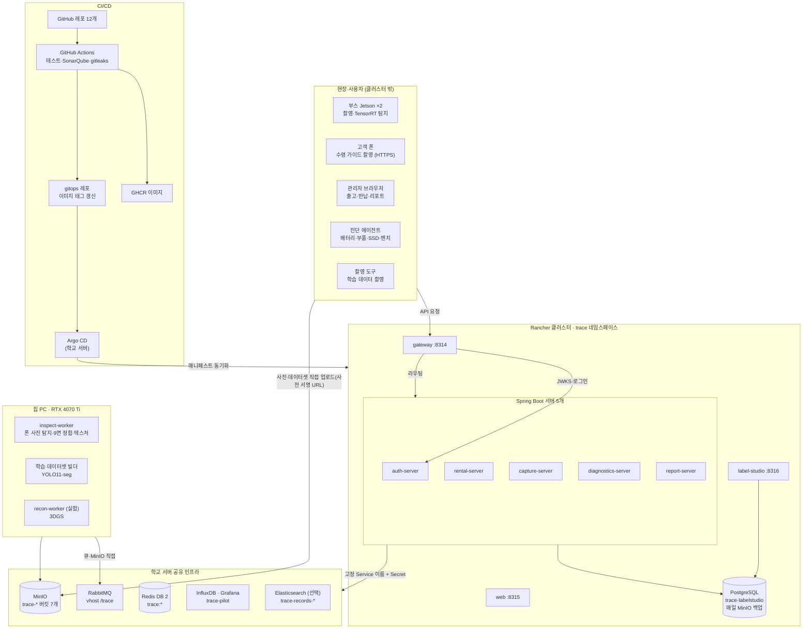
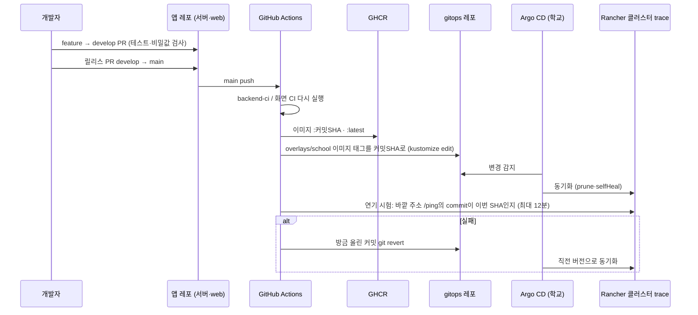

# 아키텍처 한눈에 보기

> **이 문서는 10/31 클러스터 기준 원래 설계이고, 지금 배포와 다릅니다.** 지금 구성(학교 서버 Docker Compose · https://gakdo.site)은 [mvp/01-architecture.md](mvp/01-architecture.md)·[mvp/02-services.md](mvp/02-services.md)가 기준입니다(11/8 갱신).
>
> - 11/3: Rancher 클러스터·Argo CD·Cloudflare Tunnel·InfluxDB·Grafana를 멈추고 보관했습니다. 아래 구성도의 "Rancher 클러스터", "Argo CD", "InfluxDB · Grafana", NodePort 8314·8316, 배포 흐름(Argo CD 동기화·자동 롤백)은 지금 쓰지 않습니다.
> - 지금은 학교 서버(10.116.64.12) 한 대에서 gitops `compose/docker-compose.yml`로 web·gateway·auth·rental·capture·diagnostics(11/6 기본 기동)·report(11/8 기본 기동, `CHAIN_SIGNING_KEY` 필수)·inspect-worker(11/8, CPU ONNX)를 띄우고, PostgreSQL·RabbitMQ·MinIO·Redis도 같은 Compose 안에 둡니다(학교 공유 인프라가 아님). 밖으로는 web nginx 8315 하나만 열고 강사님 nginx가 gakdo.site 443을 넘겨 줍니다.
> - 11/6: 파일럿 추이는 Grafana 대신 web 관리자 화면 '성능'(`/admin/benchmark`)으로 봅니다. label-studio는 클러스터가 아니라 집 PC 로컬 Docker에서 돌립니다.

앱과 DB는 학교 클러스터에, GPU 일은 Jetson·집 PC에, 파일·큐는 학교 공유 인프라에 둡니다. 자세한 표와 근거는 [design/mvp-design.md](design/mvp-design.md)의 "아키텍처"·"서버 구성과 연결"·"확장성" 섹션에 있습니다.

## 구성도

- 파란 상자에 해당하는 **밖으로 여는 앱은 3개뿐**입니다: gateway(API, 8314), web(8315), label-studio(8316).
- 사진과 학습 데이터는 서버를 거치지 않고 MinIO로 바로 올라갑니다(사전 서명 URL).
- PostgreSQL만 예외로 클러스터 안에 둡니다(리뷰 결정 14). 나머지 인프라는 학교 것을 씁니다.

## 배포 흐름 (블로그 CI + Argo CD)

자세한 워크플로와 설정은 [cicd.md](cicd.md)에 있습니다.

## 포트와 주소

| 앱 | 클러스터 안 주소 | 밖에서 |
|---|---|---|
| gateway | `gateway:8080` | NodePort 8314 (API) |
| web | `web:8080` | NodePort 8315 |
| label-studio | `label-studio:8080` | NodePort 8316 |
| auth·rental·capture·diagnostics·report | `<이름>:8080` | 열지 않음 |
| PostgreSQL | `postgres:5432` | 열지 않음 (집 PC 빌더는 `kubectl port-forward`) |

포트 범위는 학생마다 10개(8300~8499)이고, A 계정 범위(8310~8319)를 씁니다. 8318은 지난 프로젝트가 사용 중이고 8310~8313·8317·8319는 예비입니다.

**HTTPS:** 폰 웹앱은 카메라를 쓰므로 HTTPS가 필수입니다. 11/2에 도메인을 사면 DNS 인증으로 인증서를 받아 Rancher Secret에 넣고, web과 gateway가 직접 TLS를 처리합니다(`https://<도메인>:8315`). web과 gateway는 포트가 달라 다른 출처이므로 gateway는 web 주소만 CORS로 허용합니다.

## 서버와 데이터

| 서버 | 스키마 | 맡은 기능 |
|---|---|---|
| auth-server | auth | 회원가입·이메일 인증·로그인·재설정·탈퇴, 고객↔렌탈 연결, 부스 자격, QR 링크, 페어링 코드, JWT·JWKS, 봉인 영수증 메일 |
| rental-server | rental | 렌탈·기기(상태 관리)·기종·시점, 파일럿 등록 |
| capture-server | capture · inspection | 촬영 세트, 사전 서명 URL, 검사 결과 저장, 시점 비교·등급 |
| diagnostics-server | diagnostics | 진단 검증, 전후 비교, 점검 플래그 (추이 기록 InfluxDB는 구현하지 않음, 11/3 중단) |
| report-server | report | 타임라인 읽기 모델, 해시 체인(Ed25519 서명)·검증, SSE 진행률 |
| 데이터 도구(집 PC) | ml | 데이터셋 버전, 학습 실행 |

- 서비스 간 외래 키는 걸지 않습니다. 다른 서비스의 ID는 값으로만 들고, 정합성은 RabbitMQ 이벤트(`trace.events`)로 맞춥니다. 처음 5종에서 지금은 7종입니다(11/2 `trace.checkpoint.started`, 11/4 `trace.checkpoint.purged` 추가, [design/mvp-design.md](design/mvp-design.md#이벤트-계약)).
- 테이블 정의(11/8 지금 스키마 35개와 Mermaid ERD): [design/ddl.md](design/ddl.md), 처음 스키마 SQL(31개): [db/V1__init.sql](db/V1__init.sql), ERD v1(10/31): [Crowfoot](https://crowfoot.java21.net/workspaces/68/models/688)

## 확장성 (강사님 리뷰 반영)

리뷰 뒤 기기 관리를 보강했습니다: 기기 상태(사용 가능·수리 중·폐기, 폐기해도 이력 보존), 기종의 제조사·형태·기준 사양, 기기 목록·수정·기종 목록 API, 변경자 기록(FR-RNT-05). 이미 열어 둔 확장 지점과 MVP 이후로 미룬 것(시점 종류 추가, 지점, 역할, 기기 형태, OS 추가)은 설계서 "확장성" 섹션에 바꿀 곳과 함께 적어 두었습니다.
