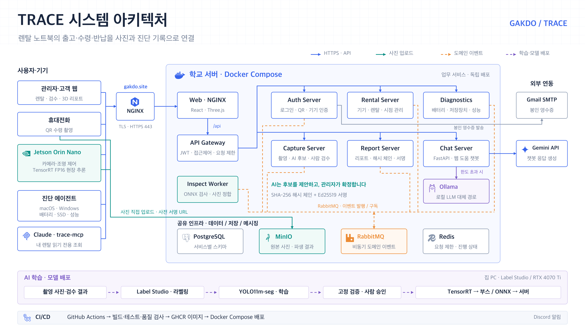
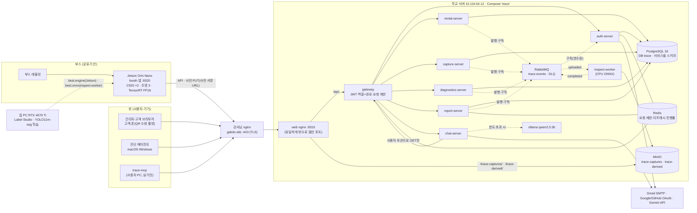
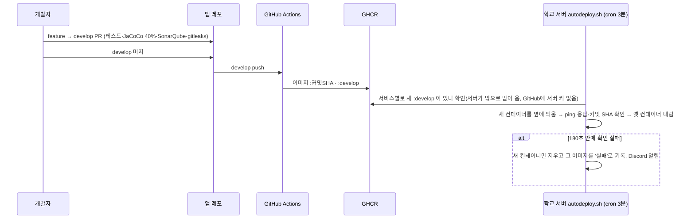
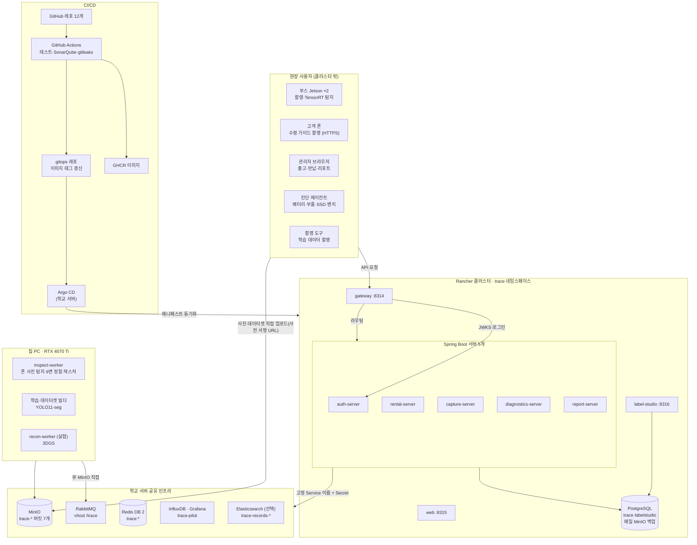
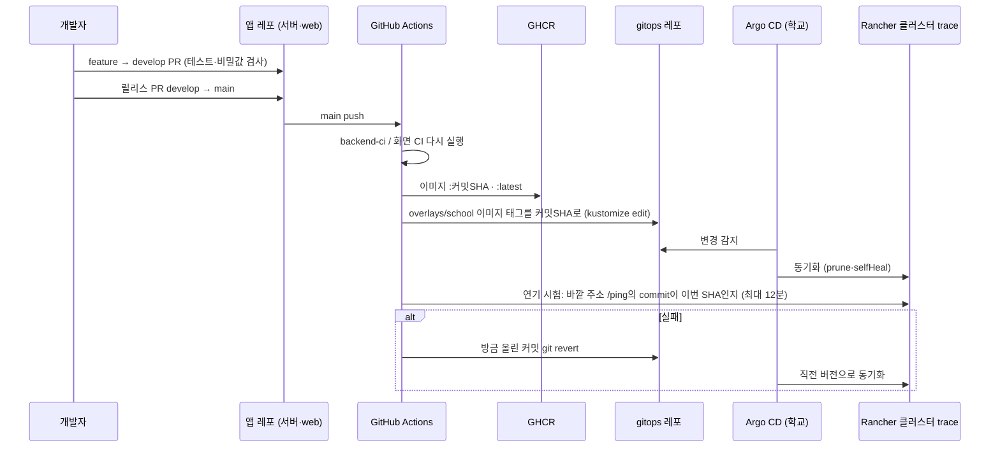

# 아키텍처 한눈에 보기

위 그림이 지금 구성입니다(11/20 코드 기준으로 다시 확인, 학교 서버 Docker Compose · https://gakdo.site). 서비스별 자세한 표는 [mvp/01-architecture.md](mvp/01-architecture.md)·[mvp/02-services.md](mvp/02-services.md), 리뷰 예상 질문과 답은 [review/architecture.md](review/architecture.md)에 있습니다.

> 10/31에 쓴 학교 클러스터(Rancher·Argo CD) 설계는 11/3 방향 전환으로 멈췄습니다. 그 설계는 맨 아래 [처음 설계 (10/31 클러스터, 보관)](#처음-설계-1031-클러스터-보관)에 접어 두었습니다. gitops 레포의 `overlays/school`·`argocd/`는 그대로 두고 CI로 계속 검증만 합니다.

## 지금 구성 (학교 서버 한 대, Docker Compose)

- **입구는 하나**입니다. 모든 요청이 `gakdo.site:443`(강사님 nginx, TLS 종료) → web nginx `:8315` 하나를 지나갑니다. 화면·API·사진이 같은 출처라 브라우저 CORS가 필요 없고, 리프레시 쿠키를 `SameSite=Strict`로 둘 수 있습니다.
- **앱 컨테이너 9개**: web, gateway, Spring 서버 5개(auth·rental·capture·diagnostics·report), inspect-worker, chat-server. 여기에 ollama와 인프라 4개(PostgreSQL·RabbitMQ·MinIO·Redis), 버킷을 만드는 minio-init이 같은 Compose에 있습니다. 근거: gitops `compose/docker-compose.yml`(develop).
- **사진은 서버를 거치지 않습니다.** capture-server가 사전 서명 PUT URL을 주면 부스·폰이 MinIO에 바로 올리고, 완료를 알릴 때 SHA-256으로 서버가 다시 확인합니다.
- **GPU 일은 현장에서**: 부스 사진의 흠집 탐지는 Jetson(TensorRT FP16, 12장 2.53초)이, 폰 사진은 학교 서버 inspect-worker(CPU ONNX)가 합니다. 학습만 집 PC에서 합니다.

## 서버끼리 통신하는 법

| 방식 | 어디에 | 이유 |
|---|---|---|
| 동기 REST (gateway 경유) | 브라우저·부스·에이전트·trace-mcp → gateway → 서버 1곳 | 사용자가 기다리는 요청. 한 요청은 한 서버만 거친다 |
| 비동기 이벤트 (RabbitMQ topic `trace.events`, 7종) | 서버 ↔ 서버, inspect-worker | 시점 상태 이동·봉인·영수증 메일처럼 다른 서버가 이어 받는 일. 받는 쪽이 꺼져 있어도 큐에 남는다 |
| Redis Pub/Sub `trace:progress:{rentalId}` | inspect-worker → report-server → SSE | 진행률은 잃어도 되는 값이라 이벤트로 남기지 않는다 |
| 예외 REST | gateway → auth-server JWKS, 각 서버 → auth-server JWKS, chat-server → gateway(사용자 토큰 GET) | 공개키 읽기와 읽기 전용 조회만 |

- 서버끼리 서로의 REST API를 부르지 않습니다(11/20 코드 확인: Spring 서버 5개 중 HTTP 클라이언트는 auth-server의 소셜 로그인 제공자 호출뿐).
- 다른 서버의 ID는 값으로만 들고 외래 키를 걸지 않습니다. 필요한 남의 상태는 이벤트를 받아 자기 스키마에 작은 사본으로 둡니다(예: diagnostics-server `sealed_checkpoint`, report-server `checkpoint_view`).
- 이벤트마다 계약(contracts `events/*.schema.json`)이 있고, 처리하지 못한 메시지는 `trace.dlx` → 큐마다 `<큐>.dlq`에 남아 사람이 봅니다. 라우팅 키와 큐 표는 [mvp/02-services.md](mvp/02-services.md#이벤트-흐름-1120-코드-기준)에 있습니다.

## 배포 흐름 (지금)

- 무중단 교체: gateway와 Spring 서버·chat-server는 새 컨테이너를 옆에 띄워 준비되면 옛 것을 내립니다(gateway가 연결 실패만 다시 보냄, Spring graceful 종료). web은 호스트 포트를 쥐고 있어 1~2초 끊깁니다. inspect-worker는 검사 도중 바뀌지 않게 자동 배포에서 뺐습니다.
- 운영 스크립트(gitops `compose/ops/`): `autodeploy.sh`(배포·되돌리기·`pause`), `health.sh`(2분마다 상태, 바뀔 때만 알림), `backup.sh`(매일 밤 cron, `pg_dumpall` 14일 + MinIO 3일 보관), GitHub Actions `site-check`(30분마다 바깥에서 점검).
- `main`은 릴리스 기록용(`:latest` 태그·CHANGELOG)이고, 지금 학교 서버는 `TRACE_TAG` 기본값인 `:develop`을 받습니다. 자세한 워크플로는 [cicd.md](cicd.md).

## 포트와 주소

| 포트 | 어디 | 무엇 | 열림 |
|---|---|---|---|
| 443 | gakdo.site (강사님 nginx) | TLS 종료 → 10.116.64.12:8315 | 외부 |
| 8315 | 학교 서버 | web nginx(컨테이너 8080): `/` 화면, `/api/` → gateway, `/trace-captures/`·`/trace-derived/` → MinIO | 학교망(밖에서는 443으로만) |
| 8080 | Compose 안 | gateway · auth · rental · capture · diagnostics · report · chat-server | 호스트에 안 엶 |
| 5432 · 6379 · 11434 | Compose 안 | PostgreSQL · Redis · Ollama | 호스트에 안 엶 |
| 5672 · 15672 · 9000 · 9001 | 학교 서버 | RabbitMQ · 관리 화면 · MinIO API · 콘솔 | 127.0.0.1만 |
| 8320 | Jetson | 부스 촬영·탐지 화면(`trace-booth serve`) | 부스 공유기 안만, 접속 비밀 `TRACE_BOOTH_UI_TOKEN` |
| 8000 | storage.java21.net | 학교 MinIO(학습 사진·모델) | 학교 |

## 서버와 데이터

| 서버 | 스키마 | 맡은 기능 |
|---|---|---|
| auth-server | auth | 회원가입·이메일 인증·로그인·소셜 로그인(구글·깃허브)·재설정·탈퇴, 고객↔렌탈 연결, 부스 자격, QR 링크, 페어링 코드, JWT(RS256)·JWKS, 봉인 영수증 메일 |
| rental-server | rental | 렌탈·기기(상태 관리)·기종·시점, 부스 코드, 공개 보유 기기 목록 |
| capture-server | capture · inspection | 촬영 세트, 사전 서명 URL, 탐지 저장, 사람 검수, 시점 비교·등급, 반납 정산 |
| diagnostics-server | diagnostics | 진단 JSON 검증(JSON Schema), 전후 비교, 점검 플래그, 봉인된 시점의 재진단 막기 |
| report-server | report | 타임라인 읽기 모델, 렌탈별 해시 체인(SHA-256 + Ed25519)·검증, 수동 봉인, SSE 진행률 |
| chat-server | 없음 | 사이트 도우미 챗봇(Gemini → 한도 초과 시 Ollama), 사용자 토큰으로 GET만 |
| inspect-worker | 없음(MinIO `trace-derived`) | 폰 사진 정합·흠집 탐지·3D 텍스처 |

- PostgreSQL은 인스턴스 하나·DB `trace` 하나에 서버마다 스키마를 따로 둡니다. 스키마 사이에는 외래 키와 조회가 없고, 각 서버의 Flyway는 자기 스키마만 고칩니다.
- 테이블 정의(11/20 지금 스키마 7개·테이블 37개와 Mermaid ERD): [design/ddl.md](design/ddl.md), 정규화 점검: [design/erd-normalization.md](design/erd-normalization.md), 처음 스키마 SQL(31개): [db/V1__init.sql](db/V1__init.sql)

## 확장성 (강사님 리뷰 반영)

리뷰 뒤 기기 관리를 보강했습니다: 기기 상태(사용 가능·수리 중·폐기, 폐기해도 이력 보존), 기종의 제조사·형태·기준 사양, 기기 목록·수정·기종 목록 API, 변경자 기록(FR-RNT-05). 이미 열어 둔 확장 지점과 MVP 이후로 미룬 것(시점 종류 추가, 지점, 역할, 기기 형태, OS 추가)은 설계서 "확장성" 섹션에 바꿀 곳과 함께 적어 두었습니다. 단일 서버 구성의 한계와 넓힐 순서는 [review/architecture.md](review/architecture.md)의 "확장성·단일 장애점"에 있습니다.

---

## 처음 설계 (10/31 클러스터, 보관)

10/31 학교 클러스터 설계 열기 (지금 쓰지 않음)

앱과 DB는 학교 클러스터에, GPU 일은 Jetson·집 PC에, 파일·큐는 학교 공유 인프라에 두는 설계였습니다. 11/3에 Rancher 클러스터·Argo CD·Cloudflare Tunnel·InfluxDB·Grafana를 멈추고 보관했고, 학교 서버 Compose로 옮겼습니다(이유는 [decisions.md](decisions.md) 11/3, [review/architecture.md](review/architecture.md) Q4).

### 구성도

- 파란 상자에 해당하는 **밖으로 여는 앱은 3개뿐**입니다: gateway(API, 8314), web(8315), label-studio(8316).
- 사진과 학습 데이터는 서버를 거치지 않고 MinIO로 바로 올라갑니다(사전 서명 URL).
- PostgreSQL만 예외로 클러스터 안에 둡니다(리뷰 결정 14). 나머지 인프라는 학교 것을 씁니다.

### 배포 흐름 (블로그 CI + Argo CD)

자세한 워크플로와 설정은 [cicd.md](cicd.md)에 있습니다.

### 포트와 주소

| 앱 | 클러스터 안 주소 | 밖에서 |
|---|---|---|
| gateway | `gateway:8080` | NodePort 8314 (API) |
| web | `web:8080` | NodePort 8315 |
| label-studio | `label-studio:8080` | NodePort 8316 |
| auth·rental·capture·diagnostics·report | `<이름>:8080` | 열지 않음 |
| PostgreSQL | `postgres:5432` | 열지 않음 (집 PC 빌더는 `kubectl port-forward`) |

포트 범위는 학생마다 10개(8300~8499)이고, A 계정 범위(8310~8319)를 씁니다. 8318은 지난 프로젝트가 사용 중이고 8310~8313·8317·8319는 예비입니다.

**HTTPS:** 폰 웹앱은 카메라를 쓰므로 HTTPS가 필수입니다. 11/2에 도메인을 사면 DNS 인증으로 인증서를 받아 Rancher Secret에 넣고, web과 gateway가 직접 TLS를 처리합니다(`https://<도메인>:8315`). web과 gateway는 포트가 달라 다른 출처이므로 gateway는 web 주소만 CORS로 허용합니다.

### 서버와 데이터

| 서버 | 스키마 | 맡은 기능 |
|---|---|---|
| auth-server | auth | 회원가입·이메일 인증·로그인·재설정·탈퇴, 고객↔렌탈 연결, 부스 자격, QR 링크, 페어링 코드, JWT·JWKS, 봉인 영수증 메일 |
| rental-server | rental | 렌탈·기기(상태 관리)·기종·시점, 파일럿 등록 |
| capture-server | capture · inspection | 촬영 세트, 사전 서명 URL, 검사 결과 저장, 시점 비교·등급 |
| diagnostics-server | diagnostics | 진단 검증, 전후 비교, 점검 플래그 (추이 기록 InfluxDB는 구현하지 않음, 11/3 중단) |
| report-server | report | 타임라인 읽기 모델, 해시 체인(Ed25519 서명)·검증, SSE 진행률 |
| 데이터 도구(집 PC) | ml | 데이터셋 버전, 학습 실행 |

- 서비스 간 외래 키는 걸지 않습니다. 다른 서비스의 ID는 값으로만 들고, 정합성은 RabbitMQ 이벤트(`trace.events`)로 맞춥니다. 처음 5종에서 지금은 7종입니다(11/2 `trace.checkpoint.started`, 11/4 `trace.checkpoint.purged` 추가, [design/mvp-design.md](design/mvp-design.md#이벤트-계약)).
- 테이블 정의(11/20 지금 스키마 37개와 Mermaid ERD, 정규화 점검 [design/erd-normalization.md](design/erd-normalization.md)): [design/ddl.md](design/ddl.md), 처음 스키마 SQL(31개): [db/V1__init.sql](db/V1__init.sql), ERD v1(10/31): [Crowfoot](https://crowfoot.java21.net/workspaces/68/models/688)

