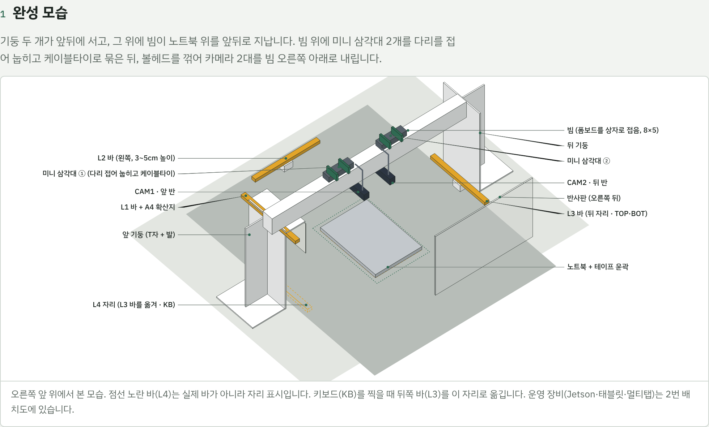
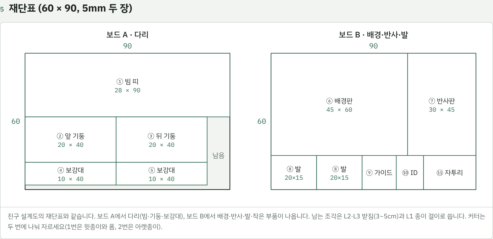
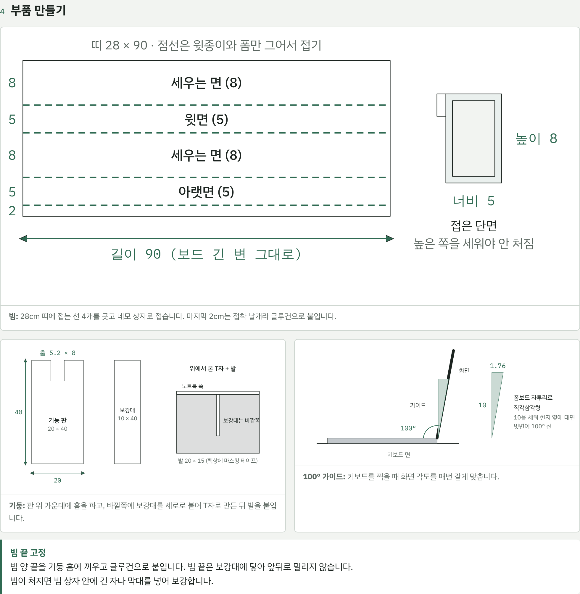
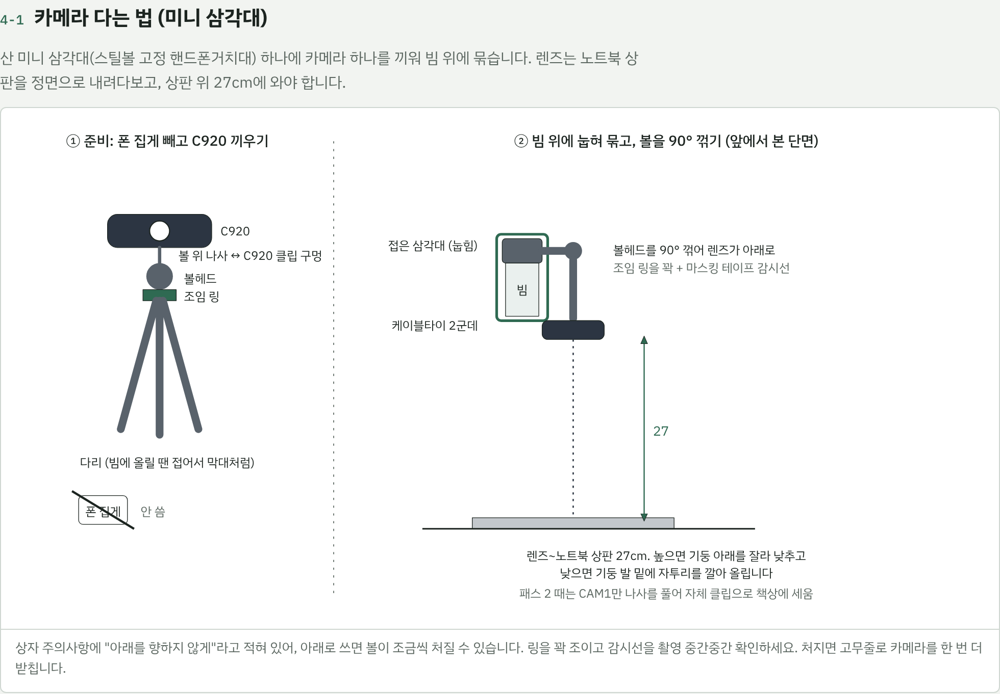
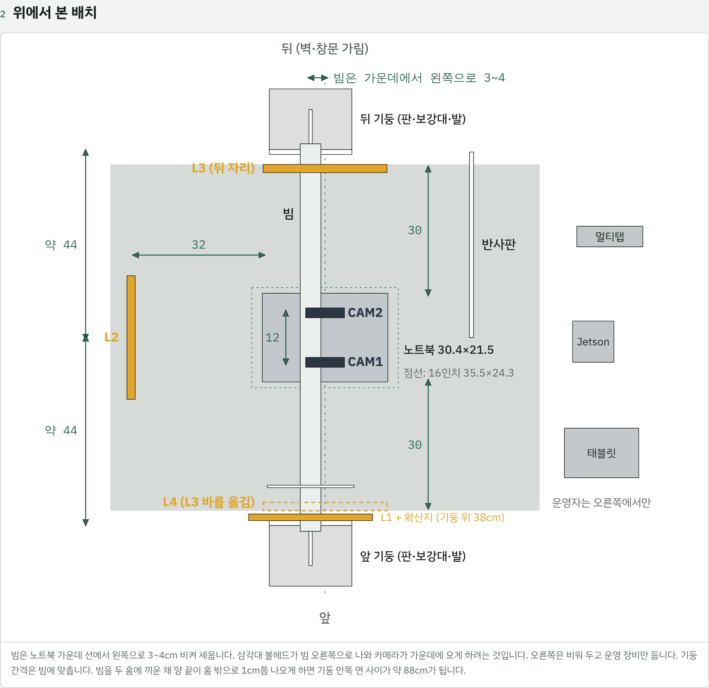
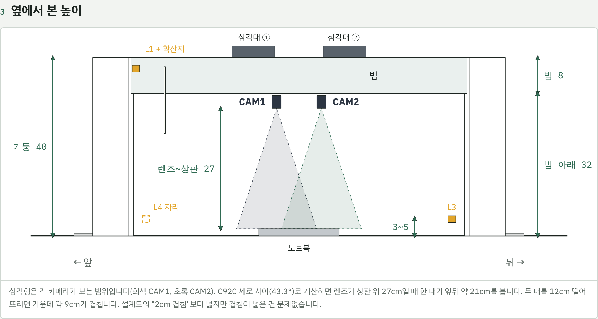
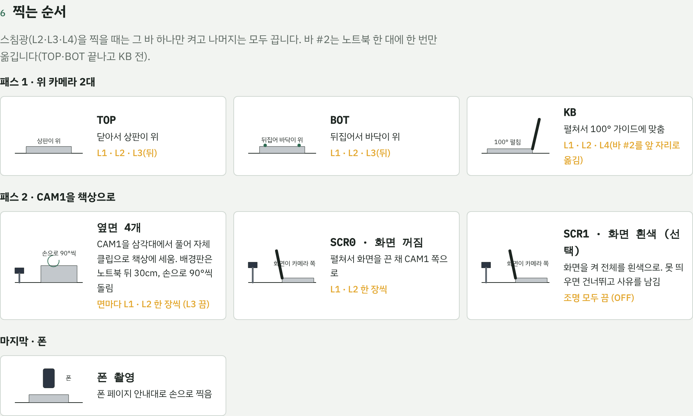

# 11/2 부스 제작·촬영 실행 가이드

2026-11-01 기준. 원본은 [Claude 문서](https://claude.ai/artifact/BM3Q7r17FJpSY9tRDhhnn9)이고, 그림은 [부스 도면](https://claude.ai/artifact/4i5UxWH21dzm3pcAqk2ThL)과 이 폴더의 PNG입니다.

## 한눈에

11/2(월) 오전에 부스 1개를 만들고 시험 촬영까지 끝낸 뒤, 오후에 맥북 촬영을 시작합니다. 같은 부스로 11/4(수) 그램 촬영과 이후 출고·반납을 모두 합니다.

| 시각 | 할 일 | 누가 |
| --- | --- | --- |
| 09:00 | 폼보드 재단 (보드 A·B) | 2명 |
| 09:00 | jetson2에 C920 2대 연결 확인 (전날 밤에 못 했으면) | 운영 |
| 09:40 | 빔 접기, 기둥 T자 + 발, 홈 파기 | 2명 |
| 10:20 | 책상 배치: 천 → 기둥 → 빔 → 삼각대·카메라 → 조명 → 전원 | 3명 |
| 10:40 | 렌즈 높이 27cm, 두 카메라 범위 확인 | 운영 + 핸들러 |
| 11:00 | 팀 노트북으로 조명별 노출·초점 맞추고 설정 저장 | 운영 |
| 11:30 | 알려진 흠집이 L2에서 보이는지, 기준 사진 1장 | 운영 |
| 11:40 | 팀 노트북으로 한 바퀴 리허설, 한 대 걸리는 시간 재기 | 3명 |
| 12:00 | 점심 | |
| 오후 (대여 시각) | 맥북 촬영, 한 대 20분 목표 | 3명 |

**역할 (3명)**

- **핸들러:** 니트릴 장갑을 끼고 노트북만 만집니다. 자세 바꾸기, 바 #2 옮기기.
- **운영:** 태블릿·Jetson·조명을 맡습니다. 촬영 버튼, 조명 켜고 끄기, 사진 확인.
- **준비:** 다음 노트북에 ID 카드를 끼우고 대여 상태 사진을 찍습니다. 폰 촬영도 맡습니다.

**볼 것**

- 친구 설계도 원본: "TRACE 촬영 부스 겸 출고·반납 부스 설계도" (치수·재단표가 이 문서와 같음)
- 촬영 절차: B의 촬영 가이드 v3, `capture/README.md` (카메라 설정 방법)
- 부스 제작 단계별 체크: [부스 제작 매뉴얼](https://claude.ai/artifact/PN4quCJWnuU55hrm1NHkKw) (휴대폰으로 보며 체크)

## 전날 밤(11/1) 미리 할 일

가장 큰 위험은 C920을 아직 Jetson에 한 번도 꽂아 보지 않았다는 것입니다.

- [ ] jetson2에 C920 2대를 꽂고 `capture/README.md` 3장의 확인 6가지를 끝낸다
- [ ] 미니 삼각대에 C920을 끼우고 볼헤드를 90° 꺾어 손을 떼도 처지지 않는지 본다
- [ ] LED 3개를 켜 보고 리모컨 하나로 하나만 켜지는지 본다 (같이 켜지면 USB를 뽑아 켜고 끄기로)
- [ ] 모니터에 DP 단자가 있는지 본다 (없으면 DP→HDMI 케이블 구하기)
- [ ] 코드 L4·CAM1·CAM2를 contracts·docs에 반영한다
- [ ] B에게 코드 이름 확인을 받는다 (L1~L4, CAM1·CAM2·PHONE, 면 TOP·BOT·SF·SB·SL·SR·KB·SCR0·SCR1)
- [ ] 대여 관리자에게 보관·삭제 문구를 보낸다
- [ ] 기기 ID 카드를 출력하고 `devices.csv`를 만든다
- [ ] 운영 태블릿과 폰(PH1)을 충전하고 Tailscale 로그인을 확인한다

## 챙길 물건

**산 것**

- [ ] 폼보드 흰색 60×90cm, 5mm × 2: 부스 몸체
- [ ] 미니 삼각대(스틸볼 고정 핸드폰거치대) × 2: 카메라를 빔에 고정
- [ ] 케이블타이 150mm: 삼각대를 빔에 묶기
- [ ] 리모컨 LED × 3: 조명 L1·L2·L3(L4)
- [ ] 멀티탭 3구 1.5m: Jetson, USB 충전기, 태블릿
- [ ] DP-DP 케이블: Jetson → 모니터
- [ ] 니트릴 장갑: 핸들러 지문 방지
- [ ] 마스킹 테이프, 네임펜, 먼지털이(책상·천에만)

**집에서 가져올 것**

- [ ] 글루건 + 심: 빔·기둥 조립
- [ ] 커터칼 + 긴 쇠자(50cm 이상), 골판지(커팅 받침)
- [ ] USB 충전기(포트 여러 개): LED 3개 전원. Jetson USB에는 꽂지 않음
- [ ] A4 복사지 몇 장: L1 확산지, ID 카드
- [ ] 검정·회색 천: 부스 바닥 배경

**배송 오는 것 (11/2)**

- [ ] 암막천 검정·그레이 90×150: 창문 가림
- [ ] 그레이카드: 기준 사진. 오기 전에는 같은 A4 한 장을 기준 종이로

**학교·팀 장비**

- [ ] jetson2 + 전원 어댑터, C920 × 2
- [ ] 모니터, 키보드·마우스, 랜선
- [ ] 운영 태블릿, 폰(PH1), 리허설용 팀 노트북

## 오전: 부스 만들기 (09:00~10:40)

기둥 2개를 노트북 앞뒤에 세우고, 그 위에 폼보드를 접은 가로 막대(빔)를 얹어 카메라 2대를 매답니다. 치수는 cm이고 노트북 가운데가 기준입니다.

1. **재단.** 커터는 두 번에 나눠 자릅니다(1번은 윗종이와 폼, 2번은 아랫종이).
    - 보드 A: ① 빔 띠 28×90, ②③ 기둥 20×40 × 2, ④⑤ 보강대 10×40 × 2
    - 보드 B: ⑥ 배경판 45×60, ⑦ 반사판 30×45, ⑧ 발 20×15 × 2, ⑨ 100° 가이드, ⑩ ID 카드 받침, ⑪ 자투리
2. **빔.** 28cm 띠에 접는 선 4개를 8·5·8·5·2 간격으로 긋고(윗종이와 폼만), 네모 상자로 접어 마지막 2cm 날개를 글루건으로 붙입니다. 높이 8cm 쪽을 세워야 안 처집니다.
3. **기둥.** 판 위 가운데에 홈 5.2×8cm를 파고, 바깥쪽 가운데에 보강대를 세로로 붙여 T자로 만든 뒤 발을 ㄴ자로 붙입니다.
4. **배치.** 바닥 천을 깔고, 빔을 두 기둥 홈에 끼운 채로 빔 양 끝이 홈 밖으로 1cm쯤 나오게 기둥 간격을 맞춥니다(기둥 안쪽 면 사이 약 88cm, 노트북 가운데에서 앞뒤 약 44cm). 그대로 자리에 놓고 발을 마스킹 테이프로 붙인 뒤 빔을 글루건으로 고정합니다. 도면의 45cm는 기둥 판 가운데까지의 거리라, 숫자보다 빔이 두 홈에 끝까지 걸치는 것이 먼저입니다. 빔은 가운데 선에서 왼쪽으로 3~4cm 비켜 세웁니다.
5. **카메라.** 삼각대의 폰 집게는 빼고 볼 위 나사에 C920 클립 아래 구멍을 돌려 끼웁니다. 다리를 접어 빔 위에 눕히고 케이블타이 2군데로 묶습니다. 볼헤드를 90° 꺾어 렌즈가 바닥을 보게 하고 조임 링을 꽉 조입니다.
    - CAM1은 가운데에서 앞으로 6cm, CAM2는 뒤로 6cm (간격 12cm)
    - C920 앞 흰 LED는 마스킹 테이프 두 겹 + 네임펜으로 가림
    - 볼헤드에 마스킹 테이프를 가로질러 붙이고 선을 그어 둠 (어긋나면 처진 것)
6. **조명.** LED는 늘 같은 흰색, 밝기 최대로 둡니다.
    - L2: 왼쪽, 노트북 가장자리에서 32cm, 자투리 받침으로 책상 위 3~5cm
    - L3: 뒤쪽, 노트북 가장자리에서 30cm, 3~5cm 높이
    - L4 자리: 앞쪽 30cm에 테이프로 표시만 (KB 때 L3 바를 여기로 옮김)
    - L1: 앞 기둥 꼭대기(38cm)에 붙이고 노트북 쪽으로 40° 내림. 5~10cm 앞에 A4 2장 확산지
    - 반사판: 오른쪽 뒤에 세움
7. **전원·장비.** Jetson·태블릿·멀티탭은 모두 오른쪽에 모읍니다. LED는 USB 충전기에 꽂습니다.
8. **테이프 표시.** 노트북 윤곽(13인치·16인치 두 색), 바 #2의 앞뒤 자리, 기둥 발 자리. 빌린 노트북 본체에는 붙이지 않습니다.

## 카메라·조명 맞추기와 시험 촬영 (10:40~12:00)

1. **높이:** 렌즈에서 닫힌 노트북 상판까지 27cm. 높으면 기둥 아래를 자르고, 낮으면 발 밑에 자투리를 깝니다. 값은 마스킹 테이프에 적어 기둥에 붙입니다.
2. **범위:** A4 격자(또는 아이패드 체커보드)로 CAM1에 노트북 앞끝이, CAM2에 뒷끝이 다 들어오는지 봅니다. 두 대가 가운데 약 9cm를 같이 봅니다.
3. **설정 고정:** 팀 노트북(REG01)으로 조명마다 노출·화이트밸런스·초점을 수동으로 정하고 저장합니다. 방법은 B의 `capture/README.md`.
4. **깜빡임:** 미리보기에 가로 줄무늬가 보이면 LED 밝기를 최대로 올리거나 노출 시간을 바꿉니다.
5. **흠집 확인:** 알려진 흠집을 L2(스침광)로 찍어 확대했을 때 보이는지 봅니다.
6. **기준 사진:** 그레이카드(오기 전에는 같은 A4 한 장)를 찍습니다. 매일 촬영 시작 때 한 장씩 찍어 비교합니다.
7. **리허설:** 팀 노트북으로 패스 1 → 패스 2 → 폰까지 한 바퀴 돌고 시간을 잽니다.
8. **배치 사진:** 부스 전체를 위·옆에서 찍어 둡니다.

## 오후: 촬영 진행

맥북 10대를 한 대 20분으로 찍으면 약 3시간 20분입니다. 노트북은 대기 책상(준비) → 부스(핸들러·운영) → 완료 책상으로 한 방향으로만 흐릅니다.

## 촬영 목록 (면 × 조명)

한 대에 위 카메라 18장(패스 1) + CAM1 10장(패스 2) + SCR1 1장(선택)입니다. 조명은 한 장에 하나만 켭니다.

| 면 | 뜻 · 자세 | 패스 · 카메라 | 조명 (한 장씩) | 필수 |
| --- | --- | --- | --- | --- |
| TOP | 상판. 닫아서 상판이 위 | 패스 1 · CAM1, CAM2 | L1, L2, L3 | 필수 |
| BOT | 바닥. 뒤집어 바닥이 위 | 패스 1 · CAM1, CAM2 | L1, L2, L3 | 필수 |
| KB | 키보드·팜레스트. 100° 가이드로 펼침 | 패스 1 · CAM1, CAM2 | L1, L2, L4 | 필수 |
| SF · SB · SL · SR | 옆면 앞·뒤·왼·오른. 닫아서 손으로 90°씩 | 패스 2 · CAM1(책상) | L1, L2 | 필수 |
| SCR0 | 화면 쪽, 화면 꺼짐. 펼쳐서 화면이 카메라 쪽 | 패스 2 · CAM1(책상) | L1, L2 | 필수 |
| SCR1 | 화면 쪽, 화면을 켜 전체 흰색 | 패스 2 · CAM1(책상) | OFF(모든 조명 끔) | 선택: 못 찍으면 건너뛰고 사유 |

코드는 `contracts/codes.yaml` 0.3.0과 같습니다. 세트 완료 검사는 필수 8면만 봅니다(`face_required.BOOTH`).

**노트북 한 대 순서**

1. **준비:** ID 카드를 끼우고 대여 상태 사진을 찍습니다. 먼지는 불어서만 털고 닦지 않습니다.
2. **SLATE:** 부스 안 ID 받침에 카드를 세워 한 장 찍습니다.
3. **패스 1 (위 카메라 2대):**
    - TOP: 닫아서 상판이 위. 조명 L1 · L2 · L3(뒤)
    - BOT: 뒤집어 바닥이 위. 조명 L1 · L2 · L3(뒤)
    - 바 #2를 뒤 자리에서 앞 자리(L4)로 옮김 (한 대에 한 번)
    - KB: 펼쳐서 100° 가이드에 맞춤. 조명 L1 · L2 · L4(앞)
4. **패스 2 (옆면·화면):** CAM1만 삼각대에서 풀어 자체 클립으로 노트북 앞 책상에 세우고, 배경판을 노트북 뒤 30cm에 둡니다. 끝나면 CAM1을 다시 끼우고 감시선을 맞춥니다. 패스 2는 노트북마다 합니다. CAM1을 처음 끼울 때 C920 클립과 볼헤드에 이어지는 선을 네임펜으로 그어 두고, 다시 끼울 때마다 그 선에 맞춰 나사를 조입니다.
    - 옆면 4개(SF·SB·SL·SR): 닫은 노트북을 손으로 90°씩 돌려 찍을 면을 카메라 쪽으로. 면마다 L1 한 장, L2 한 장 (L3는 끔)
    - SCR0: 펼쳐서 화면을 끈 채 카메라 쪽으로. L1 한 장, L2 한 장
    - SCR1 (선택): 화면을 켜 전체를 흰색으로 띄우고 조명을 모두 끈 채(OFF) 한 장. 로그인 없이 흰 화면을 못 띄우면 건너뛰고 사유를 남깁니다
5. **폰:** 폰 페이지 안내대로 손으로 찍습니다(거치대에 고정하지 않음).
6. **완료:** 운영 화면에 "완료"가 뜨면 완료 책상으로 보냅니다.

**꼭 지킬 규칙**

- 스침광(L2·L3·L4)을 찍을 때는 그 바 하나만 켜고 L1을 포함해 나머지는 모두 끕니다.
- 패스 2에서 L3는 켜지 않습니다. 노트북 뒤에서 카메라 쪽으로 빛이 들어옵니다(역광).
- 노트북을 만지는 사람은 니트릴 장갑을 낍니다.
- 빌린 노트북은 닦지 않고, 테이프를 붙이지 않습니다.
- 한 대가 25분을 넘기 시작하면 테스트용 맥북 2대를 먼저 끝내고, 남은 기기는 2차 대여로 넘깁니다.

## 막힐 때

| 증상 | 대처 |
| --- | --- |
| Jetson이 카메라를 못 잡음 | 한 대씩 꽂아 확인, 다른 USB 포트로. 두 대를 동시에 고해상도로 받지 않고 번갈아 찍기 |
| 볼헤드가 처짐 | 조임 링을 더 조이고, 고무줄·케이블타이로 카메라를 한 번 더 받침 |
| CAM1을 다시 올릴 때마다 위치가 틀어짐 | 패스를 묶어 찍기: 모든 노트북의 패스 1을 먼저, CAM1을 한 번만 내려 패스 2를 모아서 |
| LED 3개가 리모컨 하나에 같이 켜짐 | USB를 뽑았다 꽂아 켜고 끄기, 또는 다른 LED의 수신부를 테이프로 가리기 |
| 사진에 가로 줄무늬 | LED 밝기 최대, 노출 시간 조정 |
| 빔이 처짐 | 빔 상자 안에 긴 자나 막대, 보드 B 자투리로 한 겹 덧대기 |
| 렌즈 높이가 27cm가 아님 | 높으면 기둥 아래 자르기, 낮으면 발 밑 자투리 |
| 모니터 화면이 안 나옴 | DP 단자가 없으면 DP→HDMI 케이블, 아니면 태블릿으로만 운영 |
| Jetson·폰이 네트워크에 안 붙음 | 폰 핫스팟으로 연결 |
| 시간이 모자람 | 테스트용 맥북 2대 먼저, 남은 기기는 2차 대여로 |
| 그레이카드가 아직 안 옴 | 같은 A4 한 장을 기준 종이로 쓰고 다음 촬영부터 카드로 |

## 끝나고, 그리고 11/4 그램 촬영

부스는 헐지 말고 그대로 둡니다. 11/4(수) 9~15시 LG 그램 촬영과 이후 출고·반납이 같은 배치·같은 설정을 써야 비교가 됩니다.

**11/2 끝낼 때**

- [ ] 찍은 장수가 촬영 목록과 같은지, MinIO `trace-raw`에 다 올라갔는지 본다
- [ ] `devices.csv`에 찍은 기기와 못 찍은 기기를 표시한다
- [ ] 반납 전 대여 때 찍은 상태 사진과 비교하고 관리자에게 반납한다
- [ ] 조명별 노출·초점 값, 렌즈 높이, 리허설 시간을 기록해 팀 채널에 올린다
- [ ] 부스를 움직여야 하면 테이프 표시를 남기고 배치 사진을 다시 찍는다

**11/4 그램 전에**

- [ ] 그램 기종 크기로 노트북 윤곽 테이프를 확인한다 (16인치는 이미 표시함)
- [ ] 그램 17(폭 38cm)이 있으면 그 기종만 렌즈 높이 29cm (기둥 발 밑 자투리 2cm)
- [ ] 시작 전에 그레이카드 기준 사진을 다시 찍어 11/2와 같은지 본다
- [ ] 11/2에 늦어진 단계가 있으면 역할을 다시 나눈다

## 11/1에 바뀐 결정

| 항목 | 전 | 지금 |
| --- | --- | --- |
| 부스 | 2개 (Jetson 2대) | 1개로 출고·반납·학습 데이터 촬영 공용 |
| 부스 재료 | (미정) | 폼보드 60×90cm 5mm 두 장, 친구 설계도 재단표 그대로 |
| 카메라 고정 | 오버헤드 거치대 | 미니 삼각대 2개를 빔 위에 눕혀 케이블타이 |
| 조명 전환 | Jetson GPIO 릴레이 | 손으로 (USB 뽑기·리모컨) |
| 노트북 회전 | 턴테이블 | 손으로 90°씩 |
| 조명 코드 | L1·L2·L3 | L1·L2·L3·L4 (L4 = 앞 스침광, KB) |
| 카메라 코드 | CAM | CAM1(앞 반)·CAM2(뒤 반)·PHONE |
| 기준 사진 | 그레이카드 없음 | 그레이카드 주문(11/2 도착), 그전에는 같은 A4 |

코드는 11/3 계약 고정 전에 B의 촬영 도구·폰 페이지와 이름이 같은지 확인해야 합니다. 자세한 이유는 [decisions.md](../decisions.md)의 11/1 항목에 있습니다.
