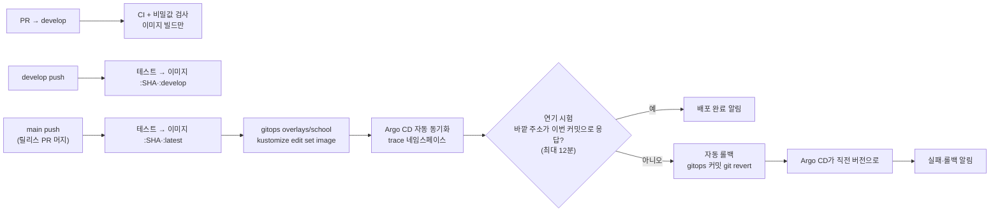

# CI/CD

블로그(AIGJ-01-002-blog/devlog)에서 쓰던 CI/CD를 TRACE 레포 12개에 옮겼습니다. 테스트·품질 분석·이미지·알림·릴리스·리뷰 설정은 블로그 그대로이고, **배포만 Argo CD 방식**으로 바꿨습니다. 블로그는 GitHub Actions가 학교 서버의 k3d에 직접 배포했지만, TRACE는 학교에 이미 설치된 Rancher 클러스터와 Argo CD를 씁니다.

## 레포별 워크플로

| 워크플로 | 서버 6개 | web | agent·booth·ml | contracts | gitops | 블로그 원본 |
|---|---|---|---|---|---|---|
| `backend-ci` (Maven verify·JaCoCo 40%·SonarQube) | ✓ | | | | | backend-ci.yml |
| `화면 CI` (타입 검사·테스트·빌드) | | ✓ | | | | frontend-ci.yml |
| `python-ci` (ruff·pytest, OS별) | | | ✓ | | | render-worker-ci.yml |
| `계약 검사` (YAML·JSON Schema·OpenAPI 린트) | | | | ✓ | | 새로 만듦 |
| `매니페스트 검증` (kustomize build·kubeconform) | | | | | ✓ | deploy.yml의 validate |
| `배포` (이미지 → GHCR, main이면 gitops 태그 갱신 → 연기 시험 → 실패 시 자동 롤백) | ✓ | ✓ | | | | deploy.yml의 image + 배포·smoke·롤백을 Argo CD 방식으로 |
| `비밀값 검사` (학교 비밀번호 패턴·gitleaks) | ✓ | ✓ | ✓ | ✓ | ✓ | check-no-secrets.sh + gitleaks(NFR-03) |
| `release` (CHANGELOG 버전 → 태그·Release) | ✓ | ✓ | ✓ | ✓ | ✓ | release.yml |
| `PR 알림`·`CI 결과 알림` (Discord·텔레그램) | ✓ | ✓ | ✓ | ✓ | ✓ | pr-notify.yml, ci-notify.yml, actions/notify |
| `SonarQube 이슈 내보내기` (수동) | ✓ | | | | | sonar-export.yml |
| `메일 시험 발송` (수동, Gmail 앱 비밀번호 확인) | auth-server | | | | | mail-test.yml |

모든 레포에 함께 들어간 것: PR 틀(`.github/pull_request_template.md`), 릴리스 노트 틀, `CONTRIBUTING.md`(Git Flow), `CHANGELOG.md`, CodeRabbit 한국어 리뷰 설정(`.coderabbit.yaml`), `scripts/check-no-secrets.sh`.

**블로그에서 가져오지 않은 것**과 이유:
- `school-tunnel`·`server-check`·`school-setup`·`cluster-status`·`infra-bench`: 블로그가 학교 서버에 직접 k3d를 만들고 SSH로 배포하던 구조용입니다. TRACE는 Rancher와 Argo CD가 맡습니다.
- `readme-check`·`org-profile-sync`: 블로그의 4개 언어 README·조직 프로필 전용입니다.

## 배포 흐름

- 이미지 이름: `ghcr.io/<조직 소문자>/<서비스 이름>` (예: `ghcr.io/gakdo/auth-server`). 서비스 이름은 레포 이름의 `_`를 `-`로 바꾼 것입니다(`auth_server` 레포 → `auth-server`). 쿠버네티스 이름에 밑줄을 쓸 수 없기 때문입니다.
- 태그: 커밋 SHA(항상), `latest`(main), `develop`(develop)
- gitops 갱신은 같은 레포 안에서 한 줄로 세우고(`concurrency: gitops-bump`, 레포 단위), 다른 서버의 커밋과 겹치면 받아서 최대 3번 다시 시도합니다.
- 학교 클러스터가 amd64라 이미지는 amd64 한 가지만 만듭니다(블로그는 Oracle ARM VM 때문에 arm64도 만들었음).

## 연기 시험과 자동 롤백

블로그는 `smoke.sh`로 새 버전을 확인하고 실패하면 `kubectl rollout undo`로 되돌렸습니다. TRACE는 Argo CD가 클러스터를 맞추므로 같은 일을 **바깥에서 확인하고 gitops 커밋을 되돌리는** 방식으로 합니다. kubectl로 직접 되돌리면 Argo CD 자동 동기화(selfHeal)가 다시 새 버전으로 덮어씁니다.

1. 이미지를 만들 때 커밋 SHA를 넣습니다(`APP_COMMIT`). 서버는 `GET /api/v1/<경로>/ping` 응답의 `commit`에, web은 `/version.txt`에 그 값을 내보냅니다.
2. gitops 커밋을 올린 뒤 `연기 시험` 작업이 10초마다 바깥 주소를 두드립니다. 응답에 이번 커밋 SHA가 보이면 통과입니다. Argo CD 기본 확인 주기(3분)와 롤아웃 시간을 생각해 최대 12분 기다립니다.
3. 12분 안에 안 보이면 `자동 롤백` 작업이 방금 올린 gitops 커밋을 `git revert`합니다. Argo CD가 그 커밋을 읽어 직전 버전으로 되돌립니다. 그사이 같은 서버의 더 새 버전이 올라갔으면 되돌리지 않고 그 배포의 연기 시험에 맡깁니다.
4. 결과(완료·롤백·롤백 실패)를 Discord·텔레그램으로 한 번 알립니다.

| 레포 | 확인 주소 |
|---|---|
| gateway | `<SMOKE_API_URL>/api/v1/gateway/ping` (gateway 자신) |
| auth_server · rental_server · capture_server · diagnostics_server · report_server | `<SMOKE_API_URL>/api/v1/auth/ping` · `rentals` · `captures` · `diagnostics` · `reports` (gateway를 거쳐 각 서버) |
| web | `<SMOKE_WEB_URL>/version.txt` |

- 조직 변수 `SMOKE_API_URL`·`SMOKE_WEB_URL`이 없으면 연기 시험을 건너뛰고 "배포 요청됨"만 알립니다. 클러스터가 처음 뜨기 전에는 비워 두고, 화면이 열리는 것을 확인한 뒤 넣습니다.
- gateway에 JWT 검증을 붙일 때 `/api/v1/*/ping`은 로그인 없이 열어 둡니다. 막히면 연기 시험이 늘 실패해 모든 배포가 롤백됩니다.
- 롤백은 gitops만 되돌립니다. DB 마이그레이션(Flyway)은 되돌리지 않으므로, 스키마를 바꾸는 배포는 이전 버전 코드에서도 동작하게(컬럼 추가 먼저, 삭제는 다음 배포) 나눠 올립니다.

## 처음 한 번 설정할 것

**11/2에 모두 넣었습니다.** `SMOKE_API_URL`·`SMOKE_WEB_URL`만 클러스터에 화면이 뜬 뒤 넣습니다. 다시 확인할 때는 아래 [점검](#점검).

조직(GAKDO) **Settings → Secrets and variables → Actions**에 조직 단위로 한 번만 넣으면 12개 레포가 함께 씁니다.

| 종류 | 이름 | 값 | 없으면 |
|---|---|---|---|
| Secret | `GITOPS_TOKEN` | gitops 레포 Contents 읽기·쓰기만 준 fine-grained 토큰 | 이미지까지만 올리고 배포 갱신은 건너뜀 |
| 변수 | `SMOKE_API_URL` | gateway 바깥 주소. 지금은 `http://<클러스터 노드 외부 주소>:8314`, 도메인 뒤에는 `https://<도메인>:8314` | 연기 시험·자동 롤백 건너뜀 |
| 변수 | `SMOKE_WEB_URL` | web 바깥 주소 (`…:8315`) | web 연기 시험 건너뜀 |
| Secret | `SONAR_TOKEN` | 학교 SonarQube **User Token** 하나(서버 6개 공용). Global·Project Analysis 토큰은 이슈·핫스팟 조회 API가 막혀 `SonarQube 이슈 내보내기`가 실패합니다 | 분석 건너뜀 |
| Secret | `SONAR_HOST_URL` | `http://s4.java21.net:9000` | SonarCloud로 시도 |
| 변수 | `SONAR_ENABLED` | `true` | 분석 안 함 |
| Secret | `DISCORD_WEBHOOK_URL` (`DISCORD_PR_WEBHOOK_URL`) | 팀 디스코드 웹훅 | 알림 없음 |
| 변수 | `DISCORD_ENABLED` | `true` | 알림 없음 |
| Secret | `TELEGRAM_BOT_TOKEN`·`TELEGRAM_CHAT_ID` | 텔레그램 봇 | 알림 없음 |
| 변수 | `TELEGRAM_ENABLED` | `true` | 알림 없음 |
| 변수 | `SMTP_USERNAME` | 팀 Gmail 주소 (auth-server 메일 시험용) | 메일 시험 실패 |
| Secret | `SMTP_PASSWORD` | Gmail 앱 비밀번호 | 메일 시험 실패 |

그 밖에:
1. **GHCR 패키지 공개:** 첫 이미지가 올라가면 조직 Packages에서 각 패키지를 Public으로 바꿉니다. 비공개로 두려면 클러스터에 이미지 받는 비밀(imagePullSecret)을 만들어야 합니다.
2. **Argo CD 등록:** `gitops/argocd/application.yaml`을 학교 Argo CD에 등록합니다(gitops 레포 README 참고).
3. **클러스터 비밀:** `gitops/scripts/create-secrets.sh`로 `trace-secrets`·`trace-postgres`를 만듭니다. 비밀번호는 레포에 넣지 않습니다.
4. **develop 브랜치와 보호 규칙:** 12개 레포 main·develop에 걸었습니다(11/2). 아래 [브랜치 보호](#브랜치-보호).
5. **CodeRabbit:** GAKDO 조직에 설치했습니다(11/2, All repositories). 설치 전에 만든 PR에는 리뷰가 없고, 열린 PR은 댓글 `@coderabbitai review`로 리뷰를 받습니다.
6. **SonarQube 프로젝트 키:** 기본값은 `trace-<레포 이름>`입니다. 다르게 쓰려면 레포 변수 `SONAR_PROJECT_KEY`.

## 브랜치 보호

12개 레포 main·develop 공통입니다(11/2).

- PR로만 머지합니다. 아래 필수 검사가 통과하고 팀원 1명이 승인해야 합니다([team/conventions.md](team/conventions.md) 리뷰 규칙). contracts는 2명(B·C)입니다.
- 강제 push와 브랜치 삭제를 막습니다.
- 조직 소유자(민서)는 규칙에서 빠져 있습니다(enforce_admins 끔). 헌법·문서 동기화 스크립트는 그대로 직접 올리고, 급할 때는 `gh pr merge --admin`으로 머지합니다.

| 레포 | 필수 검사(job 이름) |
|---|---|
| 서버 6개 | `test`(backend-ci), `secrets`(비밀값 검사) |
| web | `build`(화면 CI), `secrets` |
| agent·booth·ml | `test (ubuntu-latest)`·`test (macos-latest)`·`test (windows-latest)`(python-ci), `secrets` |
| contracts | `lint`(계약 검사), `secrets` |
| gitops | `매니페스트 검증`, `secrets` |

- **PR CI는 문서만 바뀌어도 돕니다.** 필수 검사의 워크플로가 경로 필터로 건너뛰어지면 검사가 '대기'로 남아 머지가 막힙니다. Spec Kit 산출물(`specs/…/*.md`)·README·CHANGELOG만 바뀐 PR이 여기에 걸리므로 backend-ci·화면 CI·python-ci의 PR 트리거에서 `paths-ignore`를 뺐습니다. develop·main push는 그대로 문서만 바뀌면 CI·배포를 건너뜁니다.
- 필수 검사는 job 이름으로 걸립니다. job 이름이나 matrix를 바꾸면 보호 규칙의 필수 검사도 같이 바꿉니다. 안 바꾸면 모든 PR이 '대기'로 멈춥니다.

## 점검

[scripts/check-cicd.sh](scripts/check-cicd.sh)(읽기 전용)를 조직 관리자 gh로 돌리면 CodeRabbit 설치·리뷰, SonarQube 설정과 마지막 분석 결과, 알림·배포 설정, 레포별 최근 워크플로 결과, 브랜치 보호를 ✅/❌로 보여 줍니다. 비밀값은 이름만 봅니다.

- SonarQube 단계는 `continue-on-error`라 단계가 초록이어도 분석이 실패했을 수 있습니다. 점검은 로그의 실제 출력(`ANALYSIS SUCCESSFUL`)으로 판단합니다. 분석이 실패하면 서버 채널에 "SonarQube 분석 실패" 알림이 옵니다.
- 11/2 결과: 모두 ✅(CodeRabbit 리뷰 web PR #6, SonarQube 서버 6개 분석 성공, 보호 24곳). `SMOKE_*`만 클러스터 뒤.

## 뼈대 코드

CI가 첫 실행부터 초록이 되도록 레포마다 가장 작은 뼈대를 넣었습니다.

| 레포 | 뼈대 | 로컬 확인 |
|---|---|---|
| 서버 6개 | Spring Boot 앱, `GET /api/v1/<경로>/ping`(서비스·상태·커밋 SHA), 테스트, Dockerfile(비루트·계층 분리), Maven 래퍼 | `./mvnw verify` 통과 (gateway·rental-server 확인) |
| gateway | 위 + REST API v0 경로 앞부분으로 서버 5개 라우팅 | `./mvnw verify` 통과 |
| web | Vite + React + TypeScript, Vitest, nginx(8080, 비루트) Dockerfile, `/version.txt`(커밋 SHA) | typecheck·test·build 통과 |
| agent·booth·ml | `pyproject.toml`, 패키지, pytest | ruff·pytest 통과 |
| contracts | `codes.yaml`(DB CHECK 값과 같음), openapi·diagnostics·events 폴더 | yamllint 통과 |
| gitops | base(앱 8개·PostgreSQL·네트워크 정책), overlays/school, Argo CD Application | gitops README 참고 |

## 디스코드 알림 채널

서버마다 채널을 나눠 CI/CD 알림을 받습니다. 웹훅 주소는 레포 Secret `DISCORD_WEBHOOK_URL`에 레포마다 따로 넣고(레포 값이 조직 값보다 먼저 쓰임), 레포 변수 `DISCORD_ENABLED=true`로 켭니다. 넣을 때는 팀장 맥에서 `setup-discord.sh`를 씁니다.

| 채널 | 레포 |
| --- | --- |
| `#ci-gateway` | gateway |
| `#ci-auth` | auth_server |
| `#ci-rental` | rental_server |
| `#ci-capture` | capture_server |
| `#ci-diagnostics` | diagnostics_server |
| `#ci-report` | report_server |
| `#ci-web` | web |
| `#ci-etc` | contracts, gitops, agent, booth, ml |
| `#pr` (선택) | 모든 레포의 PR 리뷰 요청·머지 (`DISCORD_PR_WEBHOOK_URL`). 없으면 각 서버 채널로 |

**무엇이 오나**

- CI 실패(테스트·검사·배포 실패)는 언제나 옵니다.
- CI 성공은 main·develop에 올라갔을 때만 옵니다. 기능 브랜치와 PR의 성공은 조용합니다.
- 배포(main)는 결과를 한 번 보냅니다: 배포 완료(연기 시험 통과), 연기 시험 실패 → 롤백, 롤백 실패.
- PR은 리뷰 요청과 머지 때 옵니다.

웹훅 주소는 비밀값이라 채팅·문서·레포에 적지 않습니다. 새어 나갔으면 디스코드에서 그 웹훅을 지우고 새로 만든 뒤 `bash setup-discord.sh <채널 이름>`으로 다시 넣습니다.
