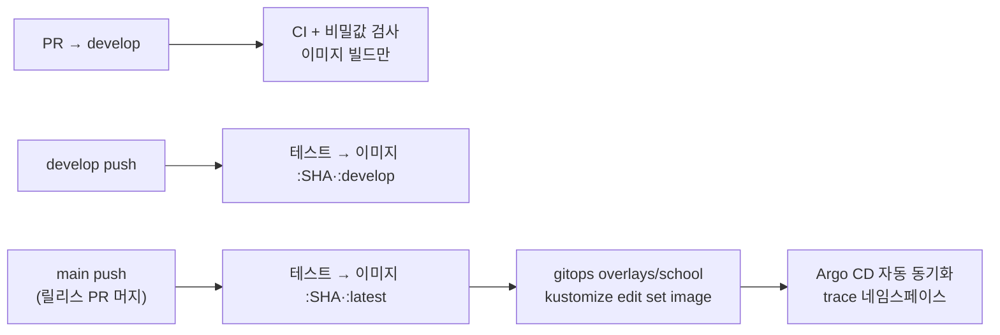

# CI/CD

블로그(AIGJ-01-002-blog/devlog)에서 쓰던 CI/CD를 TRACE 레포 12개에 옮겼습니다. 테스트·품질 분석·이미지·알림·릴리스·리뷰 설정은 블로그 그대로이고, **배포만 Argo CD 방식**으로 바꿨습니다. 블로그는 GitHub Actions가 학교 서버의 k3d에 직접 배포했지만, TRACE는 학교에 이미 설치된 Rancher 클러스터와 Argo CD를 씁니다.

## 레포별 워크플로

| 워크플로 | 서버 6개 | web | agent·booth·ml | contracts | gitops | 블로그 원본 |
|---|---|---|---|---|---|---|
| `backend-ci` (Maven verify·JaCoCo 40%·SonarQube) | ✓ | | | | | backend-ci.yml |
| `화면 CI` (타입 검사·테스트·빌드) | | ✓ | | | | frontend-ci.yml |
| `python-ci` (ruff·pytest, OS별) | | | ✓ | | | render-worker-ci.yml |
| `계약 검사` (YAML·JSON Schema·OpenAPI 린트) | | | | ✓ | | 새로 만듦 |
| `매니페스트 검증` (kustomize build·kubeconform) | | | | | ✓ | deploy.yml의 validate |
| `배포` (이미지 → GHCR, main이면 gitops 태그 갱신) | ✓ | ✓ | | | | deploy.yml의 image + 배포 단계를 Argo CD 방식으로 |
| `비밀값 검사` (학교 비밀번호 패턴·gitleaks) | ✓ | ✓ | ✓ | ✓ | ✓ | check-no-secrets.sh + gitleaks(NFR-03) |
| `release` (CHANGELOG 버전 → 태그·Release) | ✓ | ✓ | ✓ | ✓ | ✓ | release.yml |
| `PR 알림`·`CI 결과 알림` (Discord·텔레그램) | ✓ | ✓ | ✓ | ✓ | ✓ | pr-notify.yml, ci-notify.yml, actions/notify |
| `SonarQube 이슈 내보내기` (수동) | ✓ | | | | | sonar-export.yml |
| `메일 시험 발송` (수동, Gmail 앱 비밀번호 확인) | auth-server | | | | | mail-test.yml |

모든 레포에 함께 들어간 것: PR 틀(`.github/pull_request_template.md`), 릴리스 노트 틀, `CONTRIBUTING.md`(Git Flow), `CHANGELOG.md`, CodeRabbit 한국어 리뷰 설정(`.coderabbit.yaml`), `scripts/check-no-secrets.sh`.

**블로그에서 가져오지 않은 것**과 이유:
- `school-tunnel`·`server-check`·`school-setup`·`cluster-status`·`infra-bench`: 블로그가 학교 서버에 직접 k3d를 만들고 SSH로 배포하던 구조용입니다. TRACE는 Rancher와 Argo CD가 맡습니다.
- `readme-check`·`org-profile-sync`: 블로그의 4개 언어 README·조직 프로필 전용입니다.

## 배포 흐름

- 이미지 이름: `ghcr.io/<조직 소문자>/<레포 이름>` (예: `ghcr.io/gakdo/auth-server`)
- 태그: 커밋 SHA(항상), `latest`(main), `develop`(develop)
- gitops 갱신은 여러 서버가 동시에 커밋해도 꼬이지 않게 한 줄로 세우고(`concurrency: gitops-bump`), 충돌하면 받아서 최대 3번 다시 시도합니다.
- 학교 클러스터가 amd64라 이미지는 amd64 한 가지만 만듭니다(블로그는 Oracle ARM VM 때문에 arm64도 만들었음).

## 처음 한 번 설정할 것

조직(GAKDO) **Settings → Secrets and variables → Actions**에 조직 단위로 한 번만 넣으면 12개 레포가 함께 씁니다.

| 종류 | 이름 | 값 | 없으면 |
|---|---|---|---|
| Secret | `GITOPS_TOKEN` | gitops 레포 Contents 읽기·쓰기만 준 fine-grained 토큰 | 이미지까지만 올리고 배포 갱신은 건너뜀 |
| Secret | `SONAR_TOKEN` | 학교 SonarQube 토큰 | 분석 건너뜀 |
| Secret | `SONAR_HOST_URL` | `http://s4.java21.net:9000` | SonarCloud로 시도 |
| 변수 | `SONAR_ENABLED` | `true` | 분석 안 함 |
| Secret | `DISCORD_WEBHOOK_URL` (`DISCORD_PR_WEBHOOK_URL`) | 팀 디스코드 웹훅 | 알림 없음 |
| 변수 | `DISCORD_ENABLED` | `true` | 알림 없음 |
| Secret | `TELEGRAM_BOT_TOKEN`·`TELEGRAM_CHAT_ID` | 텔레그램 봇 | 알림 없음 |
| 변수 | `TELEGRAM_ENABLED` | `true` | 알림 없음 |
| 변수 | `SMTP_USERNAME` | 팀 Gmail 주소 (auth-server 메일 시험용) | 메일 시험 실패 |
| Secret | `SMTP_PASSWORD` | Gmail 앱 비밀번호 | 메일 시험 실패 |

그 밖에:
1. **GHCR 패키지 공개:** 첫 이미지가 올라가면 조직 Packages에서 각 패키지를 Public으로 바꿉니다. 비공개로 두려면 클러스터에 이미지 받는 비밀(imagePullSecret)을 만들어야 합니다.
2. **Argo CD 등록:** `gitops/argocd/application.yaml`을 학교 Argo CD에 등록합니다(gitops 레포 README 참고).
3. **클러스터 비밀:** `gitops/scripts/create-secrets.sh`로 `trace-secrets`·`trace-postgres`를 만듭니다. 비밀번호는 레포에 넣지 않습니다.
4. **develop 브랜치와 보호 규칙:** 각 레포에 `develop`을 만들고, main·develop에 "PR 필수 + CI 통과 필수"를 겁니다.
5. **CodeRabbit:** 조직에 CodeRabbit GitHub 앱을 설치하면 PR마다 한국어 리뷰가 달립니다.
6. **SonarQube 프로젝트 키:** 기본값은 `trace-<레포 이름>`입니다. 다르게 쓰려면 레포 변수 `SONAR_PROJECT_KEY`.

## 뼈대 코드

CI가 첫 실행부터 초록이 되도록 레포마다 가장 작은 뼈대를 넣었습니다.

| 레포 | 뼈대 | 로컬 확인 |
|---|---|---|
| 서버 6개 | Spring Boot 앱, `GET /api/v1/<경로>/ping`, 테스트, Dockerfile(비루트·계층 분리), Maven 래퍼 | `./mvnw verify` 통과 (gateway·rental-server 확인) |
| gateway | 위 + REST API v0 경로 앞부분으로 서버 5개 라우팅 | `./mvnw verify` 통과 |
| web | Vite + React + TypeScript, Vitest, nginx(8080, 비루트) Dockerfile | typecheck·test·build 통과 |
| agent·booth·ml | `pyproject.toml`, 패키지, pytest | ruff·pytest 통과 |
| contracts | `codes.yaml`(DB CHECK 값과 같음), openapi·diagnostics·events 폴더 | yamllint 통과 |
| gitops | base(앱 8개·PostgreSQL·네트워크 정책), overlays/school, Argo CD Application | gitops README 참고 |
