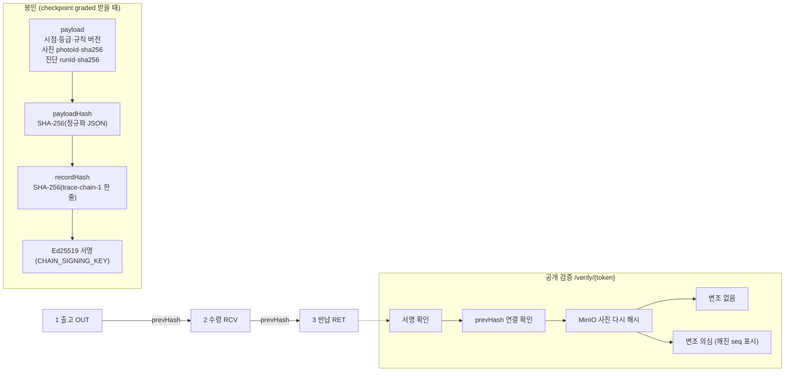

# F3 해시 체인·검증 구조 (원본)

RP1(report-server) 구현 기준. 발표용 PNG는 이 mermaid를 그려서 만든다. 개인 정보 없음.

## 시연에서 보여 줄 점

- 사진 한 장을 바꾸면 검증이 `valid=false`, 깨진 seq를 돌려준다(report_server `ReportIntegrationTest`가 같은 흐름을 매번 확인).
- 검증 페이지는 로그인 없이 열리고, 서명·사진 주소·렌탈 ID는 보이지 않는다(등급·시점·지문·서명 시각만).
- 파이프라인이 멈춰도 관리자 수동 봉인(사유 필수, 사용 기록)으로 체인을 이어 갈 수 있다.
