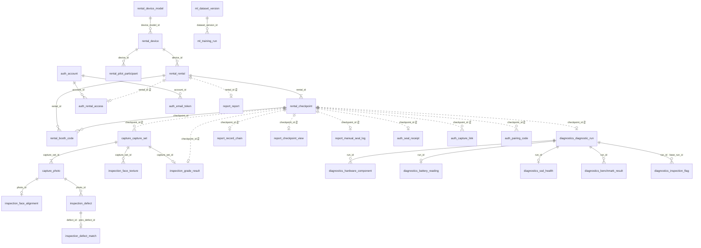

# 테이블 정의 (DDL)

PostgreSQL `trace` DB의 스키마 7개, 테이블 35개입니다. **2026-11-08 기준, 각 서버의 Flyway 마이그레이션(V1 + V2 이후)을 모두 적용한 지금 스키마**를 적었습니다. 아래 SQL을 빈 DB에 차례로 실행하면 서버 5개 develop의 마이그레이션을 모두 돌린 결과 + ml 기록부와 같은 표·컬럼·제약이 나옵니다(11/8 로컬 PostgreSQL 16에 둘 다 적용해 비교). 처음 스키마(10/31, 테이블 31개)는 [../db/V1__init.sql](../db/V1__init.sql)이고, 그 뒤 서버가 더한 것은 아래 표와 각 절의 `-- Vn` 주석에 있습니다.

| 서버 | 마이그레이션 (`src/main/resources/db/migration`) | V1 뒤에 더한 것 |
| --- | --- | --- |
| auth-server | V1 auth 절, V2·V3 | `pairing_code.rental_id`(V2), `pairing_code.device_serial`(V3) |
| rental-server | V1 rental 절, V2·V3 | 기종 시드 `MBA13-M2`(V2, 데이터만), 표 `booth_code`(V3, 부스 6자리 코드) |
| capture-server | V1 capture·inspection 절, V2~V6 | `capture_set.device`(V3), `profile`(V4, FULL·QUICK), `completed_at`·`detection_model_version`·`inference_ms`·인덱스(V5), `booth_total_ms`(V6) |
| diagnostics-server | V1 diagnostics 절, V2·V3 | `diagnostic_run.rental_id`·`collected_at`·`raw_body`·`idempotency_key`·`benchmark_skipped_reason`, 시점당 하나(UNIQUE), battery·ssd `status` 등(V2), `diagnostic_run.checks`와 플래그 종류 3개(V3) |
| report-server | V1 report 절, V2~V4 | `record_chain` 검증 재료, 표 `checkpoint_view`·`processed_event`·`manual_seal_log`(V2), 핀·기종 칸(V3), `checkpoint_view.inspected_at`(V4) |
| ml (집 PC) | `ml/src/trace_ml/sql/V1__ml.sql` | 없음 (집 PC 로컬 PostgreSQL) |

ID는 두 가지입니다. 모든 테이블의 기본 키 `id`는 DB가 매기는 bigint이고 밖으로 내보내지 않습니다. API·이벤트·URL에 나가는 9개 테이블(기기·렌탈·시점·파일럿 참여자·촬영 세트·사진·흠집·진단 실행·계정)에는 `public_id`(NanoID 21자, 앱에서 생성)를 따로 둡니다. 다른 서비스의 행은 FK 없이 그 서비스의 `public_id`를 값으로 둡니다(11/2 강사 피드백). capture·inspection은 같은 capture-server가 가져서 서로 FK를 씁니다.

## ERD (11/8 지금 스키마)

실선은 같은 서버 안의 FK, 점선은 다른 서버의 `public_id`를 값으로만 드는 참조입니다(FK 없음). 표 이름은 `<스키마>_<표>`로 썼습니다. 원래 ERD v1(10/31, 테이블 30개)은 [Crowfoot](https://crowfoot.java21.net/workspaces/68/models/688)에 있고, V1(31개) 뒤에 서버가 더한 표 4개(`rental.booth_code`, `report.checkpoint_view`·`processed_event`·`manual_seal_log`)는 Crowfoot에 아직 없으므로 이 그림이 기준입니다.



`report.report_view`·`report.processed_event`, `auth.client_credential`, `ml.dataset_device`는 다른 표와 잇지 않아 그림에서 뺐습니다.

## rental (rental-server)

```sql
CREATE SCHEMA IF NOT EXISTS rental;

CREATE TABLE rental.device_model (
  id            bigint GENERATED BY DEFAULT AS IDENTITY PRIMARY KEY,
  model_code    varchar(64)  NOT NULL UNIQUE,          -- 예: MBA13-M2
  name          varchar(128) NOT NULL,
  manufacturer  varchar(64),                           -- 예: Apple
  form_factor   varchar(16)  NOT NULL DEFAULT 'CLAMSHELL'
                CHECK (form_factor IN ('CLAMSHELL')),  -- 촬영 면·3D 트윈의 형태. 새 형태는 codes.yaml에 먼저 추가
  spec          jsonb,                                 -- 기준 사양 {cpu, ramGb, ssdGb}
  width_mm      numeric(6,1) NOT NULL,                 -- 3D 트윈 치수
  depth_mm      numeric(6,1) NOT NULL,
  base_h_mm     numeric(5,1) NOT NULL,
  lid_h_mm      numeric(5,1) NOT NULL,
  updated_by    varchar(21),                           -- auth.account.public_id (FK 없음)
  created_at    timestamptz NOT NULL DEFAULT now(),
  updated_at    timestamptz NOT NULL DEFAULT now()
);

CREATE TABLE rental.device (
  id               bigint GENERATED BY DEFAULT AS IDENTITY PRIMARY KEY,
  public_id        varchar(21) NOT NULL UNIQUE,  -- 밖에 보이는 ID (NanoID 21자, 앱에서 생성)
  serial           varchar(64) NOT NULL UNIQUE,       -- 기기 신원. 등록 뒤에는 바꾸지 않음
  device_model_id  bigint NOT NULL REFERENCES rental.device_model(id),
  os               varchar(8)  NOT NULL CHECK (os IN ('MACOS','WINDOWS')),
  color            varchar(32),
  asset_no         varchar(64),                       -- 발표 자료에서 가림
  status           varchar(16) NOT NULL DEFAULT 'ACTIVE'
                   CHECK (status IN ('ACTIVE','MAINTENANCE','RETIRED')),  -- FR-RNT-05
  retired_at       timestamptz,                       -- 폐기해도 행은 지우지 않음(이력 보존)
  updated_by       varchar(21),                       -- auth.account.public_id (FK 없음)
  created_at       timestamptz NOT NULL DEFAULT now(),
  updated_at       timestamptz NOT NULL DEFAULT now(),
  CHECK ((status = 'RETIRED') = (retired_at IS NOT NULL))
);
CREATE INDEX ix_device_model_status ON rental.device(device_model_id, status);

CREATE TABLE rental.rental (
  id          bigint GENERATED BY DEFAULT AS IDENTITY PRIMARY KEY,
  public_id   varchar(21) NOT NULL UNIQUE,  -- 밖에 보이는 ID (NanoID 21자, 앱에서 생성)
  device_id   bigint NOT NULL REFERENCES rental.device(id), -- ACTIVE 기기만 (서버에서 409)
  renter_ref  varchar(128) NOT NULL,                  -- 이름 대신 내부 참조 번호
  status      varchar(16)  NOT NULL CHECK (status IN ('OPEN','RETURNED','CLOSED')),
  started_at  timestamptz,
  ended_at    timestamptz,
  created_at  timestamptz NOT NULL DEFAULT now(),
  updated_at  timestamptz NOT NULL DEFAULT now()
);
-- FR-RNT-01: 같은 기기에 진행 중인 렌탈은 하나만
CREATE UNIQUE INDEX ux_rental_open_device ON rental.rental(device_id) WHERE status = 'OPEN';

CREATE TABLE rental.checkpoint (
  id           bigint GENERATED BY DEFAULT AS IDENTITY PRIMARY KEY,
  public_id    varchar(21) NOT NULL UNIQUE,  -- 밖에 보이는 ID (NanoID 21자, 앱에서 생성)
  rental_id    bigint NOT NULL REFERENCES rental.rental(id),
  type         varchar(3)  NOT NULL CHECK (type IN ('OUT','RCV','RET')),
  status       varchar(16) NOT NULL CHECK (status IN ('OPEN','CAPTURED','GRADED','SEALED')),
  occurred_at  timestamptz,
  created_at   timestamptz NOT NULL DEFAULT now(),
  updated_at   timestamptz NOT NULL DEFAULT now(),
  UNIQUE (rental_id, type)                            -- FR-RNT-02
);

CREATE TABLE rental.pilot_participant (
  id          bigint GENERATED BY DEFAULT AS IDENTITY PRIMARY KEY,
  public_id   varchar(21) NOT NULL UNIQUE,  -- 밖에 보이는 ID (NanoID 21자, 앱에서 생성)
  alias       varchar(16) NOT NULL UNIQUE,            -- P01 … 실명은 따로 보관
  device_id   bigint NOT NULL REFERENCES rental.device(id),
  consent_at  timestamptz NOT NULL,
  created_at  timestamptz NOT NULL DEFAULT now(),
  updated_at  timestamptz NOT NULL DEFAULT now()
);

-- V3 (11/4): 부스 6자리 코드. 관리자가 렌탈 상세에서 발급하고 부스가 넣으면 기기·렌탈·시점 ID를 받는다
-- 원문은 저장하지 않고 SHA-256만 둔다. 10분 1회용. 시험 렌탈 지우기 때 렌탈·시점과 함께 지워진다
CREATE TABLE rental.booth_code (
  id             bigint GENERATED BY DEFAULT AS IDENTITY PRIMARY KEY,
  code_hash      varchar(64) NOT NULL,
  rental_id      bigint      NOT NULL REFERENCES rental.rental(id) ON DELETE CASCADE,
  checkpoint_id  bigint      NOT NULL REFERENCES rental.checkpoint(id) ON DELETE CASCADE,
  expires_at     timestamptz NOT NULL,
  used_at        timestamptz,
  created_at     timestamptz NOT NULL DEFAULT now()   -- updated_at 없음(공통 컬럼 규칙의 예외)
);
CREATE INDEX ix_booth_code_hash ON rental.booth_code(code_hash);
CREATE INDEX ix_booth_code_rental ON rental.booth_code(rental_id);

-- V2: 기종 시드(데이터만). MBA13-M2 = MacBook Air (M2, 2022), 304.1 × 215.0, 본체 7.0·상판 4.0 mm
-- 대회까지 기종은 이것 하나(decisions.md 11/7)
```

## capture·inspection (capture-server)

```sql
CREATE SCHEMA IF NOT EXISTS capture;
CREATE SCHEMA IF NOT EXISTS inspection;

CREATE TABLE capture.capture_set (
  id             bigint GENERATED BY DEFAULT AS IDENTITY PRIMARY KEY,
  public_id      varchar(21) NOT NULL UNIQUE,  -- 밖에 보이는 ID (NanoID 21자, 앱에서 생성)
  rental_id      varchar(21) NOT NULL,                -- rental.rental.public_id (FK 없음). 이벤트 봉투 rentalId (CA1, 11/2)
  checkpoint_id  varchar(21) NOT NULL,                -- rental.checkpoint.public_id (FK 없음)
  source         varchar(8)  NOT NULL CHECK (source IN ('BOOTH','PHONE')),
  booth_id       varchar(32),
  status         varchar(16) NOT NULL CHECK (status IN ('UPLOADING','UPLOADED','INSPECTED','GRADED')),
  quality        varchar(16) NOT NULL DEFAULT 'OK' CHECK (quality IN ('OK','UNJUDGEABLE')),
  skipped_faces  jsonb       NOT NULL DEFAULT '{}',              -- 건너뛴 선택 면과 사유 {"SCR1": "사유"} (11/2)
  completion_key            varchar(128),   -- 완료 요청의 Idempotency-Key (CA1)
  completion_request_sha256 char(64),       -- 같은 키에 다른 본문인지 가리는 해시 (CA1)
  completion_response       jsonb,          -- 같은 키로 다시 오면 돌려줄 첫 응답 (CA1)
  detections_received_at    timestamptz,    -- 부스 탐지를 받은 시각. 부스 세트는 정합·탐지가 모두 와야 등급 (CA2)
  device         jsonb,                     -- V3: 찍은 기기 기종·치수 {modelCode, dimensions}. 이벤트 capture.uploaded device로 넘김
  profile        varchar(8)  NOT NULL DEFAULT 'FULL'
                 CHECK (profile IN ('FULL','QUICK')),   -- V4: QUICK = 부스 위·아래 2면 12장, 정합 없이 부스 탐지로 등급 (11/3 MVP)
  completed_at             timestamptz,     -- V5: 촬영 완료 요청을 받은 시각(성능 그래프)
  detection_model_version  varchar(64),     -- V5: 부스가 탐지와 함께 보낸 모델 버전
  inference_ms   integer CHECK (inference_ms IS NULL OR inference_ms >= 0),     -- V5: Jetson 탐지 시간
  booth_total_ms integer CHECK (booth_total_ms IS NULL OR booth_total_ms >= 0), -- V6: 부스 촬영 시작 → 판정 표시
  created_at     timestamptz NOT NULL DEFAULT now(),
  updated_at     timestamptz NOT NULL DEFAULT now()
);
CREATE INDEX ix_capture_set_checkpoint ON capture.capture_set(checkpoint_id);
CREATE INDEX ix_capture_set_rental ON capture.capture_set(rental_id);
CREATE INDEX ix_capture_set_created ON capture.capture_set(created_at DESC);   -- V5: 최근 세트부터 (GET /captures/benchmarks)

CREATE TABLE capture.photo (
  id              bigint GENERATED BY DEFAULT AS IDENTITY PRIMARY KEY,
  public_id       varchar(21) NOT NULL UNIQUE,  -- 밖에 보이는 ID (NanoID 21자, 앱에서 생성)
  capture_set_id  bigint NOT NULL REFERENCES capture.capture_set(id),
  face            varchar(4)   NOT NULL CHECK (face IN ('TOP','BOT','SF','SB','SL','SR','KB','SCR0','SCR1')),
  light           varchar(4)   NOT NULL CHECK (light IN ('L1','L2','L3','L4','ROOM','OFF')),
  camera          varchar(8)   NOT NULL CHECK (camera IN ('CAM1','CAM2','PHONE')),
  object_key      varchar(512) NOT NULL,
  sha256          char(64)     NOT NULL,
  uploaded        boolean      NOT NULL DEFAULT false,   -- 완료 때 저장소에서 존재·해시를 확인함 (CA1)
  blur_score      real,
  quality_ok      boolean      NOT NULL DEFAULT true,
  taken_at        timestamptz  NOT NULL,
  created_at      timestamptz  NOT NULL DEFAULT now(),
  updated_at      timestamptz  NOT NULL DEFAULT now(),
  UNIQUE (capture_set_id, face, light, camera)   -- 위 카메라 2대가 같은 면·조명을 찍음 (11/2)
);

CREATE TABLE inspection.face_alignment (
  id             bigint GENERATED BY DEFAULT AS IDENTITY PRIMARY KEY,
  photo_id       bigint NOT NULL UNIQUE REFERENCES capture.photo(id),
  method         varchar(16)  NOT NULL CHECK (method IN ('CONTOUR','LIGHTGLUE')),
  homography     jsonb        NOT NULL,               -- 3x3 행렬
  error_px       real,
  rectified_key  varchar(512) NOT NULL,               -- 표준 좌표로 펼친 이미지
  created_at     timestamptz  NOT NULL DEFAULT now(),
  updated_at     timestamptz  NOT NULL DEFAULT now()
);

CREATE TABLE inspection.defect (
  id             bigint GENERATED BY DEFAULT AS IDENTITY PRIMARY KEY,
  public_id      varchar(21) NOT NULL UNIQUE,  -- 밖에 보이는 ID (NanoID 21자, 앱에서 생성)
  photo_id       bigint NOT NULL REFERENCES capture.photo(id),
  class          varchar(8)  NOT NULL CHECK (class IN ('scratch','dent','crack','stain')),
  photo_polygon  jsonb       NOT NULL,                -- 원본 사진 px [[x,y], …] (탐지한 그 사진, 11/2)
  polygon        jsonb,                               -- 표준 좌표(contracts/capture/faces.md), 정합 뒤 채움
  length_mm      real,
  area_mm2       real,
  confidence     real        NOT NULL,
  model_version  varchar(64) NOT NULL,
  source         varchar(8)  NOT NULL DEFAULT 'AUTO' CHECK (source IN ('AUTO','HUMAN')),
  created_at     timestamptz NOT NULL DEFAULT now(),
  updated_at     timestamptz NOT NULL DEFAULT now()
);
CREATE INDEX ix_defect_photo ON inspection.defect(photo_id);

CREATE TABLE inspection.defect_match (
  id              bigint GENERATED BY DEFAULT AS IDENTITY PRIMARY KEY,
  defect_id       bigint NOT NULL UNIQUE REFERENCES inspection.defect(id),
  prev_defect_id  bigint REFERENCES inspection.defect(id), -- NULL이면 신규
  status          varchar(8) NOT NULL CHECK (status IN ('NEW','EXISTING')),
  distance_mm     real,
  rule_version    varchar(32) NOT NULL,             -- 비교 규칙 버전(예: view-match-v1, 11/2)
  created_at      timestamptz NOT NULL DEFAULT now(),
  updated_at      timestamptz NOT NULL DEFAULT now()
);

CREATE INDEX ix_defect_match_prev ON inspection.defect_match(prev_defect_id);

CREATE TABLE inspection.grade_result (
  id             bigint GENERATED BY DEFAULT AS IDENTITY PRIMARY KEY,
  checkpoint_id  varchar(21) NOT NULL UNIQUE,         -- rental.checkpoint.public_id (FK 없음)
  grade          char(1)     NOT NULL CHECK (grade IN ('A','B','C','D')),
  rule_version   varchar(32) NOT NULL,
  reasons        jsonb       NOT NULL,
  capture_set_id bigint      REFERENCES capture.capture_set(id),  -- 등급을 매긴 세트(다음 시점 비교 기준, CA2)
  unjudgeable_faces jsonb    NOT NULL DEFAULT '[]',    -- 판정 불가 면 ["SCR1", …] (CA2)
  created_at     timestamptz NOT NULL DEFAULT now(),
  updated_at     timestamptz NOT NULL DEFAULT now()
);

CREATE TABLE inspection.face_texture (                 -- 면별 텍스처 키(trace.inspect.completed textureKeys, 버킷 trace-derived, CA2)
  id              bigint GENERATED BY DEFAULT AS IDENTITY PRIMARY KEY,
  capture_set_id  bigint       NOT NULL REFERENCES capture.capture_set(id),
  face            varchar(4)   NOT NULL CHECK (face IN ('TOP','BOT','SF','SB','SL','SR','KB','SCR0','SCR1')),
  object_key      varchar(512) NOT NULL,
  created_at      timestamptz  NOT NULL DEFAULT now(),
  updated_at      timestamptz  NOT NULL DEFAULT now(),
  UNIQUE (capture_set_id, face)
);
```

## diagnostics (diagnostics-server)

DI1(diagnostics_server V2)에서 원본 JSON을 MinIO 대신 DB(`raw_body`)에 두기로 해 `raw_object_key`는 비어 있습니다. 자세한 표는 diagnostics_server `specs/001-diagnostics-upload/data-model.md`.

```sql
CREATE SCHEMA IF NOT EXISTS diagnostics;

CREATE TABLE diagnostics.diagnostic_run (
  id              bigint GENERATED BY DEFAULT AS IDENTITY PRIMARY KEY,
  public_id       varchar(21) NOT NULL UNIQUE,  -- 밖에 보이는 ID (NanoID 21자, 앱에서 생성)
  checkpoint_id   varchar(21) NOT NULL,               -- rental.checkpoint.public_id (FK 없음)
  rental_id       varchar(21) NOT NULL,               -- V2: AGENT 토큰 rentalId. 직전 시점 찾기·조회 범위·이벤트 봉투
  device_serial   varchar(64)  NOT NULL,
  os              varchar(8)   NOT NULL CHECK (os IN ('MACOS','WINDOWS')),
  agent_version   varchar(32)  NOT NULL,
  conditions      jsonb        NOT NULL,              -- 전원 연결, 배터리 잔량, 실행 중인 앱 수
  checks          jsonb,                              -- V3: 잠금·디스크 상태(진단 JSON checks, 11/7). 옛 진단은 null
  collected_at    timestamptz  NOT NULL,              -- V2: 측정을 마친 시각
  raw_body        text         NOT NULL,              -- V2: 올린 원본 JSON 그대로. sha256은 이 바이트의 해시
  raw_object_key  varchar(512),                       -- MinIO 원본 키. V2부터 쓰지 않음(NULL)
  sha256          char(64)     NOT NULL,
  idempotency_key varchar(128) NOT NULL,              -- V2: 같은 키 재생·다른 본문 422
  benchmark_skipped_reason varchar(16)
                  CHECK (benchmark_skipped_reason IN ('NO_PERMISSION','UNSUPPORTED','TOOL_ERROR','NO_AC_POWER')),  -- V2
  consented_at    timestamptz  NOT NULL,              -- FR-DIA-05
  created_at      timestamptz  NOT NULL DEFAULT now(),
  updated_at      timestamptz  NOT NULL DEFAULT now(),
  CONSTRAINT uq_run_checkpoint UNIQUE (checkpoint_id) -- V2: 시점당 진단 하나(409 DIAGNOSTIC_ALREADY_UPLOADED)
);
CREATE INDEX ix_run_serial     ON diagnostics.diagnostic_run(device_serial);
CREATE INDEX ix_run_rental     ON diagnostics.diagnostic_run(rental_id, created_at);  -- V2

CREATE TABLE diagnostics.hardware_component (
  id          bigint GENERATED BY DEFAULT AS IDENTITY PRIMARY KEY,
  run_id      bigint NOT NULL REFERENCES diagnostics.diagnostic_run(id),
  kind        varchar(16)  NOT NULL CHECK (kind IN ('CPU','RAM','SSD','BATTERY','DISPLAY','OTHER')),
  identifier  varchar(128) NOT NULL,                  -- 모델명·시리얼
  detail      jsonb,
  created_at  timestamptz  NOT NULL DEFAULT now(),
  updated_at  timestamptz  NOT NULL DEFAULT now()
);
CREATE INDEX ix_component_run ON diagnostics.hardware_component(run_id);  -- V2

CREATE TABLE diagnostics.battery_reading (
  id                bigint GENERATED BY DEFAULT AS IDENTITY PRIMARY KEY,
  run_id            bigint NOT NULL UNIQUE REFERENCES diagnostics.diagnostic_run(id),
  status            varchar(12) NOT NULL CHECK (status IN ('OK','SKIPPED','NO_BATTERY')),               -- V2
  skipped_reason    varchar(16) CHECK (skipped_reason IN ('NO_PERMISSION','UNSUPPORTED','TOOL_ERROR')), -- V2
  cycle_count       integer,
  design_capacity       integer,
  full_charge_capacity  integer,
  capacity_unit         varchar(3) CHECK (capacity_unit IN ('mAh','mWh')),  -- macOS mAh, Windows mWh (환산하지 않음)
  max_capacity_pct      numeric(5,2),                -- 서버 계산: 완충 ÷ 설계 × 100
  os_max_capacity_pct   smallint,                    -- macOS가 보여 주는 값, 없으면 NULL
  condition             varchar(32),                 -- NORMAL, SERVICE_RECOMMENDED
  created_at        timestamptz NOT NULL DEFAULT now(),
  updated_at        timestamptz NOT NULL DEFAULT now()
);

CREATE TABLE diagnostics.ssd_health (
  id              bigint GENERATED BY DEFAULT AS IDENTITY PRIMARY KEY,
  run_id          bigint NOT NULL UNIQUE REFERENCES diagnostics.diagnostic_run(id),
  status          varchar(8) NOT NULL CHECK (status IN ('OK','SKIPPED')),   -- V2
  protocol        varchar(8) CHECK (protocol IN ('NVME','ATA')),            -- V2
  percent_used         smallint,                     -- NVMe percentage_used (100 넘을 수 있음)
  available_spare_pct  smallint,
  critical_warning     smallint,                     -- 0이 아니면 고장 신호
  power_on_hours       integer,
  media_errors         integer,
  skipped_reason  varchar(128),                       -- 권한이 없어 생략한 이유 (FR-DIA-03)
  created_at      timestamptz NOT NULL DEFAULT now(),
  updated_at      timestamptz NOT NULL DEFAULT now()
);

CREATE TABLE diagnostics.benchmark_result (
  id            bigint GENERATED BY DEFAULT AS IDENTITY PRIMARY KEY,
  run_id        bigint NOT NULL REFERENCES diagnostics.diagnostic_run(id),
  metric        varchar(16) NOT NULL CHECK (metric IN ('CPU_SINGLE','CPU_MULTI','MEM_COPY','DISK_READ','DISK_WRITE')),
  trial_values  jsonb       NOT NULL,                 -- 3회 측정값
  median        double precision NOT NULL,
  created_at    timestamptz NOT NULL DEFAULT now(),
  updated_at    timestamptz NOT NULL DEFAULT now(),
  UNIQUE (run_id, metric)
);

CREATE TABLE diagnostics.inspection_flag (
  id             bigint GENERATED BY DEFAULT AS IDENTITY PRIMARY KEY,
  checkpoint_id  varchar(21) NOT NULL,                -- rental.checkpoint.public_id (FK 없음)
  run_id         bigint NOT NULL REFERENCES diagnostics.diagnostic_run(id),
  base_run_id    bigint NOT NULL REFERENCES diagnostics.diagnostic_run(id), -- 비교 기준(이전 시점). 상태 플래그(잠금·디스크, 11/7)는 이번 진단 자신
  kind           varchar(24) NOT NULL CHECK (kind IN ('COMPONENT_CHANGED','CAPACITY_DROP','BENCH_DROP','ACTIVATION_LOCK_ON','DISK_ENCRYPTION_ON','DISK_HEALTH_WARNING')),
  detail         jsonb       NOT NULL,
  created_at     timestamptz NOT NULL DEFAULT now(),
  updated_at     timestamptz NOT NULL DEFAULT now()
);
CREATE INDEX ix_flag_run ON diagnostics.inspection_flag(run_id);  -- V2
```

## report (report-server)

읽기 모델은 RP1(V2)부터 시점 단위 `checkpoint_view`를 씁니다. `report_view`는 V1에서 만들었지만 비워 둡니다. 핀·기종(V3)과 `inspected_at`(V4)은 화면용이라 해시 체인 재료(trace-chain-1)에는 들어가지 않습니다.

```sql
CREATE SCHEMA IF NOT EXISTS report;

CREATE TABLE report.record_chain (
  id               bigint GENERATED BY DEFAULT AS IDENTITY PRIMARY KEY,
  rental_id        varchar(21) NOT NULL,              -- rental.rental.public_id (FK 없음)
  checkpoint_id    varchar(21) NOT NULL,
  checkpoint_type  varchar(3)  NOT NULL CHECK (checkpoint_type IN ('OUT','RCV','RET')),  -- V2
  grade            char(1)     NOT NULL CHECK (grade IN ('A','B','C','D')),              -- V2
  seq              integer  NOT NULL,                 -- 렌탈 건 안에서 1부터
  payload          jsonb    NOT NULL,                 -- V2: payload_hash의 원문(정규화 JSON으로 다시 계산)
  payload_hash     char(64) NOT NULL,                 -- 사진·진단 JSON 해시를 묶은 값
  prev_hash        char(64),                          -- 첫 기록은 NULL
  record_hash      char(64) NOT NULL,                 -- V2: 이 줄 해시. 다음 줄 prev_hash, Ed25519 서명 대상
  signature        text     NOT NULL,                 -- Ed25519, base64
  manual           boolean  NOT NULL DEFAULT false,   -- V2: 관리자 수동 봉인(시연 우회로)
  signed_at        timestamptz NOT NULL,
  created_at       timestamptz NOT NULL DEFAULT now(),
  updated_at       timestamptz NOT NULL DEFAULT now(),
  UNIQUE (rental_id, seq),
  CONSTRAINT record_chain_checkpoint_uk UNIQUE (checkpoint_id),           -- V2
  CONSTRAINT record_chain_type_uk UNIQUE (rental_id, checkpoint_type)     -- V2
);

CREATE TABLE report.report (
  id            bigint GENERATED BY DEFAULT AS IDENTITY PRIMARY KEY,
  rental_id     varchar(21) NOT NULL UNIQUE,
  verify_token  char(32) NOT NULL UNIQUE,             -- 검증 QR에 들어가는 값
  device_id     varchar(21),                          -- V3: trace.checkpoint.started (기기·기종)
  serial        varchar(64),                          -- V3
  model_code    varchar(64),                          -- V3
  model_name    varchar(128),                         -- V3
  created_at    timestamptz NOT NULL DEFAULT now(),
  updated_at    timestamptz NOT NULL DEFAULT now()
);

CREATE TABLE report.report_view (                     -- V1. RP1부터 쓰지 않음(checkpoint_view로 바뀜)
  id          bigint GENERATED BY DEFAULT AS IDENTITY PRIMARY KEY,
  rental_id   varchar(21)  NOT NULL UNIQUE,
  timeline    jsonb NOT NULL,
  created_at  timestamptz NOT NULL DEFAULT now(),
  updated_at  timestamptz NOT NULL DEFAULT now()
);

-- V2: 시점 읽기 모델. checkpoint.started·capture.uploaded·inspect.completed·checkpoint.graded·diagnostics.recorded로 채운다
CREATE TABLE report.checkpoint_view (
  id                 bigint GENERATED BY DEFAULT AS IDENTITY PRIMARY KEY,
  rental_id          varchar(21) NOT NULL,
  checkpoint_id      varchar(21) NOT NULL UNIQUE,
  checkpoint_type    varchar(3)  CHECK (checkpoint_type IN ('OUT','RCV','RET')),  -- graded·수동 봉인 때 알게 된다
  status             varchar(8)  NOT NULL CHECK (status IN ('OPEN','CAPTURED','GRADED','SEALED')),
  occurred_at        timestamptz,                         -- 촬영 업로드 완료 시각
  capture_set_id     varchar(21),
  photos             jsonb NOT NULL DEFAULT '[]',          -- capture.uploaded photos[photoId, face, light, camera, objectKey, sha256]
  chain_photos       jsonb NOT NULL DEFAULT '[]',          -- graded photos[photoId, sha256] = 해시 체인 재료
  inspected_at       timestamptz,                          -- V4: trace.inspect.completed를 받은 시각(진행률 '검사 끝')
  grade              char(1) CHECK (grade IN ('A','B','C','D')),
  rule_version       varchar(32),
  new_defect_ids     jsonb NOT NULL DEFAULT '[]',
  unjudgeable_faces  jsonb NOT NULL DEFAULT '[]',
  pins               jsonb NOT NULL DEFAULT '[]',          -- V3: checkpoint.graded pins (3D 핀)
  graded_at          timestamptz,
  diag_run_id        varchar(21),
  diag_sha256        char(64),
  diag_flags         jsonb NOT NULL DEFAULT '[]',          -- 플래그 종류(kind)만
  diag_max_capacity_pct double precision,                  -- V3: diagnostics.recorded maxCapacityPct
  sealed_at          timestamptz,
  created_at         timestamptz NOT NULL DEFAULT now(),
  updated_at         timestamptz NOT NULL DEFAULT now()
);
CREATE INDEX checkpoint_view_rental_idx ON report.checkpoint_view (rental_id);
CREATE INDEX checkpoint_view_due_idx ON report.checkpoint_view (status, graded_at) WHERE status = 'GRADED';

-- V2: 같은 eventId가 다시 와도 한 번만 처리한다
CREATE TABLE report.processed_event (
  id           bigint GENERATED BY DEFAULT AS IDENTITY PRIMARY KEY,
  event_id     varchar(21) NOT NULL UNIQUE,
  routing_key  varchar(64) NOT NULL,
  created_at   timestamptz NOT NULL DEFAULT now(),
  updated_at   timestamptz NOT NULL DEFAULT now()
);

-- V2: 관리자 수동 봉인 사용 기록(11/2 결정)
CREATE TABLE report.manual_seal_log (
  id               bigint GENERATED BY DEFAULT AS IDENTITY PRIMARY KEY,
  rental_id        varchar(21) NOT NULL,
  checkpoint_id    varchar(21) NOT NULL UNIQUE,
  checkpoint_type  varchar(3)  NOT NULL CHECK (checkpoint_type IN ('OUT','RCV','RET')),
  grade            char(1)     NOT NULL CHECK (grade IN ('A','B','C','D')),
  seq              integer     NOT NULL,
  reason           varchar(300) NOT NULL,
  sealed_by        varchar(64) NOT NULL,                   -- 관리자 JWT sub(계정 publicId)
  created_at       timestamptz NOT NULL DEFAULT now(),
  updated_at       timestamptz NOT NULL DEFAULT now()
);
```

## ml (데이터 도구)

```sql
CREATE SCHEMA IF NOT EXISTS ml;

CREATE TABLE ml.dataset_device (
  id           bigint GENERATED BY DEFAULT AS IDENTITY PRIMARY KEY,
  device_code  varchar(8)  NOT NULL UNIQUE,           -- G01 …
  model_name   varchar(128) NOT NULL,
  color        varchar(32),
  split        varchar(8)  NOT NULL CHECK (split IN ('TRAIN','VAL','TEST')),
  created_at   timestamptz NOT NULL DEFAULT now(),
  updated_at   timestamptz NOT NULL DEFAULT now()
);

CREATE TABLE ml.dataset_version (
  id              bigint GENERATED BY DEFAULT AS IDENTITY PRIMARY KEY,
  version         varchar(8)   NOT NULL UNIQUE,       -- v001 …
  manifest_key    varchar(512) NOT NULL,
  builder_commit  varchar(40)  NOT NULL,
  counts          jsonb        NOT NULL,              -- 클래스별·분할별 개수
  built_at        timestamptz  NOT NULL,
  created_at      timestamptz  NOT NULL DEFAULT now(),
  updated_at      timestamptz  NOT NULL DEFAULT now()
);

CREATE TABLE ml.training_run (
  id                  bigint GENERATED BY DEFAULT AS IDENTITY PRIMARY KEY,
  dataset_version_id  bigint NOT NULL REFERENCES ml.dataset_version(id),
  base_weights        varchar(128) NOT NULL,          -- 예: yolo11s-seg.pt
  metrics             jsonb        NOT NULL,          -- mAP50, mAP50-95 …
  model_key           varchar(512) NOT NULL,
  onnx_key            varchar(512) NOT NULL,
  created_at          timestamptz  NOT NULL DEFAULT now(),
  updated_at          timestamptz  NOT NULL DEFAULT now()
);
```

## auth (auth-server)

관리자와 고객은 account 한 테이블에 role로 나누고, 고객이 볼 수 있는 렌탈은 rental\_access에 둬서 로그인 때 JWT rentals 클레임에 넣습니다. 이메일 인증·비밀번호 재설정 코드는 email\_token 하나에 purpose로 나눠 둡니다. seal\_receipt는 trace.record.sealed를 받아 둔 봉인 영수증으로, 고객이 연결되면 메일로 보냅니다. 리프레시 토큰은 DB가 아니라 Redis `trace:auth:refresh:{jti}`에 둡니다. 고객 QR 링크와 에이전트 페어링 코드는 렌탈 시점에 묶이지만, checkpoint·rental은 rental-server의 ID라 FK 없이 값으로만 둡니다.

```sql
CREATE SCHEMA IF NOT EXISTS auth;

-- 관리자·고객 계정 (FR-AUTH-01, FR-USR-01·04·05). 관리자는 초기 데이터(ACTIVE)로 넣음
CREATE TABLE auth.account (
  id                 bigint GENERATED BY DEFAULT AS IDENTITY PRIMARY KEY,
  public_id          varchar(21) NOT NULL UNIQUE,  -- 밖에 보이는 ID (NanoID 21자, 앱에서 생성)
  email              varchar(254) UNIQUE,              -- 소문자로 저장, 탈퇴하면 NULL
  password_hash      varchar(100),                     -- BCrypt, 탈퇴하면 NULL
  name               varchar(64),                      -- 탈퇴하면 NULL
  role               varchar(16)  NOT NULL CHECK (role IN ('ADMIN','CUSTOMER')),
  status             varchar(16)  NOT NULL DEFAULT 'PENDING' CHECK (status IN ('PENDING','ACTIVE','WITHDRAWN')),
  email_verified_at  timestamptz,                      -- FR-USR-05, 인증하면 ACTIVE
  privacy_agreed_at  timestamptz,                      -- 고객 가입 때 개인정보 수집 동의
  withdrawn_at       timestamptz,
  created_at         timestamptz  NOT NULL DEFAULT now(),
  updated_at         timestamptz  NOT NULL DEFAULT now(),
  CHECK (status = 'WITHDRAWN' OR (email IS NOT NULL AND password_hash IS NOT NULL)),
  CHECK (role <> 'CUSTOMER' OR status = 'WITHDRAWN' OR privacy_agreed_at IS NOT NULL)
);

-- 고객과 렌탈 연결 (FR-USR-02·03). 렌탈 하나는 계정 하나에만
CREATE TABLE auth.rental_access (
  id          bigint GENERATED BY DEFAULT AS IDENTITY PRIMARY KEY,
  account_id  bigint NOT NULL REFERENCES auth.account(id),
  rental_id   varchar(21) NOT NULL UNIQUE,             -- rental.rental.public_id (FK 없음)
  linked_at   timestamptz NOT NULL,
  created_at  timestamptz NOT NULL DEFAULT now(),
  updated_at  timestamptz NOT NULL DEFAULT now()
);
CREATE INDEX ix_access_account ON auth.rental_access(account_id);

-- 이메일 인증·비밀번호 재설정 6자리 코드 (FR-USR-05·06)
CREATE TABLE auth.email_token (
  id          bigint GENERATED BY DEFAULT AS IDENTITY PRIMARY KEY,
  account_id  bigint NOT NULL REFERENCES auth.account(id),
  purpose     varchar(8)  NOT NULL CHECK (purpose IN ('VERIFY','RESET')),
  code_hash   char(64)    NOT NULL,                  -- 코드의 SHA-256, 원문은 저장하지 않음
  attempts    smallint    NOT NULL DEFAULT 0,        -- 5번 틀리면 폐기
  expires_at  timestamptz NOT NULL,                  -- 발급 10분 뒤
  used_at     timestamptz,
  created_at  timestamptz NOT NULL DEFAULT now(),
  updated_at  timestamptz NOT NULL DEFAULT now()
);
CREATE INDEX ix_email_token_account ON auth.email_token(account_id, purpose);

-- 봉인 영수증 (FR-INT-03). trace.record.sealed를 받아 두었다가 연결된 고객에게 메일로 보냄
CREATE TABLE auth.seal_receipt (
  id               bigint GENERATED BY DEFAULT AS IDENTITY PRIMARY KEY,
  rental_id        varchar(21) NOT NULL,              -- rental.rental.public_id (FK 없음)
  checkpoint_id    varchar(21) NOT NULL UNIQUE,       -- 같은 시점은 한 번만 (멱등)
  checkpoint_type  varchar(3)  NOT NULL CHECK (checkpoint_type IN ('OUT','RCV','RET')),
  payload_hash     char(64)    NOT NULL,              -- 봉인 지문
  sealed_at        timestamptz NOT NULL,
  sent_at          timestamptz,                       -- NULL이면 아직 연결된 고객이 없음
  created_at       timestamptz NOT NULL DEFAULT now(),
  updated_at       timestamptz NOT NULL DEFAULT now()
);
CREATE INDEX ix_receipt_unsent ON auth.seal_receipt(rental_id) WHERE sent_at IS NULL;

-- 부스(Jetson)의 client credentials
CREATE TABLE auth.client_credential (
  id           bigint GENERATED BY DEFAULT AS IDENTITY PRIMARY KEY,
  client_id    varchar(64)  NOT NULL UNIQUE,          -- 예: booth-out, booth-ret
  secret_hash  varchar(100) NOT NULL,                 -- BCrypt
  kind         varchar(16)  NOT NULL CHECK (kind IN ('BOOTH')),
  active       boolean      NOT NULL DEFAULT true,
  created_at   timestamptz  NOT NULL DEFAULT now(),
  updated_at   timestamptz  NOT NULL DEFAULT now()
);

-- 고객 수령 촬영용 1회용 QR 링크 (FR-RNT-04). rental_id는 렌탈 연결에 씀
CREATE TABLE auth.capture_link (
  id             bigint GENERATED BY DEFAULT AS IDENTITY PRIMARY KEY,
  checkpoint_id  varchar(21) NOT NULL,                -- rental.checkpoint.public_id (FK 없음)
  rental_id      varchar(21) NOT NULL,                -- rental.rental.public_id (FK 없음)
  token_hash     char(64) NOT NULL UNIQUE,            -- 토큰 원문은 저장하지 않음
  expires_at     timestamptz NOT NULL,
  used_at        timestamptz,
  created_at     timestamptz NOT NULL DEFAULT now(),
  updated_at     timestamptz NOT NULL DEFAULT now()
);
CREATE INDEX ix_link_checkpoint ON auth.capture_link(checkpoint_id);

-- 진단 에이전트가 시점 하나에 붙을 때 쓰는 6자리 코드
CREATE TABLE auth.pairing_code (
  id             bigint GENERATED BY DEFAULT AS IDENTITY PRIMARY KEY,
  checkpoint_id  varchar(21) NOT NULL,                -- rental.checkpoint.public_id (FK 없음)
  rental_id      varchar(21),                         -- V2: AGENT JWT rentalId 클레임용(rental.rental.public_id, FK 없음). 새 코드는 항상 채움
  device_serial  varchar(64),                         -- V3: AGENT JWT deviceSerial 클레임용(rental.device.serial). 새 코드는 항상 채움
  code_hash      char(64)    NOT NULL,                -- 코드의 SHA-256
  expires_at     timestamptz NOT NULL,                -- 발급 5분 뒤
  used_at        timestamptz,
  created_at     timestamptz NOT NULL DEFAULT now(),
  updated_at     timestamptz NOT NULL DEFAULT now()
);
CREATE INDEX ix_pairing_checkpoint ON auth.pairing_code(checkpoint_id);
```
