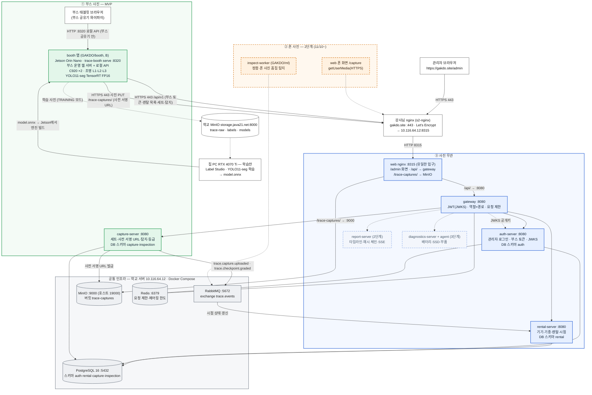
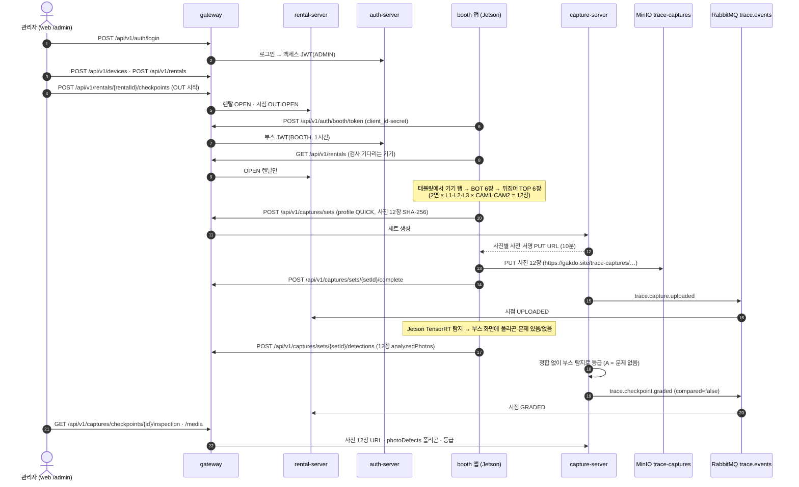

# 1. 전체 아키텍처 (11/3 최소 MVP 기준)

기준일 2026-11-04. 근거는 gitops `compose/docker-compose.yml`(develop), contracts develop(1.0.0 + 11/3 추가분), booth·web develop 코드입니다.
메인 주소는 **https://gakdo.site** 입니다.

## 그림 규칙

| 그룹 | 색 | 선 | 들어가는 것 |
|---|---|---|---|
| ① 부스 사진 (MVP) | 초록 | 실선 | booth 앱(Jetson 안 부스 운영 웹 서버 :8320 + 촬영·탐지), capture-server, MinIO `trace-captures` |
| ② 폰 사진 (2단계) | 주황 | 점선 | web 폰 화면 `/capture`, inspect-worker |
| ③ 사진 무관 | 파랑 | MVP 실선, 2·3단계 점선 | web 관리자 `/admin`, gateway, auth-server, rental-server / report-server(2단계), diagnostics-server·agent(3단계) |
| 공통 인프라 | 회색 | 실선 | PostgreSQL, RabbitMQ, MinIO, Redis (학교 서버 10.116.64.12, Docker Compose) |
| 밖 | 흰색 | 실선 | 관리자 브라우저, 강사님 nginx(s2-nginx), 집 PC(학습만), 학교 MinIO(학습 데이터) |

뺀 것: Rancher, Argo CD, Cloudflare Tunnel(DNS만 씀), Grafana, InfluxDB, 집 PC 상시 워커.

## 1-1. 전체 구성도

읽는 법

- **부스 화면은 Jetson 안의 작은 웹 서버**(booth 레포 `trace-booth serve`, 8320, B 담당)입니다. 태블릿은 부스 공유기 안에서 Jetson에만 붙고, gakdo.site와 통신하는 것은 Jetson뿐입니다. 자세히는 [2-6](02-services.md#2-6-booth-앱-jetson-안의-부스-운영-웹-서버--b--부스-사진).
- 밖에서 들어오는 길은 **443 하나**입니다. 강사님 nginx → 학교 서버 web nginx(8315) → gateway(8080) 순서이고, 사진 PUT도 같은 길로 MinIO에 갑니다.
- gateway·서버·인프라 포트는 Compose 네트워크 안에서만 열립니다(호스트에 안 엶).
- 학습 사진만 다른 길(학교 MinIO 8000)로 갑니다. 서비스용 MinIO와 다른 저장소입니다.

## 1-2. MVP 한 건의 흐름 (출고 검사 1번)

## 1-3. 포트 목록

| 포트 | 어디 | 무엇 | 열림 |
|---|---|---|---|
| 443 | gakdo.site (s2-nginx) | 강사님 nginx → 10.116.64.12:8315 | 외부 |
| 8315 | 학교 서버 | web nginx(컨테이너 8080). `/` 화면, `/api/` → gateway, `/trace-captures/`·`/trace-derived/` → MinIO | 학교 내부망(밖에서는 443으로만) |
| 8080 | Compose 안 | gateway·auth-server·rental-server·capture-server (report·diagnostics는 `--profile full`일 때만) | 호스트에 안 엶 |
| 5432 | Compose 안 | PostgreSQL 16 | 호스트에 안 엶 |
| 6379 | Compose 안 | Redis | 호스트에 안 엶 |
| 5672 / 15672 | 학교 서버 | RabbitMQ / 관리 화면 | 127.0.0.1만 |
| 19000 / 19001 | 학교 서버 | MinIO API / 콘솔 (학교 MinIO 9000과 겹쳐서 옮김) | 127.0.0.1만 |
| 8320 | Jetson | 부스 운영 화면(`trace-booth serve`) | 부스 공유기만 |
| 8000 | storage.java21.net | 학교 MinIO, 학습 데이터 전용(trace-raw·labels·models) | 학교 |
| 8822 | s2.java21.net | SSH(배포용) | 외부 |

contracts OpenAPI의 `servers`에 남은 `localhost:8314`는 클러스터 시절 gateway 포트입니다. 지금 배포에서는 `https://gakdo.site`가 그 자리입니다.

## 1-4. 단계별로 켜지는 것

| 단계 | 기간 | 켜지는 컨테이너·앱 | 그림에서 |
|---|---|---|---|
| MVP | ~11/9 | web·gateway·auth-server·rental-server·capture-server + PostgreSQL·RabbitMQ·MinIO·Redis, booth 앱 | 실선 |
| 2단계 | 11/10~12 | report-server(해시 체인·SSE), web 폰 화면·3D 리포트·검증 페이지, inspect-worker, 수령 QR 링크, 반납 시점 비교 | 점선 |
| 3단계 | 시간 남으면 | diagnostics-server + agent, Grafana, 9면 × 4조명 전체 세트 | 점선 |

2·3단계 코드는 develop에 그대로 있고, Compose 기본 기동과 그림에서만 뺐습니다(`docker compose --profile full up -d`로 켬).
