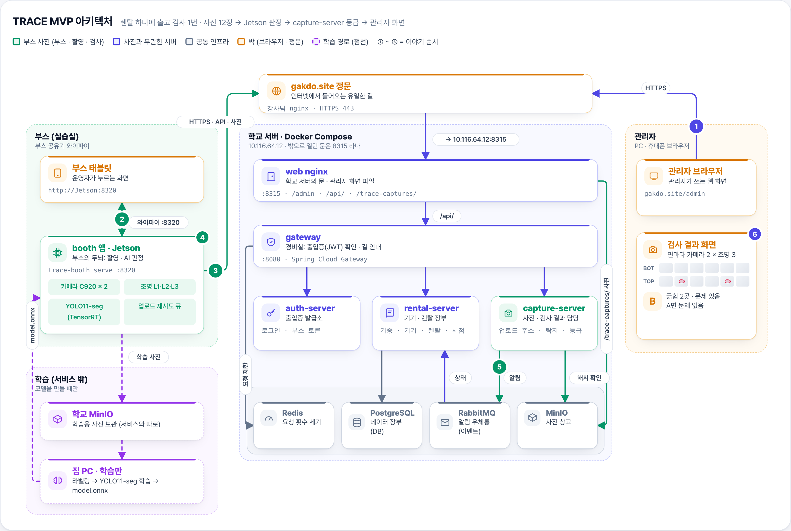
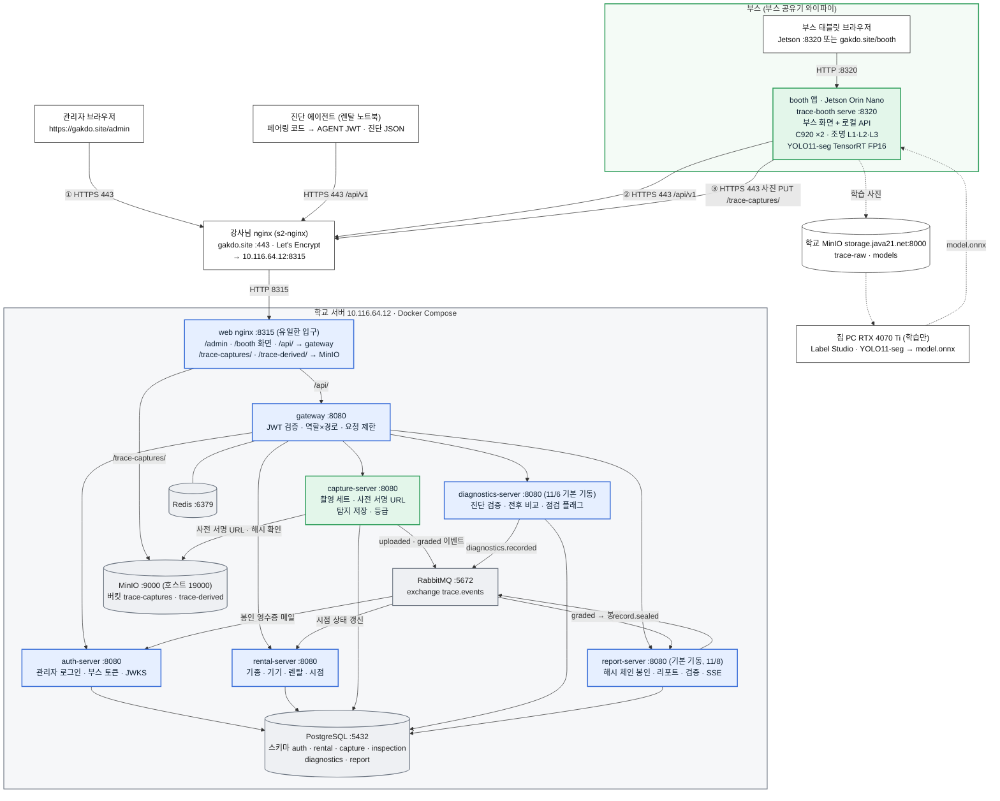
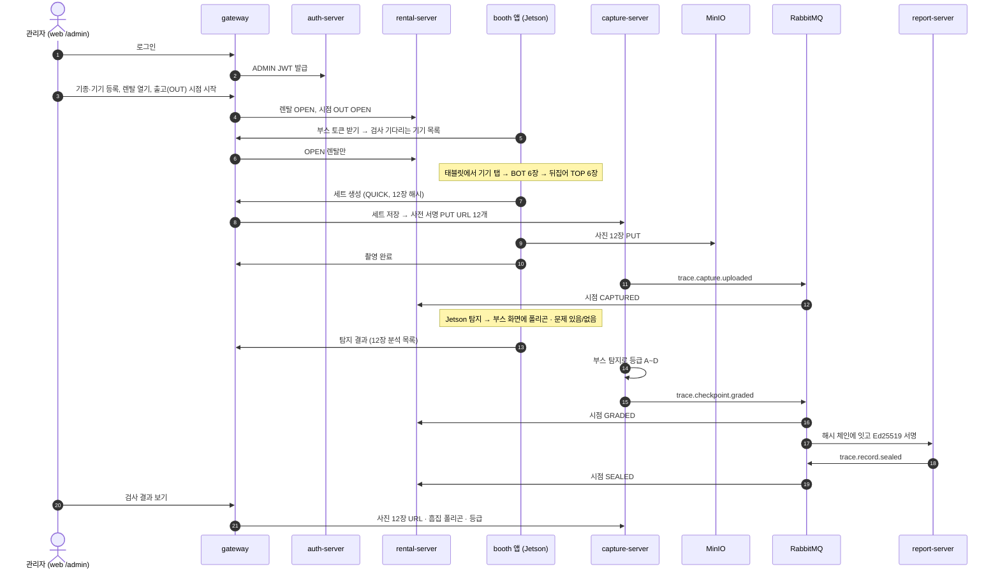

# 1. MVP 아키텍처

기준일 2026-11-08(처음 11/4). **학교 서버에서 실제로 뜨는 것만** 그렸습니다. 근거는 gitops `compose/docker-compose.yml`, contracts develop, 각 서버·booth·web develop 코드입니다. 메인 주소는 **https://gakdo.site** 입니다.

> **11/4 뒤 바뀐 것:** 11/3에 클러스터(Rancher·Argo CD)·InfluxDB·Grafana는 멈추고 보관했습니다. 11/4 봉인(SEALED)을 위해 report-server를 다시 켰고(11/8부터 Compose 기본 기동, gitops #18), 11/6 진단 페어링 시연을 위해 diagnostics-server를 Compose 기본 기동에 넣었습니다(gitops #16, 진단 에이전트 AG1 재도입). 같은 날 Grafana 대신 관리자 화면 **'성능'(`/admin/benchmark`)** 을 쓰기로 했고(지금은 기기별 렌탈 전·후 진단 비교, web #76), 부스 옆 태블릿용 **`/booth` 화면**(ADMIN 로그인)을 web에 더했습니다(web #63).

MVP 한 줄: 관리자가 웹에서 기기를 등록하고 출고 검사를 시작하면, 부스(Jetson)가 노트북 아래(BOT)·위(TOP)를 조명 3개 × 카메라 2대 = **12장** 찍고, Jetson의 YOLO11-seg가 흠집 폴리곤을 찾아 바로 "문제 있음/없음"을 띄운 뒤, capture-server가 등급을 저장하고 관리자가 웹에서 결과를 봅니다.

## 1-1. 구성도

> 위 그림은 [MVP 안내서](https://gakdo.github.io/docs/guide/)의 그림입니다(원본 `guide/data.mjs`, 어두운 배경판 [PNG](../guide/trace-mvp-architecture-dark.png)). 처음 보는 분은 안내서에서 서비스별 설명과 기능별 흐름을 그림과 함께 보면 쉽습니다. 아래 Mermaid 그림은 같은 내용의 글자판입니다.

Mermaid 글자판 열기

| 색 | 묶음 | 들어가는 것 |
|---|---|---|
| 초록 | 부스 사진 | 부스 태블릿, booth 앱(Jetson), capture-server |
| 파랑 | 사진 무관 | web nginx(관리자 화면·부스 태블릿 화면), gateway, auth-server, rental-server, diagnostics-server, report-server |
| 회색 | 공통 인프라 (학교 서버 Compose) | PostgreSQL, RabbitMQ, MinIO, Redis |
| 흰색 | 밖 | 관리자 브라우저, 진단 에이전트(렌탈 노트북), 강사님 nginx, 집 PC(학습), 학교 MinIO(학습 사진) |

읽는 법

- 밖에서 들어오는 길은 **443 하나**뿐입니다. 관리자 화면(①), 부스의 API 호출(②), 부스의 사진 업로드(③), 진단 에이전트의 페어링·업로드가 모두 강사님 nginx → web nginx(8315)를 지나갑니다.
- **촬영·탐지 화면은 Jetson 안의 작은 웹 서버**입니다(booth `trace-booth serve`, 8320). 태블릿은 부스 공유기 안에서 Jetson에 붙고, 부스 토큰으로 gakdo.site와 통신하는 것은 Jetson뿐입니다. 11/6부터 태블릿은 `https://gakdo.site/booth`(web, ADMIN 로그인)도 열어 기다리는 기기 고르기 → 부스 코드 발급 → 판정·사진 보기를 할 수 있습니다. 카메라·조명·탐지는 그대로 Jetson이 합니다.
- 서버 6개(gateway·auth·rental·capture·diagnostics·report)와 인프라 4개는 Compose 네트워크 안에서만 서로 부릅니다. 밖으로 열린 것은 web 8315뿐이고, RabbitMQ·MinIO는 학교 서버 127.0.0.1에만 엽니다.
- 서버끼리는 REST로 부르지 않고 RabbitMQ `trace.events`로만 주고받습니다(예외: gateway가 auth-server JWKS를 읽음). 큐·라우팅 키는 [2. 서비스별](02-services.md#이벤트-흐름-118-코드-기준)에 있습니다.
- 점선은 서비스가 아니라 **학습 데이터 경로**입니다. 부스가 학습 사진을 학교 MinIO에 올리고, 집 PC가 학습해 만든 model.onnx를 Jetson에 옮깁니다.

## 1-2. 검사 한 건의 흐름 (요약)

기능 하나하나의 자세한 설명은 [3. 기능별 흐름](03-features.md)에 있습니다.

## 1-3. 포트 목록

| 포트 | 어디 | 무엇 | 열림 |
|---|---|---|---|
| 443 | gakdo.site (s2-nginx) | 강사님 nginx → 10.116.64.12:8315 | 외부 |
| 8315 | 학교 서버 | web nginx(컨테이너 8080). `/` 화면, `/api/` → gateway, `/trace-captures/` → MinIO | 학교 내부망 (밖에서는 443으로만) |
| 8080 | Compose 안 | gateway · auth-server · rental-server · capture-server · diagnostics-server(11/6 기본) · report-server(11/8 기본) · inspect-worker(11/8, 포트 없음) | 호스트에 안 엶 |
| 5432 | Compose 안 | PostgreSQL 16 | 호스트에 안 엶 |
| 6379 | Compose 안 | Redis | 호스트에 안 엶 |
| 5672 / 15672 | 학교 서버 | RabbitMQ / 관리 화면 | 127.0.0.1만 |
| 19000 / 19001 | 학교 서버 | MinIO API / 콘솔 | 127.0.0.1만 |
| 8320 | Jetson | 부스 촬영·탐지 화면 (`trace-booth serve`) | 부스 공유기만 |
| 8000 | storage.java21.net | 학교 MinIO (학습 사진·모델) | 학교 |
| 8822 | s2.java21.net | SSH (배포용) | 외부 |

contracts OpenAPI의 `servers`에 남은 `localhost:8314`는 예전 클러스터 시절 gateway 포트이고, 지금은 `https://gakdo.site`가 그 자리입니다.

## 1-4. MVP에 넣지 않은 것

그림을 깔끔하게 두려고 MVP 그림에서 뺐습니다. 코드는 develop에 남아 있습니다.

Grafana, InfluxDB, Rancher, Argo CD, Cloudflare Tunnel

- 11/8: 폰 수령 촬영을 다시 켰습니다(web `VITE_ARCHIVED_FEATURES=pilot`, 파일럿 화면만 숨김). 폰 사진은 Compose의 **inspect-worker**(CPU ONNX, `ghcr.io/gakdo/inspect-worker`)가 검사합니다. 모델은 학교 서버 `~/gitops/compose/models/`에 `best.onnx`·`model.json`을 넣고 `docker compose restart inspect-worker`로 바꿔 끼웁니다(gitops `compose/models/README.md`). 폴더가 비어 있으면 흠집 탐지만 건너뛰고 정합·3D 텍스처는 계속 만듭니다(modelVersion `contour-v1`). 그래서 처음 배포할 때도 탐지 모델 파일을 넣어야 폰 사진에 흠집이 나옵니다. 모델을 읽었는지는 `docker compose logs --tail 20 inspect-worker`에서 "폰 탐지 모델" 줄로 확인합니다.
- 클러스터(Rancher·Argo CD)·InfluxDB·Grafana는 11/3에 멈추고 보관했습니다. 배포는 GitHub Actions가 GHCR 이미지를 만들고, 학교 서버에서 `docker compose pull && up -d`로 올립니다. gitops `overlays/school`은 남아 있지만 쓰지 않습니다.
- 파일럿 추이는 Grafana 대신 관리자 화면 '성능'(`/admin/benchmark`, 11/6)이 diagnostics-server 조회 API로 보여 줍니다. diagnostics-server에는 InfluxDB 쓰기 코드가 없습니다.
- report-server·diagnostics-server·진단 에이전트는 11/4·11/6에 다시 켰습니다(위 그림에 있음).
