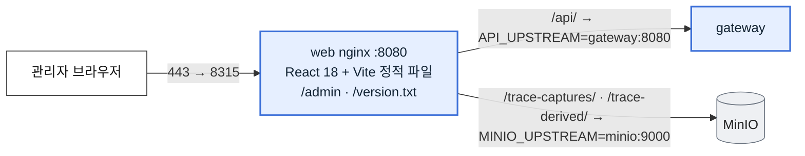
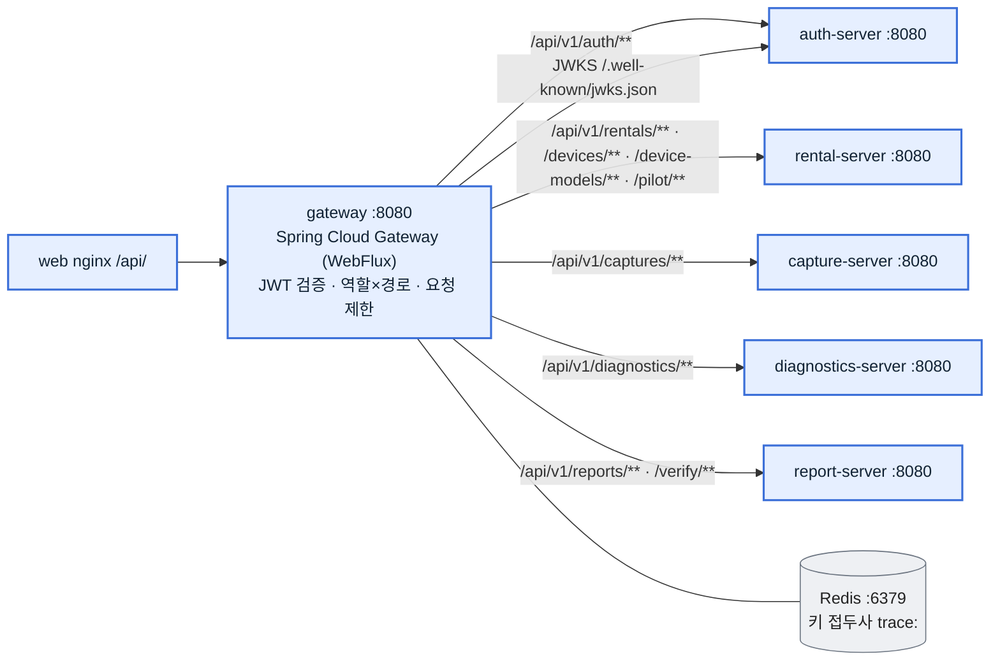
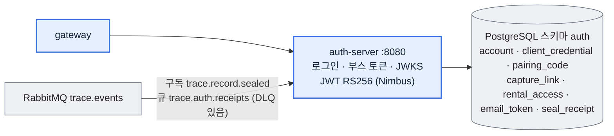
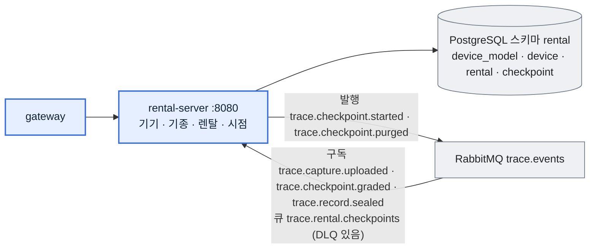
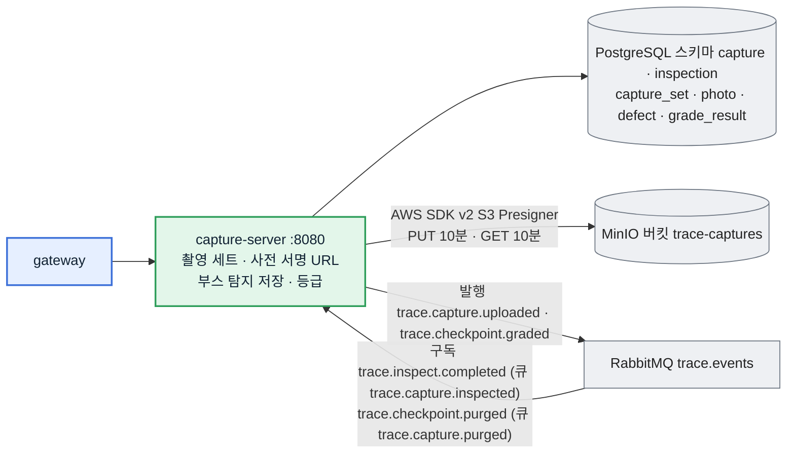
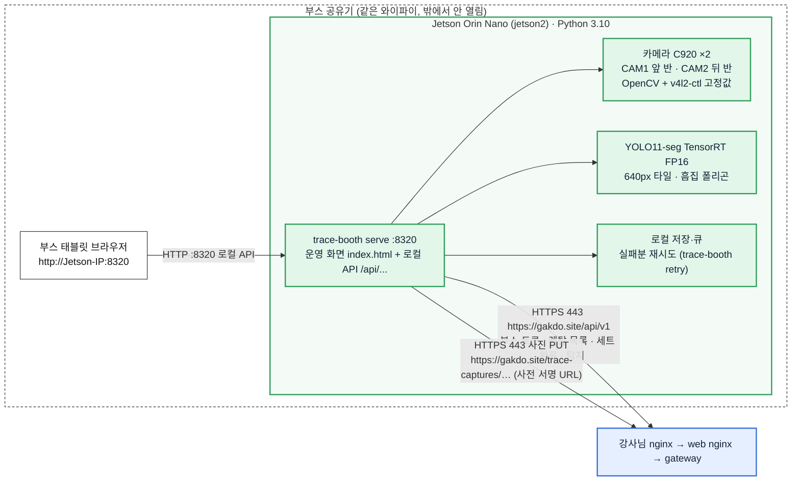
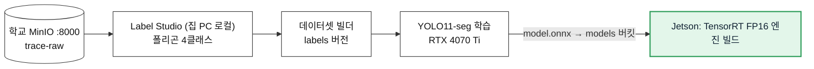
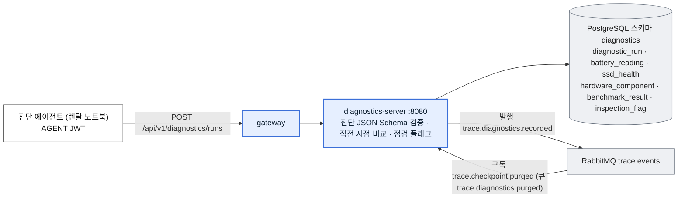
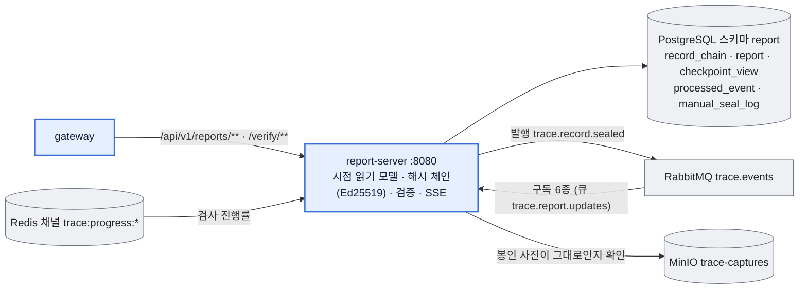
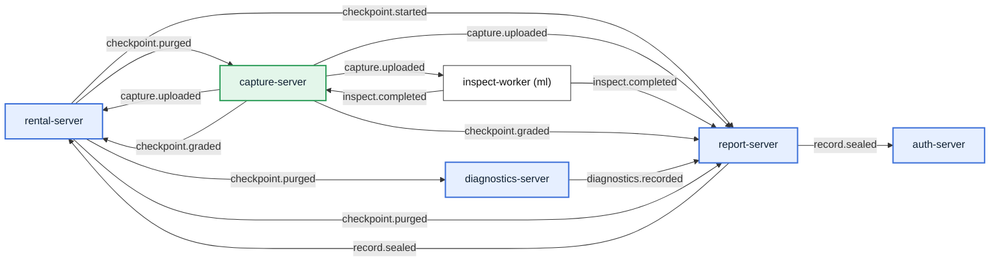

# 2. 서비스 단위 아키텍처

> 그림으로 쉽게 보기: [MVP 안내서 · 서비스별](https://gakdo.github.io/docs/guide/#services)

> 11/8 갱신: 11/4 report-server(`--profile full`), 11/6 diagnostics-server(기본 기동)·진단 에이전트가 다시 들어와 서비스를 더했고, 맨 아래에 [이벤트 흐름](#이벤트-흐름-118-코드-기준)을 코드 기준으로 정리했습니다.

학교 서버에서 뜨는 서비스마다 요약 표에는 **레포 · 어디서 · 포트 · 저장소 · 담당**을, 서비스별 절에는 그림과 함께 하는 일 · 받는 API · 이벤트 · 환경 변수를 적었습니다. 그림 색은 [1. MVP 아키텍처](01-architecture.md)와 같습니다(초록 = 부스 사진, 파랑 = 사진 무관, 회색 = 인프라).

기능마다 어떤 순서로 이 서비스들을 거치는지는 [3. 기능별 흐름](03-features.md)에, 필드 단위 원본은 contracts OpenAPI와 [자동 생성 API 문서](https://gakdo.github.io/docs/)에 있습니다.

## 한눈에 보기

| 서비스 | 레포 | 어디서 | 포트 | 저장소 | 담당 |
|---|---|---|---|---|---|
| web (nginx + React 관리자·부스 태블릿·고객 화면) | GAKDO/web | 학교 서버 Compose | 8080 → 호스트 8315 | 없음 | C |
| gateway | GAKDO/gateway | 학교 서버 Compose | 8080 | Redis (키 접두사 `trace:`) | A |
| auth-server | GAKDO/auth_server | 학교 서버 Compose | 8080 | PostgreSQL `auth` | A |
| rental-server | GAKDO/rental_server | 학교 서버 Compose | 8080 | PostgreSQL `rental` | A |
| capture-server | GAKDO/capture_server | 학교 서버 Compose | 8080 | PostgreSQL `capture`·`inspection`, MinIO `trace-captures`·`trace-derived` | A |
| diagnostics-server | GAKDO/diagnostics_server | 학교 서버 Compose (11/6 기본 기동) | 8080 | PostgreSQL `diagnostics` | A |
| report-server | GAKDO/report_server | 학교 서버 Compose (`--profile full`, 11/4) | 8080 | PostgreSQL `report`, Redis(진행률 구독) | A |
| 진단 에이전트 | GAKDO/agent | 렌탈 노트북(macOS·Windows) | 없음 | 없음(올리기 전 화면에 보여 줌) | B |
| booth 앱 (부스 화면 + 촬영 + 탐지) | GAKDO/booth | Jetson Orin Nano | 8320 (부스 공유기만) | Jetson 로컬 저장·큐 | B |
| 학습 | GAKDO/ml | 집 PC | 없음 | 학교 MinIO `trace-raw`·`models` | A (라벨링 연동은 B) |
| 인프라 4개 | GAKDO/gitops | 학교 서버 Compose | 5432 · 5672 · 9000 · 6379 | — | A |
| 계약 | GAKDO/contracts | — | — | OpenAPI · 이벤트 스키마 · codes.yaml | A (B·C 리뷰) |

공통 규칙: Spring 서버는 모두 Java 21 · Spring Boot 3.5.7, RFC 9457 Problem Details 오류, 이벤트는 RabbitMQ topic exchange `trace.events`, 외부 ID는 NanoID 21자(`PublicId`). 비밀은 학교 서버 `compose/.env`에만 있고 이름만 적습니다.

---

## 2-1. web (관리자 화면) — C

| 항목 | 값 |
|---|---|
| 하는 일 | 관리자 로그인, 기기·기종 등록, 렌탈 열기·출고 시점 시작·부스 코드·페어링 코드 발급, 검사 결과(사진 12장 격자 + 흠집 폴리곤 + 등급)·진단 결과 보기, 성능(기기별 진단 전·후 비교), 부스 태블릿 화면, 고객 가입·내 렌탈·리포트·검증 페이지 |
| 기능 ID | WE1 (WE3·WE4 일부 다시 보임, WE2 폰 촬영은 숨김) |
| 화면 | 관리자 `/admin/login`, `/admin/models`, `/admin/devices`(`/:deviceId` 상세), `/admin/rentals`, `/admin/rentals/:rentalId`, `/admin/inspections`, `/admin/inspections/:rentalId/:checkpointId`, `/admin/benchmark`(성능, 11/6 Grafana 대신). 부스 태블릿 `/booth`(ADMIN 로그인, 11/6). 고객 `/`, `/guide`, `/signup`, `/login`, `/my/rentals`, `/my/rentals/:rentalId`(3D 리포트), `/my/account`, `/verify/:verifyToken`. 숨김: `VITE_ARCHIVED_FEATURES=phoneCapture,pilot`(`/capture`·파일럿) |
| 부르는 API | auth 로그인·가입·내 정보·페어링 코드, rental 기기·기종·렌탈·시점·부스 코드·시험 렌탈 지우기, capture `inspection`·`media`, diagnostics 시점 진단, report 리포트·체인·수동 봉인·검증 |
| 토큰 | 액세스 JWT는 메모리에만, 리프레시는 HttpOnly 쿠키 |
| 환경 변수 | `API_UPSTREAM`, `MINIO_UPSTREAM` |

## 2-2. gateway — A

| 항목 | 값 |
|---|---|
| 하는 일 | 모든 `/api/v1/**`의 유일한 입구. auth-server JWKS로 JWT 서명 검증, 역할(ADMIN·CUSTOMER·BOOTH·AGENT) × 경로 규칙으로 막기(규칙은 contracts `x-trace-access`에서 만든 `access-policy.yaml`, 규칙 없는 경로는 404), 로그인과 페어링 코드 교환은 Redis로 IP당 1분 10번 요청 제한 |
| 기능 ID | GW1 |
| 받는 API | 자체 API 없음(라우팅). JWKS는 밖으로 열지 않음 |
| 환경 변수 | `AUTH_SERVER_URL`, `RENTAL_SERVER_URL`, `CAPTURE_SERVER_URL`, `DIAGNOSTICS_SERVER_URL`, `REPORT_SERVER_URL`, `TRACE_WEB_ORIGIN`, `TRACE_CLIENT_IP_HEADER`(= X-Real-IP), `REDIS_*` |

## 2-3. auth-server — A

| 항목 | 값 |
|---|---|
| 하는 일 | 관리자·고객 로그인(액세스 JWT 15분 + 리프레시 쿠키 7일), 고객 가입·이메일 인증·재설정·탈퇴, 부스 client_id·secret → BOOTH JWT(1시간), 에이전트 페어링 코드 → AGENT JWT, 수령 QR 링크, JWT 공개키(JWKS), 봉인 영수증 메일 |
| 기능 ID | AU1, AU2(11/6 다시 보임), AU3 |
| API | contracts `auth-server.yaml` 17개 모두 구현(`getJwks`는 내부) |
| 환경 변수 | `JWT_PRIVATE_KEY`, `ADMIN_EMAIL`, `ADMIN_PASSWORD`(처음 뜰 때 관리자 계정 생성), `BOOTH_CLIENT_ID`, `BOOTH_CLIENT_SECRET`, `DEMO_CUSTOMER_EMAIL`·`DEMO_CUSTOMER_PASSWORD`, `SMTP_USERNAME`·`SMTP_PASSWORD`, `DB_*`, `RABBITMQ_*`, `REDIS_*` |

## 2-4. rental-server — A

| 항목 | 값 |
|---|---|
| 하는 일 | 기기 등록·검색·상세, 기종(치수) 관리, 렌탈 열기, 시점 시작(출고 → 수령 → 반납 순서, 앞 시점이 SEALED가 아니면 409), 부스 6자리 코드, 시험 렌탈 지우기(`TEST-` 시리얼만), 파일럿 등록, 이벤트로 시점 상태(OPEN → CAPTURED → GRADED → SEALED) 갱신(SEALED는 report-server의 `trace.record.sealed`). 렌탈·시점 짝이 맞지 않는 이벤트는 DLQ |
| 기능 ID | RE1, RE2 |
| API | contracts `rental-server.yaml` 18개 모두 구현: `listRentals`(ADMIN 전체 · CUSTOMER 본인 · BOOTH는 OPEN만), `createRental`, `getRental`, `deleteTestRental`, `startCheckpoint`, `issueBoothCode`, `redeemBoothCode`, `closeRental`, `createDevice`, `listDevices`, `getDevice`, `updateDevice`, `listDeviceModels`, `getDeviceModel`, `upsertDeviceModel`, `createPilotParticipant` |
| 시드 | 기종 `MBA13-M2`(V2). 대회까지 이 기종 하나(decisions.md 11/7) |

## 2-5. capture-server — A (① 부스 사진)

| 항목 | 값 |
|---|---|
| 하는 일 | 사진마다 면·조명·카메라·SHA-256을 받아 사전 서명 PUT URL 발급, 완료 때 해시 확인, 부스 탐지(원본 사진 px 폴리곤) 저장, **QUICK 세트는 정합 없이 부스 탐지로 등급**(A = 문제 없음, B~D = 문제 있음), 관리자 화면용 사진 보기 URL |
| 기능 ID | CA1 세트·URL, CA2 검사 결과·등급(QUICK) |
| 등급 규칙 | grade-rules-v1: 균열 1개 이상 또는 찍힘 3개 이상 D, 찍힘 1~2개 또는 긁힘 5개 이상 C, 긁힘 1~4개 B, 흠집 없음 A. 같은 면·같은 카메라에서 조명만 다른 사진의 흠집은 20 px 안이면 하나로 셈 |
| API | `createCaptureSet`, `reissueUploadUrls`, `completeCaptureSet`, `saveBoothDetections`, `getCaptureSet`, `getCheckpointInspection`, `getCheckpointMedia`, `listCaptureBenchmarks`(11/6 성능 기록) |
| 코드 값 | `capture.profile` = FULL·QUICK, `capture.face_required_quick.BOOTH` = TOP·BOT (contracts #20) |
| 환경 변수 | `MINIO_PUBLIC_BASE`(= `PUBLIC_BASE_URL` = `https://gakdo.site`), `MINIO_ACCESS_KEY`, `MINIO_SECRET_KEY`, `MODEL_METRICS`(성능 기록의 모델별 mAP, 선택) |

## 2-6. booth 앱 (Jetson 안의 부스 운영 웹 서버) — B (① 부스 사진)

**부스 화면은 web 레포가 아니라 booth 레포가 만듭니다.** Jetson에서 `trace-booth serve`를 실행하면 Python 표준 라이브러리(`http.server.ThreadingHTTPServer`)로 만든 **작은 웹 서버**가 `0.0.0.0:8320`에 뜨고, 같은 부스 공유기(와이파이)에 붙은 태블릿 브라우저가 `http://<Jetson IP>:8320`으로 엽니다. 화면 파일은 `src/trace_booth/static/index.html` 하나이고, 화면이 부르는 `/api/...`는 **Jetson 안에서 처리되는 로컬 API**입니다(서버 API가 아님).

태블릿은 gakdo.site에 직접 붙지 않습니다. **서버와 통신하는 것은 Jetson의 booth 앱뿐**이고, 부스 비밀(client_id·secret)과 부스 JWT도 Jetson에만 있습니다.

| 항목 | 값 |
|---|---|
| 담당 | **B** (화면·로컬 API·카메라·탐지 모두 booth 레포). 서버 쪽 API(auth·rental·capture)는 A, 관리자 결과 화면은 C |
| 하는 일 | 검사 기다리는 기기 목록 → 탭 → BOT 6장 → 뒤집어 TOP 6장(L1·L2·L3 × CAM1·CAM2) → Jetson 탐지 → 화면에 폴리곤과 "문제 있음/없음" → 세트·사진·탐지 업로드 |
| 기능 ID | BO1 촬영(학습 사진 TRAINING 모드 포함), BO2 Jetson 탐지 |
| 실행 | `trace-booth serve [--host 0.0.0.0] [--port 8320]`. 엔진 빌드는 `trace-booth build-engine --onnx model.onnx` |
| 열림 | 8320은 부스 공유기 안에서만. 로그인 없음(부스 공유기에 붙은 기기만 쓴다는 전제) → 공유기를 외부에 포트포워딩하지 않음 |
| 환경 변수 | `TRACE_API_URL`(= `https://gakdo.site`), `TRACE_BOOTH_CLIENT_ID`, `TRACE_BOOTH_CLIENT_SECRET`, `TRACE_BOOTH_SHOTLIST`(= `mvp`, 12장), `TRACE_BOOTH_PRESETS`, `TRACE_BOOTH_ENGINE` |

부스 화면 로컬 API (Jetson :8320, booth `src/trace_booth/web.py`)

| 메서드·경로 | 화면 동작 | 안에서 하는 일 |
|---|---|---|
| `GET /api/rentals/waiting` | 검사 기다리는 기기 목록 | 서버 `GET /api/v1/rentals`(부스 토큰) → 지금 시점이 OPEN인 렌탈만 |
| `POST /api/sessions` | 기기 탭 → 세션 시작 | 로컬 세션 만들기(렌탈·시점 ID 기억) |
| `GET /api/live/{camera}` | 카메라 미리보기 | C920 프레임 |
| `POST /api/sessions/current/shoot` · `retake` · `next` | 찍기 · 다시 찍기 · 다음 면(뒤집기) | 조명 순서대로 저장, 해시 계산 |
| `POST /api/sessions/current/complete` | 촬영 끝 | 서버 `POST /captures/sets`(QUICK) → 사진 PUT → `POST …/complete` |
| `POST /api/sessions/current/detect` | 판정 | TensorRT 탐지 → 서버 `POST …/detections`(12장 analyzedPhotos) |
| `GET /api/sessions/current/result` | 결과 화면 | 폴리곤·문제 있음/없음 |
| `POST /api/sessions/current/submit` | 학습 사진 올리기(TRAINING) | 학교 MinIO `trace-raw`로 직접 |
| `GET /api/queue` · `GET /api/shots/{id}/thumbnail` | 업로드 상태 · 썸네일 | 로컬 큐 조회 |

로컬 API는 계약(contracts) 밖이라 booth `specs/001-booth-capture-tool/contracts/operator-web-api.md`가 원본입니다.

## 2-7. 학습 (집 PC, GAKDO/ml) — A

| 항목 | 값 |
|---|---|
| 하는 일 | 부스 학습 사진 라벨링 → 데이터셋 → 학습 → ONNX. 집 PC는 학습만 하고 상시 서비스를 띄우지 않음 |
| 기능 ID | ML1 데이터셋·학습 기록(A), ML3 Label Studio 연동(B) |

## 2-8. diagnostics-server — A (11/6 다시 켬)

| 항목 | 값 |
|---|---|
| 하는 일 | 진단 JSON(contracts `diagnostics/` 스키마, networknt)을 검증해 시점당 하나 저장(원본 JSON은 DB `raw_body`), 시리얼 대조, 직전 시점과 비교해 점검 플래그(부품 변경·용량 급감·벤치 하락, 11/7 잠금·디스크 암호화·디스크 상태 경고) |
| 기능 ID | DI1, DI2 (InfluxDB 추이 기록은 구현하지 않음) |
| API | `uploadDiagnosticRun`(AGENT, `Idempotency-Key`), `getCheckpointDiagnostics`(ADMIN·CUSTOMER 본인) |
| 환경 변수 | `DB_*`, `RABBITMQ_*`, `AUTH_SERVER_URL`. Compose가 넘기는 `INFLUX_TOKEN`은 이 서버가 읽지 않음 |

## 2-9. report-server — A (`--profile full`, 11/4 다시 켬)

| 항목 | 값 |
|---|---|
| 하는 일 | 이벤트로 시점 읽기 모델을 만들고, 등급이 나온 시점을 해시 체인에 이어 Ed25519로 서명(진단을 최대 1분 기다림, `REPORT_SEAL_DIAGNOSTICS_WAIT`), 관리자 수동 봉인, 공개 검증, 진행률 SSE |
| 기능 ID | RP1, RP2 |
| API | `getRentalTimeline`, `streamRentalProgress`, `getRentalChain`, `sealCheckpointManually`, `listManualSeals`, `verifyRecord`. 계약의 `searchReports`(FR-RPT-05, 선택)는 구현하지 않음 |
| 환경 변수 | `CHAIN_SIGNING_KEY`(full 프로필에서 필수), `MINIO_ACCESS_KEY`·`MINIO_SECRET_KEY`, `WEB_PUBLIC_URL`, `DB_*`, `RABBITMQ_*`, `REDIS_*` |

## 2-10. 진단 에이전트 (렌탈 노트북, GAKDO/agent) — B

| 항목 | 값 |
|---|---|
| 하는 일 | 관리자가 렌탈 상세에서 발급한 6자리 페어링 코드 → AGENT JWT(10분) → macOS·Windows에서 고정 명령만 실행해 배터리·부품·SSD·벤치마크(3회 중앙값)·잠금·디스크 상태를 읽고, 화면에 보여 준 뒤 동의하면 `https://gakdo.site/api/v1/diagnostics/runs`로 올림. 실패하면 남긴 JSON을 새 코드로 다시 올림(같은 `Idempotency-Key`) |
| 기능 ID | AG1(macOS), AG2(Windows) |
| 읽는 명령 | `src/trace_agent/commands.py`의 `ALLOWED` 고정 목록(NFR-02) |

## 이벤트 흐름 (11/8 코드 기준)

exchange는 topic `trace.events` 하나, 실패한 메시지는 `trace.dlx` → 큐마다 `<큐>.dlq`. 아래는 각 서버 코드의 `@RabbitListener` 큐·바인딩과 발행(`convertAndSend`)을 그대로 옮긴 것입니다.

| 라우팅 키 | 발행 | 받는 큐 (서버) |
|---|---|---|
| `trace.checkpoint.started` | rental-server (시점 시작) | `trace.report.updates` (report) |
| `trace.capture.uploaded` | capture-server (촬영 완료) | `trace.rental.checkpoints` (rental → CAPTURED), `trace.report.updates` (report), `trace.inspect.requested` (ml inspect-worker) |
| `trace.inspect.completed` | ml inspect-worker | `trace.capture.inspected` (capture), `trace.report.updates` (report, 진행률) |
| `trace.checkpoint.graded` | capture-server (등급) | `trace.rental.checkpoints` (rental → GRADED), `trace.report.updates` (report → 봉인) |
| `trace.diagnostics.recorded` | diagnostics-server (진단 저장) | `trace.report.updates` (report, 봉인 재료) |
| `trace.record.sealed` | report-server (봉인) | `trace.rental.checkpoints` (rental → SEALED), `trace.auth.receipts` (auth, 영수증 메일) |
| `trace.checkpoint.purged` | rental-server (시험 렌탈 지우기) | `trace.capture.purged` (capture), `trace.report.updates` (report), `trace.diagnostics.purged` (diagnostics) |

진행률은 이벤트가 아니라 Redis 채널 `trace:progress:{rentalId}`(inspect-worker 발행 → report-server 구독 → SSE)로 흐릅니다.
