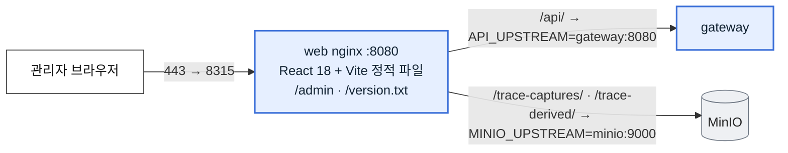
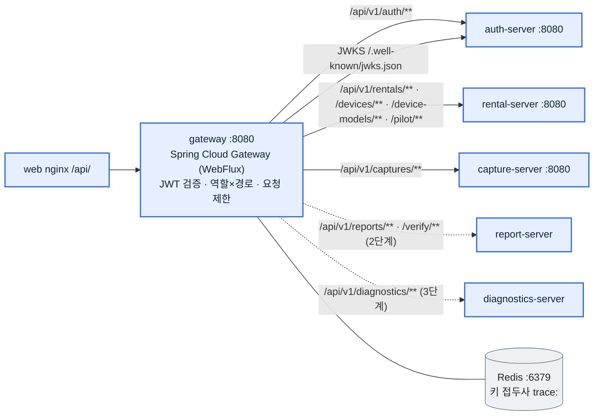
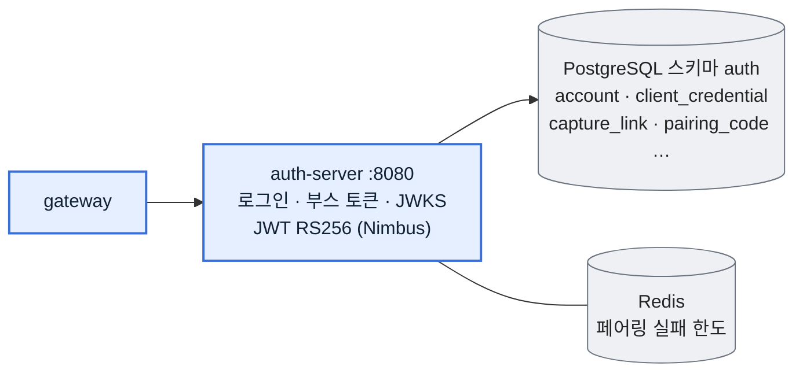
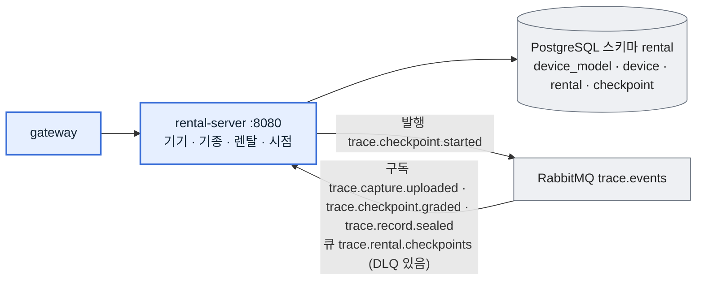
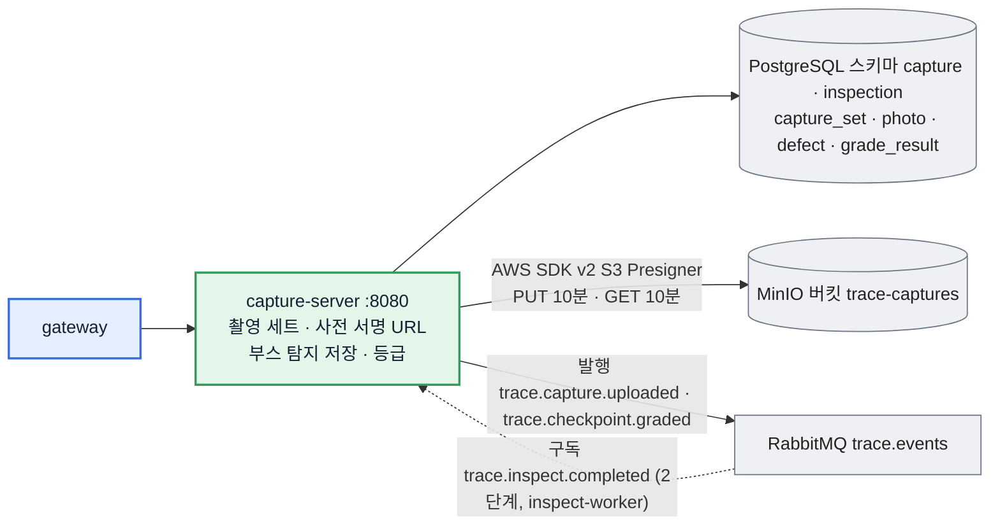
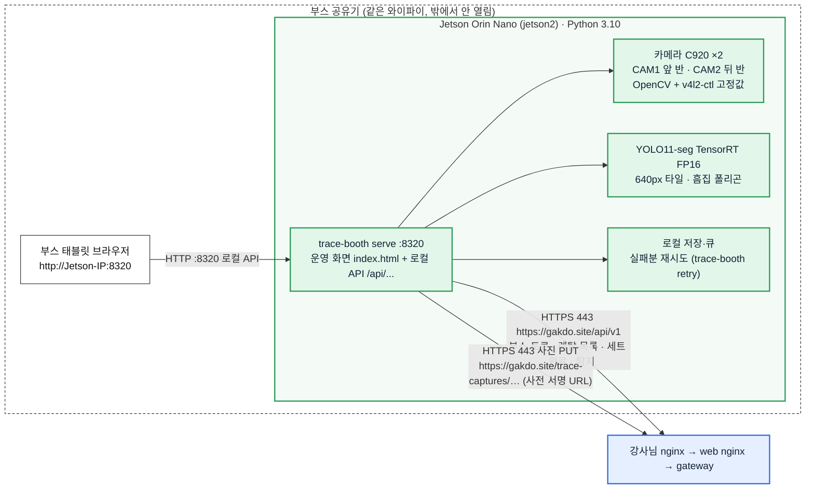
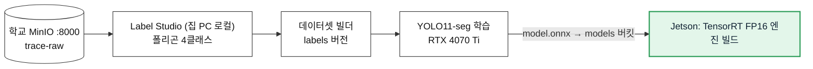

# 2. 서비스 단위 아키텍처

서비스마다 **레포 · 컨테이너 · 포트 · 저장소 · 받는 API · 내보내는 이벤트 · 담당**을 같은 틀로 적었습니다. 그림 색은 [1. 전체 아키텍처](01-architecture.md)와 같습니다(초록 = 부스 사진, 주황 = 폰 사진, 파랑 = 사진 무관, 회색 = 인프라).

API 한 줄 설명과 요청·응답은 [3. 기능별 API 명세](03-api-by-feature.md)에, 필드 단위 원본은 contracts OpenAPI와 [자동 생성 API 문서](https://gakdo.github.io/docs/)에 있습니다.

## 한눈에 보기

| 서비스 | 레포 | 그룹 | 컨테이너 포트 | 저장소 | 단계 | 담당 |
|---|---|---|---|---|---|---|
| web (nginx + React) | GAKDO/web | ③ 사진 무관 (`/capture`는 ②) | 8080 → 호스트 8315 | 없음 | MVP (`/admin`) | C |
| gateway | GAKDO/gateway | ③ | 8080 | Redis `trace:` | MVP | A |
| auth-server | GAKDO/auth_server | ③ | 8080 | PostgreSQL `auth`, Redis | MVP | A |
| rental-server | GAKDO/rental_server | ③ | 8080 | PostgreSQL `rental` | MVP | A |
| capture-server | GAKDO/capture_server | ① 부스 사진 | 8080 | PostgreSQL `capture`·`inspection`, MinIO `trace-captures` | MVP | A |
| booth 앱 (부스 운영 웹 서버 + 촬영·탐지) | GAKDO/booth | ① | Jetson 8320 (부스 공유기만) | Jetson 로컬 큐 | MVP | B |
| 학습 (집 PC) | GAKDO/ml | 밖 | 없음 | 학교 MinIO `trace-raw`·`labels`·`models` | MVP(학습만) | A (라벨링 연동 ML3은 B) |
| report-server | GAKDO/report_server | ③ | 8080 | PostgreSQL `report`, Redis | 2단계 | A (SSE 화면은 C) |
| inspect-worker | GAKDO/ml | ② 폰 사진 | 없음(큐 소비) | MinIO `trace-derived` | 2단계 | A |
| diagnostics-server | GAKDO/diagnostics_server | ③ | 8080 | PostgreSQL `diagnostics` | 3단계 | A |
| agent | GAKDO/agent | ③ | 없음(노트북에서 실행) | 없음 | 3단계 | B |
| contracts | GAKDO/contracts | 전체 | — | OpenAPI·JSON Schema·codes.yaml | 1.0.0 고정, 추가만 | A (B·C 리뷰) |
| gitops | GAKDO/gitops | 인프라 | — | `compose/docker-compose.yml` | MVP | A |

공통 규칙: Spring 서버는 모두 Java 21 · Spring Boot 3.5.7, RFC 9457 Problem Details 오류, 이벤트는 RabbitMQ topic exchange `trace.events`, 외부 ID는 NanoID 21자(`PublicId`). 비밀은 학교 서버 `compose/.env`에만 있고 이름만 적습니다.

---

## 2-1. web (관리자 화면) — C

| 항목 | 값 |
|---|---|
| 하는 일 | 관리자 로그인, 기기·기종 등록, 렌탈 열기·출고 시점 시작, 검사 결과(사진 12장 격자 + 흠집 폴리곤 + 등급) 보기 |
| 기능 ID | WE1(MVP). WE2 폰 촬영·WE3 3D 리포트·WE4 검증 페이지는 2단계, 메뉴에서 숨김 |
| 부르는 API | auth `login`·`refresh`·`logout`·`me`, rental 기기·기종·렌탈·시점, capture `inspection`·`media` |
| 토큰 | 액세스 JWT는 메모리에만, 리프레시는 HttpOnly 쿠키 |
| 환경 변수 | `API_UPSTREAM`, `MINIO_UPSTREAM` |

## 2-2. gateway — A

| 항목 | 값 |
|---|---|
| 하는 일 | 모든 `/api/v1/**`의 유일한 입구. auth-server JWKS로 JWT 서명 검증, 역할(ADMIN·CUSTOMER·BOOTH·AGENT) × 경로 표로 막기, 로그인·페어링 교환은 Redis 요청 제한 |
| 기능 ID | GW1 |
| 받는 API | 자체 API 없음(라우팅). JWKS는 밖으로 열지 않음 |
| 환경 변수 | `AUTH_SERVER_URL`, `RENTAL_SERVER_URL`, `CAPTURE_SERVER_URL`, `REPORT_SERVER_URL`, `DIAGNOSTICS_SERVER_URL`, `REDIS_PASSWORD` |

## 2-3. auth-server — A

| 항목 | 값 |
|---|---|
| 하는 일 | 관리자·고객 로그인(액세스 15분 + 리프레시 7일 쿠키), 부스 client_id·secret → BOOTH JWT(1시간), JWT 공개키(JWKS) |
| 기능 ID | AU1(MVP). AU2 가입·인증 메일, AU3 수령 QR·봉인 영수증은 중단 또는 2단계 |
| MVP API | `login`, `refreshToken`, `logout`, `getMe`, `issueBoothToken`, `getJwks`(내부) |
| 2·3단계 API | `createCaptureLink`·`exchangeCaptureLink`(2단계 폰), `createPairingCode`·`exchangePairingCode`(3단계 진단), 가입·재설정·탈퇴(AU2, 중단) |
| 환경 변수 | `JWT_PRIVATE_KEY`, `ADMIN_EMAIL`, `ADMIN_PASSWORD`, `BOOTH_CLIENT_ID`, `BOOTH_CLIENT_SECRET`, `DB_USERNAME`, `DB_PASSWORD` |

## 2-4. rental-server — A

| 항목 | 값 |
|---|---|
| 하는 일 | 기기 등록·검색, 기종(치수) 관리, 렌탈 열기, 시점 OUT → RCV → RET 순서 강제, 이벤트로 시점 상태(UPLOADED → GRADED → SEALED) 갱신. 렌탈·시점 짝이 맞지 않는 이벤트는 DLQ |
| 기능 ID | RE1(MVP). RE2 파일럿 등록은 중단 |
| MVP API | `listRentals`(ADMIN 전체 · BOOTH는 OPEN만), `createRental`, `getRental`, `startCheckpoint`, `createDevice`, `listDevices`, `updateDevice`, `listDeviceModels`, `getDeviceModel`, `upsertDeviceModel` |
| 2단계 API | `closeRental`(반납 시점 봉인 뒤) |
| 시드 | 기종 `MBA13-M2`(V2). 그램·델은 실측 뒤 추가 |

## 2-5. capture-server — A (① 부스 사진)

| 항목 | 값 |
|---|---|
| 하는 일 | 사진마다 면·조명·카메라·SHA-256을 받아 사전 서명 PUT URL 발급, 완료 때 해시 확인, 부스 탐지(원본 사진 px 폴리곤) 저장, **QUICK 세트는 정합 없이 부스 탐지로 등급**(A = 문제 없음, B~D = 문제 있음), 관리자 화면용 사진 보기 URL |
| 기능 ID | CA1 세트·URL, CA2 검사 결과·등급(MVP는 QUICK만, 시점 비교는 2단계) |
| MVP API | `createCaptureSet`, `reissueUploadUrls`, `completeCaptureSet`, `saveBoothDetections`, `getCaptureSet`, `getCheckpointInspection`, `getCheckpointMedia` |
| 코드 값 | `capture.profile` = FULL·QUICK, `capture.face_required_quick.BOOTH` = TOP·BOT (contracts #20) |
| 환경 변수 | `MINIO_PUBLIC_BASE`(= `PUBLIC_BASE_URL` = `https://gakdo.site`), `MINIO_ACCESS_KEY`, `MINIO_SECRET_KEY` |

## 2-6. booth 앱 (Jetson 안의 부스 운영 웹 서버) — B (① 부스 사진)

**부스 화면은 web 레포가 아니라 booth 레포가 만듭니다.** Jetson에서 `trace-booth serve`를 실행하면 Python 표준 라이브러리(`http.server.ThreadingHTTPServer`)로 만든 **작은 웹 서버**가 `0.0.0.0:8320`에 뜨고, 같은 부스 공유기(와이파이)에 붙은 태블릿 브라우저가 `http://<Jetson IP>:8320`으로 엽니다. 화면 파일은 `src/trace_booth/static/index.html` 하나이고, 화면이 부르는 `/api/...`는 **Jetson 안에서 처리되는 로컬 API**입니다(서버 API가 아님).

태블릿은 gakdo.site에 직접 붙지 않습니다. **서버와 통신하는 것은 Jetson의 booth 앱뿐**이고, 부스 비밀(client_id·secret)과 부스 JWT도 Jetson에만 있습니다.

| 항목 | 값 |
|---|---|
| 담당 | **B** (화면·로컬 API·카메라·탐지 모두 booth 레포). 서버 쪽 API(auth·rental·capture)는 A, 관리자 결과 화면은 C |
| 하는 일 | 검사 기다리는 기기 목록 → 탭 → BOT 6장 → 뒤집어 TOP 6장(L1·L2·L3 × CAM1·CAM2) → Jetson 탐지 → 화면에 폴리곤과 "문제 있음/없음" → 세트·사진·탐지 업로드 |
| 기능 ID | BO1 촬영(학습 사진 TRAINING 모드 포함), BO2 Jetson 탐지 |
| 실행 | `trace-booth serve [--host 0.0.0.0] [--port 8320]`. 엔진 빌드는 `trace-booth build-engine --onnx model.onnx` |
| 열림 | 8320은 부스 공유기 안에서만. 로그인 없음(부스 공유기에 붙은 기기만 쓴다는 전제) → 공유기를 외부에 포트포워딩하지 않음 |
| 환경 변수 | `TRACE_API_URL`(= `https://gakdo.site`), `TRACE_BOOTH_CLIENT_ID`, `TRACE_BOOTH_CLIENT_SECRET`, `TRACE_BOOTH_SHOTLIST`(= `mvp`, 12장), `TRACE_BOOTH_PRESETS`, `TRACE_BOOTH_ENGINE` |

부스 화면 로컬 API (Jetson :8320, booth `src/trace_booth/web.py`)

| 메서드·경로 | 화면 동작 | 안에서 하는 일 |
|---|---|---|
| `GET /api/rentals/waiting` | 검사 기다리는 기기 목록 | 서버 `GET /api/v1/rentals`(부스 토큰) → 지금 시점이 OPEN인 렌탈만 |
| `POST /api/sessions` | 기기 탭 → 세션 시작 | 로컬 세션 만들기(렌탈·시점 ID 기억) |
| `GET /api/live/{camera}` | 카메라 미리보기 | C920 프레임 |
| `POST /api/sessions/current/shoot` · `retake` · `next` | 찍기 · 다시 찍기 · 다음 면(뒤집기) | 조명 순서대로 저장, 해시 계산 |
| `POST /api/sessions/current/complete` | 촬영 끝 | 서버 `POST /captures/sets`(QUICK) → 사진 PUT → `POST …/complete` |
| `POST /api/sessions/current/detect` | 판정 | TensorRT 탐지 → 서버 `POST …/detections`(12장 analyzedPhotos) |
| `GET /api/sessions/current/result` | 결과 화면 | 폴리곤·문제 있음/없음 |
| `POST /api/sessions/current/submit` | 학습 사진 올리기(TRAINING) | 학교 MinIO `trace-raw`로 직접 |
| `GET /api/queue` · `GET /api/shots/{id}/thumbnail` | 업로드 상태 · 썸네일 | 로컬 큐 조회 |

로컬 API는 계약(contracts) 밖이라 booth `specs/001-booth-capture-tool/contracts/operator-web-api.md`가 원본입니다.

## 2-7. 학습 (집 PC, GAKDO/ml) — A

| 항목 | 값 |
|---|---|
| 하는 일 | 부스 학습 사진 라벨링 → 데이터셋 → 학습 → ONNX. 집 PC는 학습만 하고 상시 서비스를 띄우지 않음 |
| 기능 ID | ML1 데이터셋·학습 기록(A), ML3 Label Studio 연동(B) |

---

## 2-8. 2·3단계 서비스 (점선, 코드는 develop에 있음)

| 서비스 | 단계 | 하는 일 | 받는 API | 이벤트 |
|---|---|---|---|---|
| report-server | 2단계 (11/10~) | 시점 기록을 해시 체인으로 봉인(Ed25519 서명), 타임라인, 공개 검증, 진행률 SSE | `getRentalTimeline`, `streamRentalProgress`, `getRentalChain`, `sealCheckpointManually`, `listManualSeals`, `verifyRecord`, `searchReports` | 구독 graded·diagnostics.recorded, 발행 `trace.record.sealed` |
| inspect-worker (ml) | 2단계 | 폰 사진 정합·흠집 탐지·표준 좌표 변환 | 없음 | 구독 `trace.capture.uploaded`, 발행 `trace.inspect.completed` |
| web `/capture`·리포트·검증 | 2단계 | 폰 수령 촬영(WE2), 3D 리포트(WE3), 검증 페이지(WE4) | — | — |
| diagnostics-server | 3단계 | 진단 JSON 검증(diag.v1)·이전 시점 비교·점검 플래그 | `uploadDiagnosticRun`, `getCheckpointDiagnostics` | 발행 `trace.diagnostics.recorded` |
| agent | 3단계 | macOS·Windows 배터리·SSD·부품 읽기, 페어링 코드로 업로드 | — | — |
