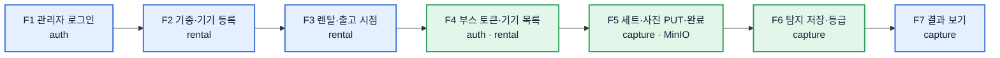

# 3. 기능별 API 명세 (MVP)

MVP 흐름의 기능 순서대로 API를 묶었습니다. **필드·예시·오류 코드의 원본은 contracts OpenAPI**이고, 이 표는 "누가 어떤 기능에서 무엇을 부르는가"를 보여 주는 지도입니다.

- 자동 생성 API 문서(Redoc): **https://gakdo.github.io/docs/** — `MVP 통합` 페이지는 아래 25개(ping 3개 포함)만, 서버별 페이지는 전체 경로를 보여 줍니다. contracts develop에서 매일·docs main 푸시마다 다시 만듭니다([`api-docs/`](../api-docs/README.md)).
- 모든 경로 앞부분은 `https://gakdo.site` 입니다. 인증은 `Authorization: Bearer <JWT>`, 오류는 RFC 9457 Problem Details(`code`는 codes.yaml `error_code`).
- 열 설명: **구현** = 서버를 만드는 사람, **호출** = 그 API를 부르는 화면·앱과 담당, **역할** = JWT role(gateway가 막음).

## 기능 지도

| # | 기능 | 화면·앱 (담당) | 서버 (구현) | 백로그 |
|---|---|---|---|---|
| F1 | 관리자 로그인 | web `/admin` (C) | auth-server (A) | AU1 · WE1 |
| F2 | 기종·기기 등록 | web `/admin` (C) | rental-server (A) | RE1 · WE1 |
| F3 | 렌탈 열기·출고 시점 시작 | web `/admin` (C) | rental-server (A) | RE1 · WE1 |
| F4 | 부스 로그인·검사 기다리는 기기 목록 | booth 앱 (B) | auth-server · rental-server (A) | AU1 · RE1 · BO1 |
| F5 | 부스 촬영 세트·사진 업로드 | booth 앱 (B) | capture-server (A) | CA1 · BO1 |
| F6 | 부스 탐지 저장·등급 | booth 앱 (B) | capture-server (A) | BO2 · CA2 |
| F7 | 검사 결과 보기 | web `/admin` (C) | capture-server (A) | CA2 · WE1 |
| F0 | 배포 확인 | curl (A) | 서버마다 | — |

---

## F1. 관리자 로그인 — auth-server (A) ← web (C)

| 메서드 | 경로 | operationId | 역할 | 요청 핵심 | 응답 핵심 |
|---|---|---|---|---|---|
| POST | `/api/v1/auth/login` | `login` | 없음 | `email`, `password` | 200 `accessToken`(15분) + 리프레시 HttpOnly 쿠키(7일). 요청 제한 있음 |
| POST | `/api/v1/auth/refresh` | `refreshToken` | 리프레시 쿠키 | 쿠키 | 200 새 `accessToken`, 쿠키 교체 |
| POST | `/api/v1/auth/logout` | `logout` | ADMIN·CUSTOMER | — | 204, 쿠키 삭제 |
| GET | `/api/v1/auth/me` | `getMe` | ADMIN·CUSTOMER | — | 200 계정·역할·연결 렌탈 ID |

관리자 계정은 서버 `.env`의 `ADMIN_EMAIL`·`ADMIN_PASSWORD`로 auth-server가 처음 뜰 때 만듭니다(가입 API는 MVP에서 안 씀).

## F2. 기종·기기 등록 — rental-server (A) ← web (C)

| 메서드 | 경로 | operationId | 역할 | 요청 핵심 | 응답 핵심 |
|---|---|---|---|---|---|
| GET | `/api/v1/device-models` | `listDeviceModels` | ADMIN | — | 200 기종 전부(페이지 없음) |
| GET | `/api/v1/device-models/{modelCode}` | `getDeviceModel` | ADMIN·CUSTOMER | — | 200 기종·치수(mm) |
| PUT | `/api/v1/device-models/{modelCode}` | `upsertDeviceModel` | ADMIN | 치수(가로·세로 ≤ 1000, 두께 ≤ 100 mm)·제조사 | 200/201 |
| POST | `/api/v1/devices` | `createDevice` | ADMIN | `serial`, `modelCode`, `os` (선택 color·assetNo) | 201 기기(ACTIVE). 시리얼 중복 409, 기종 없음 404 |
| GET | `/api/v1/devices` | `listDevices` | ADMIN | `modelCode`·`status`·`q` | 200 페이지 목록 |
| PATCH | `/api/v1/devices/{deviceId}` | `updateDevice` | ADMIN | 색상·자산번호·OS·상태 | 200. 진행 중 렌탈이 있으면 MAINTENANCE·RETIRED 409 |

## F3. 렌탈 열기·출고 시점 시작 — rental-server (A) ← web (C)

| 메서드 | 경로 | operationId | 역할 | 요청 핵심 | 응답 핵심 |
|---|---|---|---|---|---|
| POST | `/api/v1/rentals` | `createRental` | ADMIN | `deviceId`, `renterRef` | 201 렌탈 OPEN(기기 시리얼 포함). 기기당 OPEN 렌탈 하나 |
| GET | `/api/v1/rentals` | `listRentals` | ADMIN·CUSTOMER·BOOTH | 페이지 | 200 목록, 항목마다 `currentCheckpoint` |
| GET | `/api/v1/rentals/{rentalId}` | `getRental` | ADMIN·CUSTOMER(본인) | — | 200 렌탈과 세 시점 상태 |
| POST | `/api/v1/rentals/{rentalId}/checkpoints` | `startCheckpoint` | ADMIN | `type`: OUT | 201 시점 OPEN. 순서 위반 409 `CHECKPOINT_ORDER_VIOLATION` |

MVP는 렌탈당 **출고(OUT) 검사 1번**입니다. 수령(RCV)·반납(RET)과 `closeRental`은 2단계입니다.

## F4. 부스 로그인·검사 기다리는 기기 목록 — auth·rental (A) ← booth (B)

| 메서드 | 경로 | operationId | 역할 | 요청 핵심 | 응답 핵심 |
|---|---|---|---|---|---|
| POST | `/api/v1/auth/booth/token` | `issueBoothToken` | 없음(본문 자격) | `clientId`, `clientSecret` | 200 BOOTH JWT(1시간, scope=boothId). 만료 전에 다시 받음 |
| GET | `/api/v1/rentals` | `listRentals` | BOOTH | — | 200 진행 중(OPEN) 렌탈만. 부스는 `currentCheckpoint.status`가 OPEN인 것만 띄움 (contracts #22) |

## F5. 부스 촬영 세트·사진 업로드 — capture-server (A) ← booth (B)

| 메서드 | 경로 | operationId | 역할 | 요청 핵심 | 응답 핵심 |
|---|---|---|---|---|---|
| POST | `/api/v1/captures/sets` | `createCaptureSet` | BOOTH(자기 부스) | `rentalId`, `checkpointId`, `source`: BOOTH, **`profile`: QUICK**, `photos[]`{face(TOP·BOT), light(L1·L2·L3), camera(CAM1·CAM2), sha256} 12장, 선택 `device` | 201 `captureSetId`, 사진별 사전 서명 PUT URL(10분) |
| PUT | `https://gakdo.site/trace-captures/…` (사전 서명) | — | URL 서명 | 사진 바이트 | 200 (MinIO) |
| POST | `/api/v1/captures/sets/{setId}/uploads` | `reissueUploadUrls` | BOOTH | 선택 `photos` | 200 아직 안 올라간 사진의 새 URL |
| POST | `/api/v1/captures/sets/{setId}/complete` | `completeCaptureSet` | BOOTH | `skippedFaces`(QUICK은 TOP·BOT 밖만), `Idempotency-Key` | 202, 해시 확인 뒤 `trace.capture.uploaded` 발행 |
| GET | `/api/v1/captures/sets/{setId}` | `getCaptureSet` | ADMIN·CUSTOMER | — | 200 올라간 사진·세트 상태 |

## F6. 부스 탐지 저장·등급 — capture-server (A) ← booth (B)

| 메서드 | 경로 | operationId | 역할 | 요청 핵심 | 응답 핵심 |
|---|---|---|---|---|---|
| POST | `/api/v1/captures/sets/{setId}/detections` | `saveBoothDetections` | BOOTH(자기 부스) | `modelVersion`, `detections[]`{face, light, camera, class, polygon(원본 사진 px), confidence}, **`analyzedPhotos[]` 12장 전부(QUICK 필수, 빠지면 400)** | 201 `accepted`. 다시 보내면 그 세트 탐지를 통째로 바꿈 |

QUICK 세트는 정합 없이 이 탐지로 바로 등급을 매기고 `trace.checkpoint.graded`(이벤트 1.2, `compared`=false)를 냅니다. 여러 조명에 같이 잡힌 흠집은 서버가 하나로 셉니다. 등급 **A = 문제 없음, B~D = 문제 있음**.

## F7. 검사 결과 보기 — capture-server (A) ← web (C)

| 메서드 | 경로 | operationId | 역할 | 요청 핵심 | 응답 핵심 |
|---|---|---|---|---|---|
| GET | `/api/v1/captures/checkpoints/{checkpointId}/inspection` | `getCheckpointInspection` | ADMIN·CUSTOMER(본인) | — | 200 `grade`(등급 전이면 null), `defects`(QUICK은 빈 배열), **`photoDefects[]`**{face, light, camera, class, polygon, confidence} |
| GET | `/api/v1/captures/checkpoints/{checkpointId}/media` | `getCheckpointMedia` | ADMIN·CUSTOMER(본인) | — | 200 **`photos[]`**{face, light, camera, url}(사전 서명 GET 10분). QUICK은 모든 photoDefects의 사진이 들어 있음 |

화면(C)은 면(BOT·TOP)마다 카메라 2 × 조명 3 격자로 사진을 놓고, 같은 face·light·camera 사진 위에 폴리곤을 겹칩니다.

## F0. 배포 확인 (로그인 없음)

| 경로 | operationId |
|---|---|
| `GET /api/v1/auth/ping` | `authPing` |
| `GET /api/v1/rentals/ping` | `rentalPing` |
| `GET /api/v1/captures/ping` | `capturePing` |
| `GET /version.txt` | web nginx |

---

## 이벤트 (RabbitMQ `trace.events`, 원본 contracts `events/`)

| 이벤트 | 발행 | 구독 (MVP) | 언제 |
|---|---|---|---|
| `trace.checkpoint.started` (1.1) | rental-server | (2단계 report-server) | 시점 시작 |
| `trace.capture.uploaded` (1.0) | capture-server | rental-server → 시점 UPLOADED | 완료 요청의 해시 확인 뒤 |
| `trace.checkpoint.graded` (1.2) | capture-server | rental-server → 시점 GRADED | QUICK 탐지로 등급 |
| `trace.inspect.completed` | inspect-worker (2단계) | capture-server | 폰 사진 정합 뒤 |
| `trace.record.sealed` | report-server (2단계) | rental-server → 시점 SEALED | 해시 체인 봉인 |
| `trace.diagnostics.recorded` (1.1) | diagnostics-server (3단계) | report-server | 진단 업로드 |

## MVP에서 쓰지 않는 API (계약에는 그대로 둠)

| 단계 | API |
|---|---|
| 2단계 (11/10~) | report-server 7개(`getRentalTimeline`, `streamRentalProgress`, `getRentalChain`, `sealCheckpointManually`, `listManualSeals`, `verifyRecord`, `searchReports`), `createCaptureLink`·`exchangeCaptureLink`(폰 수령 QR), `closeRental` |
| 3단계 | `uploadDiagnosticRun`, `getCheckpointDiagnostics`, `createPairingCode`, `exchangePairingCode` |
| 중단 | 가입·이메일 인증·재설정·탈퇴(AU2), `createPilotParticipant`(RE2) |
