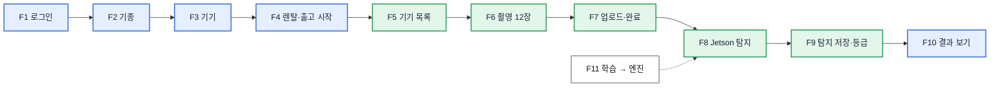
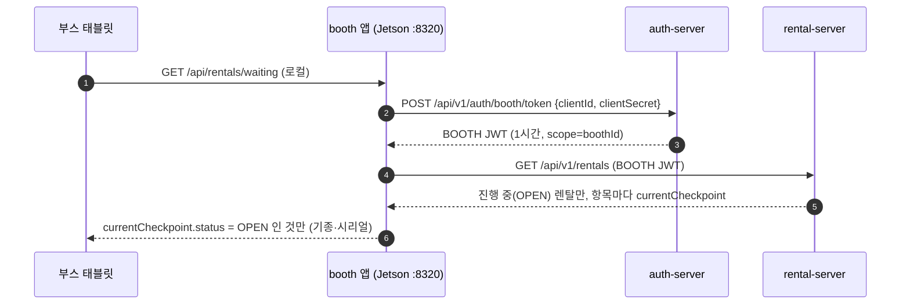
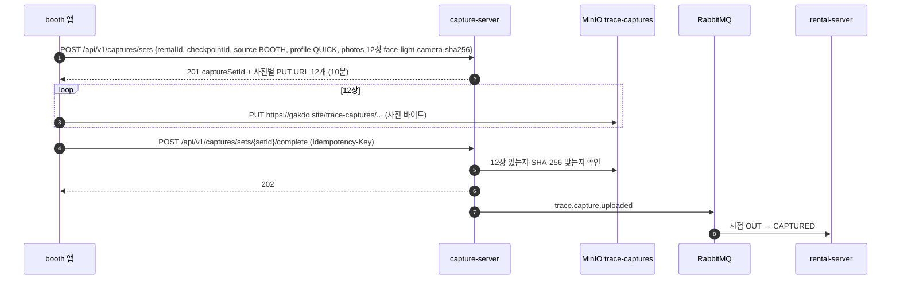
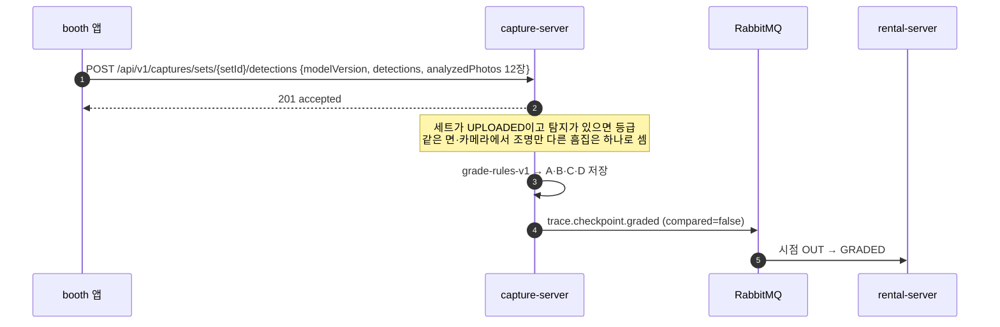

# 3. 기능별 흐름 (MVP)

> 그림으로 쉽게 보기: [MVP 안내서 · 기능별 흐름](https://gakdo.github.io/docs/guide/#features)

[1. MVP 아키텍처](01-architecture.md)의 구성도를 기준으로, MVP 기능을 **일어나는 순서대로** 하나씩 설명합니다. 기능마다 목적, 담당, 시작 조건, 단계(누가 → 어디로 → 무엇이 바뀌는지), 실패하면 어떻게 되는지를 적었습니다.

- 서버 API(`/api/v1/...`) 주소 앞부분은 `https://gakdo.site` 입니다. 부스 화면의 로컬 API(`/api/rentals/waiting`, `/api/sessions/...` 등, F5·F6·F8·F11)는 Jetson 안의 `http://<Jetson IP>:8320` 이고 서버로 가지 않습니다. 요청은 강사님 nginx → web nginx(8315) → gateway(8080) → 각 서버 순서로 갑니다(아래 단계에서는 gateway 통과를 생략).
- 인증은 `Authorization: Bearer <JWT>`이고, 오류는 RFC 9457 Problem Details(`code`는 contracts codes.yaml `error_code`)입니다.
- 필드 단위 원본은 contracts OpenAPI이고, 같은 내용을 [자동 생성 API 문서](https://gakdo.github.io/docs/api/mvp.html)에서 볼 수 있습니다.

## 기능 목록

| # | 기능 | 누가 쓰나 | 화면·앱 (담당) | 서버 (담당) |
|---|---|---|---|---|
| F1 | 관리자 로그인 | 관리자 | web `/admin/login` (C) | auth-server (A) |
| F2 | 기종 등록 | 관리자 | web `/admin/models` (C) | rental-server (A) |
| F3 | 기기 등록·검색 | 관리자 | web `/admin/devices` (C) | rental-server (A) |
| F4 | 렌탈 열기·출고 검사 시작 | 관리자 | web `/admin/rentals` (C) | rental-server (A) |
| F5 | 부스 로그인·검사 기다리는 기기 목록 | 부스 운영자 | 부스 화면 (B) | auth-server · rental-server (A) |
| F6 | 부스 촬영 12장 | 부스 운영자 | 부스 화면 (B) | 없음 (Jetson 안) |
| F7 | 사진 업로드·촬영 완료 | booth 앱 자동 | booth 앱 (B) | capture-server · MinIO (A), 이벤트 받는 rental-server (A) |
| F8 | Jetson 흠집 탐지·부스 판정 표시 | booth 앱 자동 | 부스 화면 (B) | 없음 (Jetson 안) |
| F9 | 탐지 결과 저장·등급 | booth 앱 자동 | booth 앱 (B) | capture-server (A), 이벤트 받는 rental-server (A) |
| F10 | 검사 결과 보기 | 관리자 | web `/admin/inspections` (C) | capture-server · rental-server (A) |
| F11 | 탐지 모델 학습·Jetson 반영 | A·B | 집 PC · Jetson | 학교 MinIO |

## 상태가 바뀌는 순서

검사 한 건 동안 서버에 저장되는 상태입니다. 아래 기능 설명의 "바뀌는 것"이 이 표의 어느 칸인지 보면 됩니다.

| 저장 위치 | 상태 순서 | 바꾸는 기능 |
|---|---|---|
| rental `rental.status` | OPEN | F4 |
| rental `checkpoint.status` (OUT) | OPEN → CAPTURED → GRADED → SEALED | F4 → F7 → F9 → report-server 봉인(`trace.record.sealed`) |
| capture `capture_set.status` | UPLOADING → UPLOADED → GRADED | F7 → F7 → F9 |
| inspection `grade_result.grade` | 없음 → A·B·C·D | F9 |

---

## F1. 관리자 로그인

- **목적**: 관리자만 기기·렌탈을 다루게 한다.
- **담당**: 화면 C(web `/admin/login`), 서버 A(auth-server).
- **시작 조건**: 학교 서버 `.env`의 `ADMIN_EMAIL`·`ADMIN_PASSWORD`로 auth-server가 처음 뜰 때 관리자 계정을 만들어 둔다(가입 화면은 MVP에 없음).

| 단계 | 누가 | 무엇을 | 결과 |
|---|---|---|---|
| 1 | 관리자 | 이메일·비밀번호 입력 | — |
| 2 | web | `POST /api/v1/auth/login` {email, password} | gateway가 요청 제한(Redis)을 확인하고 auth-server로 넘김 |
| 3 | auth-server | 비밀번호를 BCrypt로 확인 | 200 `accessToken`(JWT RS256, 15분, role ADMIN) + 리프레시 토큰 HttpOnly 쿠키(7일) |
| 4 | web | 액세스 토큰을 메모리에만 들고(localStorage 안 씀) `GET /api/v1/auth/me` | 관리자 메뉴 표시 |
| 5 | web | 15분이 지나 401을 받으면 `POST /api/v1/auth/refresh`(쿠키) | 새 액세스 토큰, 쿠키 교체 |
| 6 | web | 로그아웃 `POST /api/v1/auth/logout` | 204, 쿠키 삭제 |

- **gateway가 하는 일**: 이후 모든 요청에서 auth-server의 공개키(`/.well-known/jwks.json`, 내부 전용)로 JWT 서명을 확인하고, 역할×경로 표에 없으면 403으로 막는다.
- **실패하면**: 비밀번호 틀림 401, 너무 자주 시도하면 429.

## F2. 기종 등록

- **목적**: 기기를 등록할 때 고를 기종과 치수를 미리 둔다.
- **담당**: 화면 C(`/admin/models`), 서버 A(rental-server). 치수 실측은 B.
- **시작 조건**: F1 로그인. `MBA13-M2`(맥북 에어 M2 13.6)는 서버가 처음 뜰 때 시드로 들어가 있다.

| 단계 | 누가 | 무엇을 | 결과 |
|---|---|---|---|
| 1 | web | `GET /api/v1/device-models` | 기종 전부(페이지 없음) |
| 2 | 관리자 | 새 기종 코드·제조사·치수(mm) 입력 | — |
| 3 | web | `PUT /api/v1/device-models/{modelCode}` | 없으면 만들고 있으면 바꿈. 가로·세로 1000 mm, 두께 100 mm 넘으면 400 |

- **남은 일**: 그램·델은 실측 뒤 등록.

## F3. 기기 등록·검색

- **목적**: 빌려줄 노트북 한 대 한 대를 시리얼로 등록한다(노트북에 스티커·QR은 붙이지 않음).
- **담당**: 화면 C(`/admin/devices`), 서버 A(rental-server).

| 단계 | 누가 | 무엇을 | 결과 |
|---|---|---|---|
| 1 | 관리자 | 시리얼·기종·OS(선택 색상·자산번호) 입력 | — |
| 2 | web | `POST /api/v1/devices` | 201 기기(상태 ACTIVE). 시리얼 중복 409, 없는 기종 404 |
| 3 | web | 목록 `GET /api/v1/devices?modelCode=&status=&q=` | 최근 등록 순, q로 시리얼·자산번호 일부 검색 |
| 4 | web | 수정 `PATCH /api/v1/devices/{deviceId}` | 색상·자산번호·OS·상태만. 진행 중 렌탈이 있으면 수리 중·폐기로 못 바꿈(409) |

## F4. 렌탈 열기·출고 검사 시작

- **목적**: "이 기기를 지금 출고 검사한다"를 서버에 알린다. 이게 있어야 부스 목록에 기기가 나타난다.
- **담당**: 화면 C(`/admin/rentals`), 서버 A(rental-server).
- **시작 조건**: F3에서 등록한 ACTIVE 기기. MVP는 **렌탈당 출고(OUT) 검사 1번**이다.

| 단계 | 누가 | 무엇을 | 결과 |
|---|---|---|---|
| 1 | 관리자 | 기기 고르고 빌리는 사람 참조(`renterRef`) 입력 | — |
| 2 | web | `POST /api/v1/rentals` {deviceId, renterRef} | 201 렌탈 **OPEN**. 한 기기에 OPEN 렌탈은 하나만. 수리 중·폐기 기기면 409 `DEVICE_NOT_ACTIVE` |
| 3 | 관리자 | 렌탈 상세에서 "출고 검사 시작" | — |
| 4 | web | `POST /api/v1/rentals/{rentalId}/checkpoints` {type: OUT} | 201 시점 OUT **OPEN**, 렌탈 시작 시각 기록. 같은 시점이 이미 있으면 409 `CHECKPOINT_ORDER_VIOLATION` |

- **바뀌는 것**: `rental.status = OPEN`, `checkpoint(OUT).status = OPEN`.
- **다음**: F5에서 부스 목록에 이 기기가 보인다.

## F5. 부스 로그인·검사 기다리는 기기 목록

- **목적**: 부스가 어떤 노트북을 찍을지 태블릿에서 고르게 한다.
- **담당**: 부스 화면·booth 앱 B, 서버 A(auth-server·rental-server).
- **시작 조건**: Jetson에서 `trace-booth serve`가 떠 있고, 환경 변수 `TRACE_API_URL=https://gakdo.site`, `TRACE_BOOTH_CLIENT_ID`, `TRACE_BOOTH_CLIENT_SECRET`이 들어 있다.

| 단계 | 누가 | 무엇을 | 결과 |
|---|---|---|---|
| 1 | 태블릿 | 부스 화면을 열면 로컬 `GET /api/rentals/waiting` | — |
| 2 | booth 앱 | 토큰이 없거나 곧 만료면 `POST /api/v1/auth/booth/token` | BOOTH JWT 1시간. 비밀은 Jetson에만 있고 태블릿은 모름 |
| 3 | booth 앱 | `GET /api/v1/rentals` | 서버는 BOOTH에게 OPEN 렌탈만 준다 |
| 4 | booth 앱 | 지금 시점이 OPEN(아직 안 찍음)인 것만 남김 | 태블릿에 "검사 기다리는 기기" 목록 |
| 5 | 운영자 | 기기 탭 → 로컬 `POST /api/sessions` | Jetson에 촬영 세션 하나(렌탈·시점 ID 기억) |

- **실패하면**: 목록이 비면 F4의 출고 시점 시작을 안 한 것. 부스 자격이 틀리면 401.

## F6. 부스 촬영 12장

- **목적**: 같은 조건(고정 카메라·고정 조명)으로 아래·위 면을 찍는다.
- **담당**: B (Jetson 안에서만 일어남, 서버 호출 없음).
- **장비**: CAM1(앞 반)·CAM2(뒤 반) C920 2대, L1 = VIJIM VL49 확산광, L2 = 왼쪽 LED 바 스침광, L3 = 뒤쪽 LED 바 스침광. 카메라 값은 `TRACE_BOOTH_PRESETS`, 촬영 목록은 `TRACE_BOOTH_SHOTLIST=mvp`.

| 단계 | 누가 | 무엇을 | 결과 |
|---|---|---|---|
| 1 | 운영자 | 노트북을 뒤집어 놓음(아래 BOT이 위로) | `GET /api/live/{camera}`로 미리보기 |
| 2 | 운영자 | 조명 L1 → L2 → L3 순서로 켜며 `POST /api/sessions/current/shoot` | 조명마다 CAM1·CAM2 2장 = BOT 6장, 사진마다 SHA-256 |
| 3 | 운영자 | 흔들렸으면 `retake` | 그 장만 다시 |
| 4 | 운영자 | 노트북을 바로 놓고 `next` → 조명 L3 → L2 → L1로 TOP 6장 | 합계 12장 (2면 × 조명 3 × 카메라 2) |
| 5 | 운영자 | `POST /api/sessions/current/complete` | F7 업로드 시작 |

## F7. 사진 업로드·촬영 완료

- **목적**: 12장을 서버 저장소에 올리고, 다 올라갔는지 해시로 확인한다.
- **담당**: booth 앱 B, 서버 A(capture-server). 사진 바이트는 서버를 거치지 않고 **사전 서명 URL로 MinIO에 바로** 간다.

| 단계 | 누가 | 무엇을 | 결과 |
|---|---|---|---|
| 1 | booth 앱 | `POST /api/v1/captures/sets` (profile **QUICK**, 12장 목록) | 세트 UPLOADING, 사진별 PUT URL(10분). 같은 세트 안에서 (면, 조명, 카메라)는 겹치면 안 됨 |
| 2 | booth 앱 | URL마다 사진 PUT | web nginx가 `/trace-captures/`를 MinIO로 넘김(nginx 최대 요청 64MB) |
| 3 | booth 앱 | URL이 만료되면 `POST /api/v1/captures/sets/{setId}/uploads` | 아직 안 올라간 사진만 새 URL |
| 4 | booth 앱 | `POST /api/v1/captures/sets/{setId}/complete` | capture-server가 12장 존재·해시를 확인. QUICK은 TOP·BOT × CAM1·CAM2가 모두 있어야 함 |
| 5 | capture-server | `trace.capture.uploaded` 발행 | 세트 UPLOADED |
| 6 | rental-server | 이벤트를 받아 렌탈·시점 짝을 확인 | 시점 **CAPTURED**. 짝이 안 맞으면 DLQ로 |

- **실패하면**: 네트워크가 끊기면 booth 앱이 로컬 큐에 두고 다시 시도(`trace-booth retry`). 해시가 다르면 완료가 400. 413이면 nginx 업로드 크기 설정, 403 SignatureDoesNotMatch면 서버 `.env`의 `PUBLIC_BASE_URL`이 `https://gakdo.site`인지 확인.

## F8. Jetson 흠집 탐지·부스 판정 표시

- **목적**: 서버를 기다리지 않고 부스에서 바로 "문제 있음/없음"을 보여 준다.
- **담당**: B (Jetson 안). 모델은 A가 학습(F11).

| 단계 | 누가 | 무엇을 | 결과 |
|---|---|---|---|
| 1 | 태블릿 | 로컬 `POST /api/sessions/current/detect` | 탐지 시작 |
| 2 | booth 앱 | 12장을 640px 타일로 나눠 YOLO11-seg TensorRT FP16 엔진에 넣음 | 사진마다 흠집 폴리곤(원본 사진 px)·종류(긁힘·찍힘·균열·오염)·신뢰도 |
| 3 | 태블릿 | `GET /api/sessions/current/result`를 주기적으로 | 사진 위에 폴리곤, 흠집이 있으면 "문제 있음" |

- **목표 시간**: 버튼부터 판정까지 15초 안쪽, 기준 30초(11/6 실측).
- **부스 판정과 서버 등급의 관계**: 같은 탐지 결과를 쓴다. 부스 화면은 "있음/없음"만 바로 보여 주고, A~D 등급은 F9에서 서버가 매긴다.
- **판정 규칙**: 긁힘·찍힘·균열이 하나라도 있으면 "문제 있음". 오염만 잡히면 폴리곤은 그리되 "문제 없음"으로, 서버 등급 A와 같습니다(11/4 결정, booth #28).

## F9. 탐지 결과 저장·등급

- **목적**: 탐지 결과를 서버에 남기고, 같은 규칙으로 등급을 매긴다.
- **담당**: booth 앱 B, 서버 A(capture-server).

| 단계 | 누가 | 무엇을 | 결과 |
|---|---|---|---|
| 1 | booth 앱 | 12장을 다 분석한 뒤 `POST …/detections` 한 번 | `analyzedPhotos`에 12장 전부(흠집 없는 사진도). 빠지면 400. 다시 보내면 그 세트 탐지를 통째로 바꿈 |
| 2 | capture-server | 흠집을 묶음 | 같은 면·같은 카메라 사진에서 20 px 안에 겹치는 흠집은 하나(조명 L1·L2·L3에 같이 잡힌 흠집) |
| 3 | capture-server | 등급 매김 (grade-rules-v1) | 균열 ≥1 또는 찍힘 ≥3 → D, 찍힘 1~2 또는 긁힘 ≥5 → C, 긁힘 1~4 → B, 없음 → **A(문제 없음)**. 오염은 등급에 안 넣음 |
| 4 | capture-server | `trace.checkpoint.graded` 발행 | 세트 GRADED |
| 5 | rental-server | 이벤트 받음 | 시점 **GRADED** |

- **QUICK의 뜻**: 아래·위 2면만 찍고, 면 정합·이전 시점 비교 없이 부스 탐지만으로 등급을 매긴다(contracts `capture.profile = QUICK`).
- **실패하면**: 업로드가 실패하면 booth 앱이 로컬 큐에서 재시도. 완료(F7) 전에 탐지가 먼저 와도 저장해 두고, 둘 다 모이면 등급을 매긴다. 등급이 이미 매겨진 세트에 다시 보내면 409 `CAPTURE_SET_CLOSED`.

## F10. 검사 결과 보기

- **목적**: 관리자가 사진 12장, 흠집 위치, 등급을 웹에서 확인한다.
- **담당**: 화면 C(`/admin/inspections`), 서버 A(capture-server·rental-server).

| 단계 | 누가 | 무엇을 | 결과 |
|---|---|---|---|
| 1 | web | 목록 화면에서 `GET /api/v1/rentals`를 주기적으로 | 기기별 최근 검사와 시점 상태(CAPTURED·GRADED) |
| 2 | 관리자 | 검사 하나 클릭 → `GET /api/v1/rentals/{rentalId}` | 기기 시리얼·시점 ID |
| 3 | web | `GET /api/v1/captures/checkpoints/{checkpointId}/media` | `photos[]` {face, light, camera, url} — 사진 12장 보기 URL(10분) |
| 4 | web | `GET /api/v1/captures/checkpoints/{checkpointId}/inspection` | `grade`(아직이면 null), `photoDefects[]` {face, light, camera, class, polygon, confidence} |
| 5 | web | 면(BOT·TOP)마다 카메라 2 × 조명 3 격자로 사진을 놓고, 같은 face·light·camera 사진 위에 폴리곤을 겹침 | 등급 A = 문제 없음, B~D = 문제 있음 |

- **확인할 화면 폭**: 375px·1280px.

## F11. 탐지 모델 학습·Jetson 반영

- **목적**: 부스 조명·카메라에서 찍은 사진으로 흠집 모델을 만든다.
- **담당**: 학습 사진 촬영·라벨링 연동·Jetson 엔진 빌드 B, 학습 A(집 PC).

| 단계 | 누가 | 무엇을 | 결과 |
|---|---|---|---|
| 1 | B | 부스 TRAINING 모드로 TOP·BOT × L1·L2·L3 × CAM1·CAM2 촬영, `POST /api/sessions/current/submit` | 학교 MinIO `trace-raw`에 올라감(서비스 MinIO와 다른 곳) |
| 2 | A·B | 집 PC Label Studio에서 폴리곤 4종 라벨 | labels |
| 3 | A | 데이터셋 빌드 → YOLO11-seg 학습(RTX 4070 Ti) | `model.onnx`(1×3×640×640) + model.json |
| 4 | B | Jetson에서 `trace-booth build-engine --onnx model.onnx` | TensorRT FP16 엔진(`TRACE_BOOTH_ENGINE`) |
| 5 | B | `trace-booth bench`로 속도 실측 | F8 목표 시간 확인 |

- 집 PC는 학습만 하고, 서비스로 상시 띄우지 않는다.

## F0. 배포 확인 (로그인 없음)

| 확인 | 정상 |
|---|---|
| `curl https://gakdo.site/version.txt` | web 버전 |
| `curl https://gakdo.site/api/v1/auth/ping` · `/api/v1/rentals/ping` · `/api/v1/captures/ping` | 서비스 이름·버전 |
| `curl -o /dev/null -w '%{http_code}' https://gakdo.site/api/v1/rentals` | 401 (토큰 없음) |

## 이벤트 (RabbitMQ `trace.events`)

| 이벤트 | 내는 곳 | 받는 곳 | 기능 |
|---|---|---|---|
| `trace.capture.uploaded` | capture-server | rental-server → 시점 CAPTURED | F7 |
| `trace.checkpoint.graded` | capture-server | rental-server → 시점 GRADED | F9 |

## 정한 것

| 항목 | 결정 | 반영 |
|---|---|---|
| 오염(stain)만 잡혔을 때 부스 판정 | 부스도 오염을 빼고 "문제 없음"(서버 등급 A와 같게), 11/4 민서 | booth #28 (B 리뷰 뒤 머지) |
