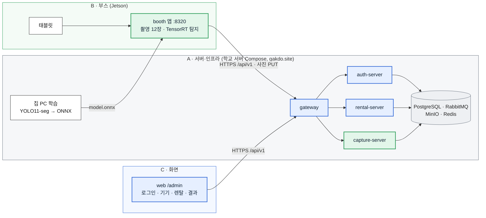

# TRACE 최소 MVP 문서 (11/3 재조정 기준)

강사님 리뷰(11/3)로 줄인 최소 MVP의 **전체 아키텍처 → 서비스 단위 아키텍처 → 기능별 API 명세 → A/B/C 임무 분담**을 한곳에 모았습니다. 기준일 2026-11-04, 메인 주소 **https://gakdo.site**.

> MVP 한 줄: 부스(Jetson)에서 노트북 아래(BOT)·위(TOP) 2면을 조명 3개 × 카메라 2대 = 12장 찍고, Jetson의 YOLO11-seg가 흠집 폴리곤을 찾아 바로 "문제 있음/없음"을 띄운 뒤, capture-server가 등급을 저장하고 관리자 화면(web `/admin`)에서 결과를 본다.

| 문서 | 내용 |
|---|---|
| [1. 전체 아키텍처](01-architecture.md) | 3그룹(부스 사진 · 폰 사진 · 사진 무관) 색 구분 구성도, 한 건의 흐름(시퀀스), 포트 목록, 단계별로 켜지는 것 |
| [2. 서비스 단위 아키텍처](02-services.md) | 서비스마다 레포·컨테이너·포트·저장소·API·이벤트·담당과 그림. **부스 운영 웹 서버(Jetson :8320)** 설명 포함 |
| [3. 기능별 API 명세](03-api-by-feature.md) | 기능 F1~F7별 API(메서드·경로·역할·요청·응답), 이벤트, MVP에서 안 쓰는 API |
| [4. A/B/C 임무 분담](04-roles.md) | 사람별·기능별 담당(R/C), 일정, 경계에서 헷갈리는 것 |
| [자동 생성 API 문서](https://gakdo.github.io/docs/) | contracts OpenAPI → Redoc(GitHub Pages). MVP 통합 1쪽 + 서버별 5쪽. 만드는 법은 [api-docs/](../api-docs/README.md) |
| [그림 파일](figures/) | 위 Mermaid 그림을 SVG·PNG로 뽑은 것(발표·보고서용). [Codex 이미지 프롬프트](codex-prompts.md) |

## 한눈에 보기

## 원본과 고치는 법

- API·이벤트·코드 값의 원본은 [GAKDO/contracts](https://github.com/GAKDO/contracts)(develop)입니다. 이 폴더의 표가 계약과 다르면 계약이 맞습니다.
- 포트·컨테이너의 원본은 gitops `compose/docker-compose.yml`, 부스 로컬 API의 원본은 booth `specs/001-booth-capture-tool/contracts/operator-web-api.md`입니다.
- 그림은 Markdown 안의 Mermaid가 원본입니다. 고친 뒤 `scripts/render-mvp-figures.sh`로 `figures/`를 다시 뽑습니다(CI가 문법을 검사).
- 이전(클러스터 기준) 구성은 [../architecture.md](../architecture.md)에 남겨 두었습니다. 지금 배포와 다릅니다.
